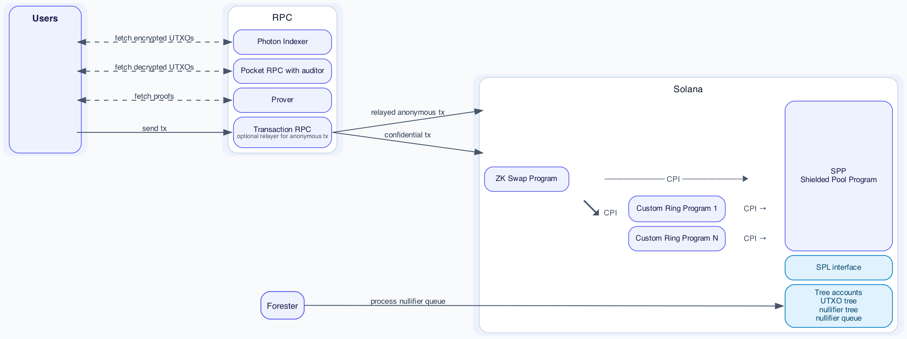
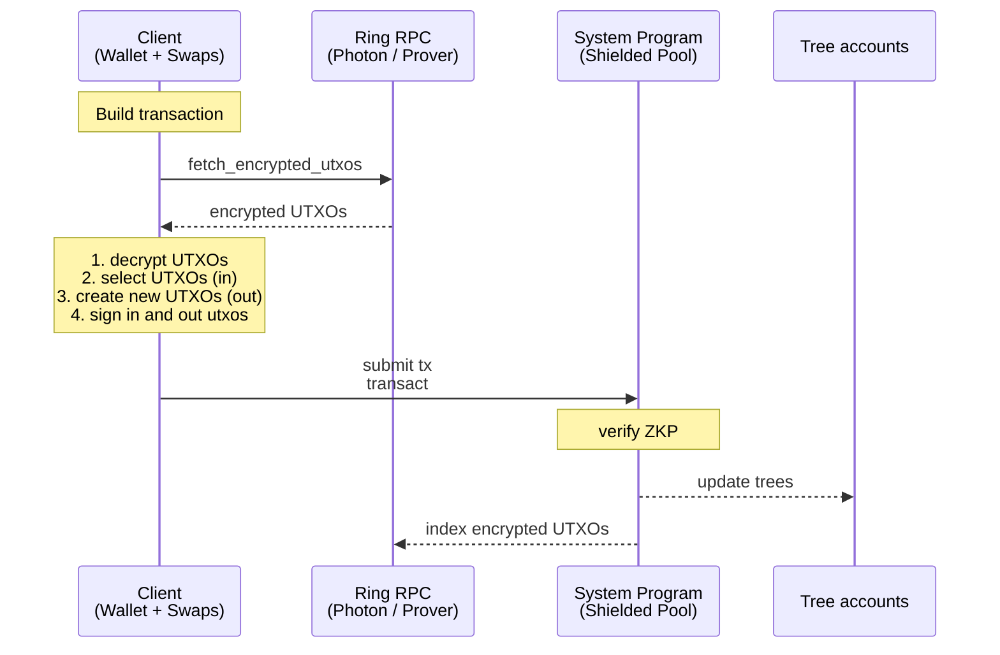
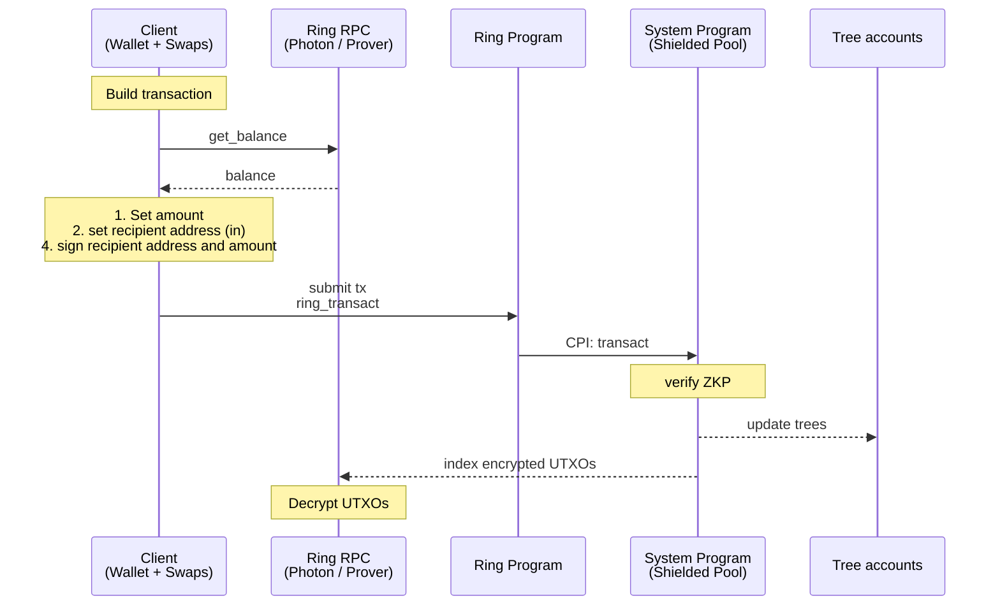
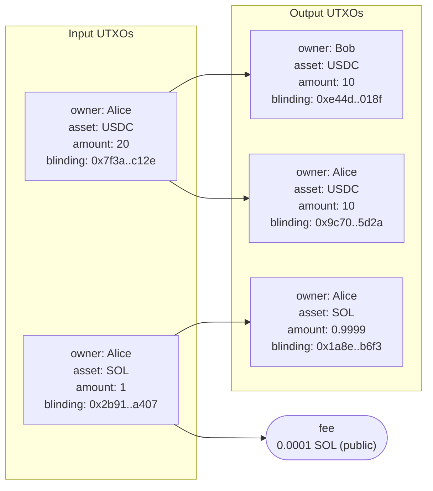

# Spec

## Table of Contents

- [Abstract](#abstract)
- [Architecture](#architecture)
  - [Operations](#operations)
    - [User](#user)
    - [Protocol](#protocol)
    - [Ring Creator](#ring-creator)
    - [Merge Service](#merge-service)
  - [Concurrency & Balance Fragmentation](#concurrency--balance-fragmentation)
  - [Default Ring](#default-ring)
  - [Policy Rings](#policy-rings)
- [Glossary](#glossary)
- [Shielded Address](#shielded-address)
  - [Ring Address](#ring-address)
- [Shielded Keypair](#shielded-keypair)
  - [Signing Key](#signing-key)
  - [Nullifier Key](#nullifier-key)
  - [ViewingKey](#viewingkey)
    - [Derived secrets](#derived-secrets)
    - [Transaction Viewing Key](#transaction-viewing-key)
    - [View Tags](#view-tags)
      - [Sender View Tag](#sender-view-tag)
      - [Recipient view tag](#recipient-view-tag)
      - [Merge view tag](#merge-view-tag)
      - [View Tag Selection](#view-tag-selection)
    - [Methods](#methods)
  - [Derivation seed](#derivation-seed)
  - [Solana wallet](#solana-wallet)
  - [HSM](#hsm)
  - [PDA](#pda)
- [UTXO](#utxo)
  - [UTXO Hash](#utxo-hash)
  - [Nullifier](#nullifier)
  - [Blinding Seed](#blinding-seed)
  - [Output Blinding](#output-blinding)
- [Output UTXO Serialization](#output-utxo-serialization)
  - [Ring outputs](#ring-outputs)
  - [UTXO Data](#utxo-data)
  - [Transfer](#transfer-2)
    - [Plaintext Layout](#plaintext-layout)
    - [Instruction Data Layout](#instruction-data-layout)
  - [Plaintext Transfer](#plaintext-transfer)
  - [UTXO Split](#utxo-split)
    - [Plaintext Layout](#plaintext-layout-1)
    - [Instruction Data Layout](#instruction-data-layout-1)
  - [Merge](#merge)
    - [PoseidonCtrV1](#poseidonctrv1)
- [SPP Proof - Solana Privacy ZK Proof](#spp-proof---solana-privacy-zk-proof)
- [Merge Proof - Merge ZK Proof](#merge-proof---merge-zk-proof)
- [SPP - Solana Privacy Program](#spp---solana-privacy-program)
  - [Accounts](#accounts)
    - [Authority Governance](#authority-governance)
    - [Ring Accounts](#ring-accounts)
  - [Instructions](#instructions)
    - [transact](#transact)
    - [deposit](#deposit)
    - [ring_deposit](#ring_deposit)
    - [merge_transact](#merge_transact)
    - [merge_ring](#merge_ring)
- [Ring Program Interface](#ring-program-interface)
  - [Ring configuration](#ring-configuration)
  - [Member registry](#member-registry)
  - [Ring transact data](#ring-transact-data)
  - [Ring tags](#ring-tags)
  - [Auditor envelope](#auditor-envelope)
  - [Audit disclosure](#audit-disclosure)
  - [Audit proof](#audit-proof)
  - [Policy proof](#policy-proof)
  - [Deposits, merges and key registration](#ring-deposits-merges-and-key-registration)
- [ZK Program Interface](#zk-program-interface)
- [RPC](#rpc)
  - [Indexer](#indexer)
    - [getEncryptedUtxosByTags](#getencryptedutxosbytags)
    - [getShieldedTransactionsByTags](#getshieldedtransactionsbytags)
    - [subscribeToShieldedTransactionsByTags](#subscribetoshieldedtransactionsbytags)
    - [getMerkleProofs](#getmerkleproofs)
    - [getNonInclusionProofs](#getnoninclusionproofs)
    - [getUserRecords](#getuserrecords)
  - [Prover](#prover)
  - [Relayer](#relayer)
  - [Ring RPC](#ring-rpc)
  - [Merge Service](#merge-service-1)
  - [Registry](#registry)
    - [Record](#record)
    - [Operations](#operations-1)
      - [`get_record`](#get_record)
      - [`register`](#register)
      - [`set_merge_encryption`](#set_merge_encryption)
- [User Flows](#user-flows)
  - [First Time Sync Wallet](#first-time-sync-wallet)
  - [Merge Flow](#merge-flow)
  - [Transfer User Flows](#transfer-user-flows)
    - [Privacy Guarantee Matrix](#privacy-guarantee-matrix)

## Abstract

The solana privacy protocol (TSPP) enables programmable, UTXO-based confidential transfers that execute directly on Solana, and supports private DeFi and institutional compliance. UTXO balances are backed by SPL and Token-2022 tokens, viewing keys provide selective disclosure, and owner tagging enables wallet sync at Solana speed. Policy rings add anonymity.

Confidential transfers are performed by a minimal Solana Privacy Program (SPP) that enforces UTXO state transitions with a zero knowledge proof (ZKP). To enable private DeFi, third-party programs run custom private logic in a separate ZKP over user-owned UTXOs that hold arbitrary `utxo_data`, authorized by the owner's signature. For tailored compliance, institutions can implement rings with custom ring programs, for example with configurable auditors, authorities, freeze authority, co-signer, permanent delegate, and anonymity.

For wallet sync at Solana RPC speed, the owner pubkey prefixes every encrypted UTXO so wallets and indexers locate relevant outputs without trial decryption.

For compatibility with Solana addresses, a registry maps Solana addresses to shielded addresses, so a sender holding only a recipient's Solana address can pay them privately.

An optional merge service consolidates fragmented balances without per-merge wallet signatures once the owner enables merging on their registry record.

The document specifies the key derivation, UTXO layout, SPP accounts and instructions, the ring program interface, the ZK program interface, the ZK circuits, the indexer / prover / relayer / ring RPC / merge service / registry interfaces, and user flows.

# Architecture



Source: [`diagrams/architecture.dot`](diagrams/architecture.dot). Regenerate with `just render-diagrams`.

1. Users — own wallets, build encrypted transactions, and authorize spends with Ed25519 transaction signatures.
2. Photon Indexer — indexes trees + encrypted UTXOs; default-ring users fetch ciphertexts here.
3. Ring RPC (with auditor) holds a ring's auditor key, opens the ring's transactions and serves them to granted readers.
4. Prover — generates Groth16 proofs. Users can generate client side proofs as well.
5. Relayer (optional) — fee-payer that submits a transaction on a user's behalf; by default users invoke the programs directly. Targets SPP (default ring), the ZK Swap program, or a Ring program (policy ring).
6. Forester — processes the nullifier queue into the nullifier tree and closes reclaimable nullifier PDAs.
7. SPP (Solana Privacy Program) — verifies proofs, updates trees, moves SPL to and from the vaults.
8. ZK Swap Program — enforces swap logic in a zk proof and settles the swap with a shielded transfer by CPI into a Ring program or directly into SPP.
9. Ring Programs (1..N) verify a ring's audit and policy proofs and CPI into SPP.
10. SPL interface — per-mint SPL / Token-22 holding all shielded tokens.
11. Tree accounts — co-located UTXO tree, nullifier tree, and nullifier queue.

Per-flow sequence diagrams are in the [User Flows](#user-flows) section below.


## Operations

### User

Operations 1-4 run against the default ring via [`transact`](#transact) (or [`deposit`](#deposit)), or against a policy ring via the ring program's CPI into `ring_transact` or an audited [`ring_deposit`](#ring_deposit).

| # | Name | Description | Privacy |
| --- | --- | --- | --- |
| 1 | deposit | Deposit SPL tokens into the shielded pool; existing UTXOs can be merged in the same transaction. | sender + amount visible; recipient visible |
| 2 | deposit | Public deposit without a proof. Allows depositing dynamic amounts, for example for the flow withdraw, swap, deposit. | sender + amount visible; recipient `owner` visible |
| 3 | withdraw | Withdraw SPL tokens from the shielded pool to a public account. | sender visible (or hidden via an optional relayer); recipient + amount visible |
| 4 | shielded transfer | Transfer value between shielded balances. | confidential: amount hidden; sender + recipient visible (hidden in an [anonymous ring](../custom-rings/docs/anonymous-rings.md)) |

### Protocol

| # | Name | Description |
| --- | --- | --- |
| 1 | create_spl_interface | Initialize SPL/Token-22 pool escrow per token mint |
| 2 | create_tree | Create and initialize a new Tree PDA (nullifier tree + queue and UTXO tree, co-located) |
| 3 | create_protocol_config | Initialize protocol config (role authorities, permissionless flags) |
| 4 | update_protocol_config | Rotate the protocol config authority and the role authorities |
| 5 | pause_tree | Freeze writes to a Tree account |
| 6 | set_tree_fees | Set a tree's fee schedule (insertion fee, append and close reimbursements) |
| 7 | claim_tree_lamports | Claim a tree's lamports above its rent, fee balance, and nullifier PDA working capital |
| 8 | set_ring_activation | Activate or deactivate a ring, and set its `ring_authority_transact_is_enabled` |

### Ring Creator

Operations performed by the owner of a policy ring's config.

| # | Name | Description |
| --- | --- | --- |
| 1 | create_ring_config | Create the ring config PDA and set its owner; activation follows [Ring Accounts](#ring-accounts) |
| 2 | update_ring_config | Set `paused`. A paused ring cannot authorize any ring operation; the owner can still update or rotate the config |
| 3 | update_ring_config_owner | Transfer ring config ownership |
| 4 | ring_authority_transact | Prove correctness of a state transition by a ring authority (freeze, thaw, permanent-delegate transfer) |

### Merge Service

Operations performed by a merge service for a user who has selected a merge encryption scheme (`merge_encryption != Disabled`) on their [registry record](#registry). See [Merge Service](#merge-service-1) for the operator's responsibilities.

| # | Name | Description |
| --- | --- | --- |
| 1 | merge_transact | Consolidate N input UTXOs of the same owner and asset into one default-ring output UTXO |
| 2 | merge_ring | Policy-ring analog of `merge_transact`; called via CPI from a ring program. Inputs and output share `ring_program_id` |


## Concurrency & Balance Fragmentation

UTXOs are inherently concurrent. Every transaction to a user will fragment the users balance since the transaction amount is a new UTXO.

1. The balance of a keypair can be used concurrently when it is split up between a number of utxos.
2. To keep the balance spendable in one transaction we split it in up to X utxos.
3. Optionally, fragmented balances can be reconsolidated without user interaction by a trust minimized [merge service](#merge_transact) once the user has enabled merging on their registry record.


## Default Ring

The default ring is confidential and has no policy: amounts and assets are private, owners are public. Each output is tagged by its Ed25519 owner pubkey and bound to the output UTXO in the SPP proof, so wallets sync by querying the indexer for their own pubkey.
Users invoke the SPP directly.
An optional merge service can be used to improve UX.

### Transfer



## Policy Rings

**Properties:**
1. Fully programmable: the ring creator deploys a ring program that implements custom logic enforcing encryption to auditors, authorities, freeze authority, co-signer, and permanent delegate.
2. Enter Ring: a ring is entered by a deposit from an SPL token account, the standard shielded pool, or another ring via a shielded transfer.
3. Exit Ring: a ring is exited by a withdraw to an SPL token account, the standard shielded pool, or another ring via a shielded transfer.
4. Transfers: users invoke the ring program, which CPIs into the SPP program.

**Policy storage.** The reference ring stores its rule table in its `MemberRegistry` PDA beside the root history of its record tree. Each rule checks the sender, the output owners or the output assets against lists. See [Policy proof](#policy-proof).

Each list membership is a bit of a member record in a registry's 4-ary indexed record tree. See [Member registry](#member-registry). Member writes queue on chain, and an apply proof moves the tree root. A transfer publishes no member list. Its policy proof opens the records privately under roots the registries hold.

Each referenced list uses the ring's own registry or the one curator registry the policy names. Only the config authority signs a table or source update. The program hashes both into `policy_hash` at every table or source update, so a change invalidates proofs over the previous policy immediately. An authority list write raises the registry's floor, so it also binds every later transfer immediately. A curator's authority list write binds its subscribers within `GRACE_SLOTS`.

### Transfer




# Glossary

Type aliases used in the `struct` definitions throughout this spec. Each is defined once here and referenced by name elsewhere.

| Type | Definition | Description |
| --- | --- | --- |
| `PublicKey` | `[u8; 34]` | 1-byte scheme prefix + 33-byte body. Prefix `0x00` is reserved and every decoder rejects it; `0x01`: Ed25519, 32-byte key then one zero byte; `0x02`: PDA, 32-byte Solana address then one zero byte (off-curve, cannot sign). The protocol's scheme-tagged key, used wherever the scheme varies — UTXO owners (`signing_pk` / `owner_pubkey`). |
| `X25519Pubkey` | `[u8; 33]` | X25519 public key, `0x04 \|\| u` with `u` the little-endian Montgomery u-coordinate. Only a canonical `u < 2^255 - 19` decodes. No scheme prefix beyond the tag. Used where the key is X25519 by construction, the viewing and ECDH keys (`tx_viewing_pk`, registry `viewing_pk`, ring auditor keys, ephemeral envelope keys). |
| `X25519Keypair` | — | An X25519 `(secret, public)` keypair. The secret is stored clamped: `clamp` is RFC 7748 `decodeScalar25519`, so each key has one secret byte string. Its public half is an `X25519Pubkey`. |
| `Signature` | `[u8; 64]` | An Ed25519 signature. A Solana transaction signature, or a Ring RPC request signature under the signer's key. |
| `SPPProof` | `[u8; 192]` | Vanilla Groth16 proof `a(32) || b(128) || c(32)`: `a` and `c` are compressed G1 points, `b` is the raw big-endian G2 point. |
| `TransactProof` | struct | A 192-byte vanilla Groth16 proof (`a`, `b`, `c`): `a` and `c` compressed G1 (32 bytes each), `b` the raw big-endian G2 point (128 bytes). |
| `CircuitId` | enum | Selects the circuit family and fixed shape: `ConfidentialEddsa`, `ConfidentialRingEddsa`, `AnonymousRingEddsa`, or `RingAuthority`, each carrying `(n_inputs, n_outputs, n_public_asset_slots)`. Owner-signed families have `*Cached` twins that add `CacheAccess { read_bitmap: u64, write_slots: [CacheWrite; MAX_CACHE_WRITES] }` (40 bytes, `MAX_CACHE_WRITES = 16`; validated in [`transact`](#transact) check 14) and use the family's key. Unknown values are rejected at deserialization. |

Raw fixed-size byte arrays keep their literal types where no alias adds clarity:

- `[u8; 32]` — a Poseidon or SHA-256 digest, a BN254 field element (including blindings), an owner pubkey, or a view tag.

Hashing conventions:

- `Sha256BE` — SHA-256 over the byte preimage, then `digest[0] = 0`, interpreted as a BN254 field element. Zeroing the most-significant byte holds the result below the BN254 field modulus.
- `hash_bytes_N` — a fixed-length byte commitment. Split the `N` bytes into consecutive 31-byte big-endian chunks, right-align each chunk in a 32-byte BN254 field representation, set `acc = chunk_0`, then fold each remaining chunk as `acc = Poseidon(acc, chunk_i)`. `hash_bytes_0([]) = 0`; a value of at most 31 bytes is its packed field value and invokes no Poseidon permutation. The length is fixed by the calling protocol type and is not encoded or domain-separated. A generic variable-length byte-hash API is forbidden. The 32-byte and 33-byte encodings share a hash namespace. Typed callers must keep their roles separate and must not treat cross-length or cross-role hash equality as identity.

# Shielded Address

A shielded address consists of the signing public key, signs to spend UTXOs, the nullifier public key, ties the nullifier to a spent UTXO, and the viewing public key, encrypts the UTXO.
In compressed form the signing and nullifier public keys are compressed in an owner poseidon hash.

`ShieldedAddress = (signing_pk, nullifier_pk, viewing_pk)`

`CompressedShieldedAddress = (owner_hash, viewing_pk)`

The 99-byte `ShieldedAddress` encoding is `signing_pk (34) || nullifier_pk (32) || viewing_pk (33)`.

<a id="ring-address"></a>
## Ring Address

A ring address names a recipient inside one anonymous custom ring. Its
shielded address carries the wallet's signing and nullifier public keys and,
as its viewing key, the [ring address key](#derived-secrets) of index `i`. It
also carries the ring program id and the recipient's pairing rows. Holding it
lets a sender derive the inbox tags of that address, so a wallet shares it only
with senders. See [Ring tags](#ring-tags).

```
ring_address = 0x02 || shielded_address (99) || ring_program_id (32) || count (1) || row (40) * count || checksum (4)
row          = mint (32) || u64_be(min_amount)
checksum     = SHA-256("zolana/ring-addr/v2" || every byte before it)[0..4]
text         = "zolana:" || base58(ring_address) [ "?" query ]
query        = key=value pairs joined by "&", keys amount (u64 decimal), mint (base58), label (percent-encoded UTF-8)
```

A row admits a [first contact](#ring-tags) of asset `A` and amount `x` when
`x >= min_amount` and the row's mint is `A` or all zero. With `count = 0` the
address has no pair streams. A new address carries the one row of the zero
mint and amount 0.

Rule. A decoder rejects another version byte, `count > 4`, a length other than
`137 + 40 * count` bytes and a wrong checksum. It rejects a shielded address
the [Shielded Address](#shielded-address) decoder rejects, an unknown query key
and a repeated query key. It rejects text without the `zolana:` prefix, an
address that is not base58, and an `amount`, `mint` or `label` that does not
parse. The checksum does not cover the query.
`test-vectors/ring_address.json` pins the encoding.

The ring program does not check that a sender anchors a pair payment only on a
first contact the rows admit. A pair payment anchored on a first contact the
rows do not admit reaches no recipient scan. The SDKs check the rows before
they take a pair stream.

## Fixed-byte proof-input encoding

Raw fixed-size values use `hash_bytes_N` everywhere they enter a field-level
commitment. Structured hashes over values that are already field elements keep
their stated Poseidon preimages.

```
Solana owner (Ed25519 pubkey or PDA address, 32 B):
  owner_proof_input_hash(pk) := hash_bytes_33(0x53 || pk)      // 'S'

X25519 viewing key (33 B, 0x04 || u):
  viewing_proof_input_hash(pk) := hash_bytes_33(pk)

Ring program id (32 B, untagged; `0` when absent):
  pk_field(program_id) := hash_bytes_32(program_id)
```

Owner identities carry the tag `0x53`. It differs from the X25519 key tag
`0x04`, so an owner identity cannot equal a viewing-key commitment. The
`AnonymousRingEddsa` proof computes the hidden owner's Solana identity and
asserts it differs from every signer identity; SPP hashes Solana identities.

## Owner Hash

```
owner_hash := Poseidon(owner_proof_input_hash(signing_pk), nullifier_pk)
```

SPP derives the Solana owner proof input from the verified signer account — an
Ed25519 signer or a PDA signing via `invoke_signed`. The circuit relies on the
SVM's signature verification, so the two are equivalent in the proof. The
`AnonymousRingEddsa` rail instead proves one shared Ed25519 signature and
derives the owner proof input from the hidden owner's Ed25519 key in-circuit.

# Shielded Keypair

The client-side triple behind a [Shielded Address](#shielded-address): a
[Signing Key](#signing-key), a [Nullifier Key](#nullifier-key), and a
[ViewingKey](#viewingkey).

**Curves** (the `PublicKey` scheme prefix, [Glossary](#glossary)):

- `Ed25519` — Solana signer, authorized by SPP's signer-account check, or on the `AnonymousRingEddsa` rail by one shared Ed25519 signature proven in-circuit.
- Prefix `0x00` is reserved, and every decoder rejects it.
- `Pda` — off the Ed25519 curve and cannot sign; the owning program authorizes via `invoke_signed`.

**Interface**:

- `signing_pubkey` — the [Signing Key](#signing-key) public key (`PublicKey`).
- `viewing_pubkey` — [ViewingKey](#viewingkey) public key (`X25519Pubkey`).
- `curve` — the signing scheme identifier: the `PublicKey` scheme prefix ([Glossary](#glossary)).
- `sign_message(msg)` — message signature in the scheme's native form ([Signing Key](#signing-key) methods).
- `nullifier_key` — the host-side [Nullifier Key](#nullifier-key), used to build spendable inputs.
- `nullifier(utxo)` — the UTXO's [nullifier](#nullifier).
- `nullifier_pk` — the published half of the nullifier role ([Nullifier Key](#nullifier-key)).
- `owner_hash` — the [Owner Hash](#owner-hash) of the signing and nullifier public keys.
- `shielded_address` — the three public keys as a [Shielded Address](#shielded-address).
- `compressed_address` — its compressed form: `owner_hash` and `viewing_pubkey`.

## Signing Key

`(signing_sk, signing_pk)` — the spend-authorizing keypair.

**Methods:**

- `pubkey() -> PublicKey` — the scheme-tagged public key ([Glossary](#glossary)).
- `sign_message(msg) -> Result<Signature>` — Ed25519 over the raw bytes (RFC 8032, delegated to the host Solana wallet). PDA: error. On the `AnonymousRingEddsa` rail the owner signs the [ring spend message](#ring-spend-message) with this method, and the proof verifies the signature.

## Nullifier Key

Symmetric 31-byte key to derive nullifiers. The `nullifier_secret` is
wallet-side material: it is a private proof input on every spend path, so it
cannot be hardware-resident. It is required to spend but does not authorize a
spend: authorization is the owner signature, checked by the proof
(`AnonymousRingEddsa`) or by SPP's signer-account check (Ed25519, PDA).

`nullifier_pk := Poseidon(nullifier_secret)`

**Methods:**

- `nullifier_pk() -> [u8; 32]` — returns `nullifier_pk` (defined above).
- `nullifier(utxo) -> [u8; 32]` — the UTXO's [nullifier](#nullifier).

## ViewingKey

`(viewing_sk, viewing_pk)` is an [`X25519Keypair`](#glossary), used
for HPKE-style encryption and to derive view-tag secrets. Viewing keys can
rotate. Each scenario defines how `viewing_sk` is produced.

- `viewing_pk := 0x04 || X25519(viewing_sk, 9)`, the `X25519Pubkey` ([Glossary](#glossary)). A decoder rejects a non-canonical `u` (`u >= 2^255 - 19`) and any tag other than `0x04`.
- `ECDH(sk, pk)` is the 32-byte RFC 7748 output `X25519(sk, pk.u)`. An all-zero result (a low-order peer) is rejected before any key derives from it.

### Derived secrets

Secrets derive from `view_root`.

- `view_root := HKDF-Extract(salt="TSPP/view_root/x25519/v1", IKM=viewing_sk)`
- `sender_view_tag_secret    := HKDF-Expand(view_root, "TSPP/sender_view_tag",    L=32)`
- `recipient_view_tag_secret := HKDF-Expand(view_root, "TSPP/recipient_view_tag", L=32)`
- `tx_viewing_secret         := HKDF-Expand(view_root, "TSPP/tx_viewing/x25519/v1", L=32)` — seeds the transaction viewing keys.

Each anonymous ring key is an [`X25519Keypair`](#glossary) with the secret
below:

```
ring_address_key(R, i) := clamp(HKDF-Expand(view_root, "TSPP/ring_address_key/" || R || u32_be(i), L=32))
ring_change_key(R)     := clamp(HKDF-Expand(view_root, "TSPP/ring_change_key/" || R, L=32))
```

`R` is the 32-byte ring program id. `ring_address_key(R, i)` is the viewing key
of [ring address](#ring-address) index `i`. `ring_change_key(R)` receives the
spender's change in anonymous ring `R`. The spender finds the change through
its own spends.

### Transaction Viewing Key

The transaction viewing key is a single use keypair (ephemeral key) that is deterministically derived for every private transaction.
Every ciphertext in a transaction is encrypted with HPKE between the transaction viewing key and the ciphertext owner's viewing key.
This way the transaction viewing key can decrypt both the sender's change and recipient UTXOs of the transaction.

**Properties**

- **Scope**: one transaction.
- **Read-only**: viewing keys grant decryption only.
- **Derivable on demand**:
  ```
  first_nullifier := nullifier_key.nullifier(inputs[0])              // see [Nullifier](#nullifier)
  tx_viewing_sk := clamp(HKDF-SHA256(salt=first_nullifier, IKM=tx_viewing_secret, info="TSPP/tx_viewing/x25519/v1", L=32))
  tx_viewing_pk := 0x04 || X25519(tx_viewing_sk, 9)
  ```
  `tx_viewing_secret` is defined in [ViewingKey](#viewingkey), `clamp` in [`X25519Keypair`](#glossary). Binding the HKDF salt to `first_nullifier` makes the keypair unique per Solana transaction (nullifier tree uniqueness implies `tx_viewing_pk` uniqueness).

### View Tags

A view tag is a 32-byte value attached to an output or message. A wallet queries the indexer by exact tag. In the confidential [default ring](#default-ring) every output carries its Ed25519 owner pubkey as its tag. Sender change, recipients and the [`merge_transact`](#merge_transact) output follow the same rule, and a wallet syncs by its own owner pubkey.

An [anonymous ring](../custom-rings/docs/anonymous-rings.md) hides the owner, so every [scheme-9](#ring-outputs) output carries an inbox, pair or free [ring tag](#ring-tags) in its `owner_tag`. A viewing key also has a deposit stream for anonymous ring deposits.

**Encoding.** A derived tag is `expand_view_tag(IKM, info) := 0x00 || HKDF-SHA256(salt = ∅, IKM, info, L = 31)`. SPP and the indexer do not check the leading byte.

**Uniqueness.** View tags should not be reused. The indexer must handle the case that these may be used multiple times erroneously and return all ciphertexts matching a single tag value. No sender reads the indexer to pick a stream index. Readers open every output under a tag.

#### Sender View Tag

```
sender_view_tag(n) = expand_view_tag(sender_view_tag_secret, "TSPP/sender_view_tag/" || u64_be(n))
```

1. **`sender_view_tag(n)`** is the deposit stream. An anonymous [`ring_deposit`](#ring_deposit) takes the `deposit_next` of the wallet's stored ring state as `n`. Two deposits made between two scans share one tag.

#### Recipient view tag

```
recipient_request_view_tag(n) = expand_view_tag(recipient_view_tag_secret, "TSPP/recipient_request_view_tag/" || u64_be(n))
```

2. **`recipient_shared_view_tag`** chains two HKDFs over an ECDH shared secret:

      ```
      shared := ECDH(self.viewing_sk, counterparty_pubkey)
      domain := HKDF-SHA256(salt = ∅, IKM = shared,
                           info = "TSPP/pair-domain/" || R_pubkey, L = 32)
      return    expand_view_tag(domain, "TSPP/pair-hint/" || u64_be(k))
      ```

      `R_pubkey` is the recipient of the direction. It is `counterparty_pubkey` on the sender side (`get_send_shared_view_tag`) and `self.viewing_pk` on the recipient side (`get_recipient_shared_view_tag`). ECDH symmetry plus the matched direction label produces the same byte value across the pair.
3. **`recipient_request_view_tag(n)`** is a recipient-minted stream.
4. **`recipient_bootstrap_view_tag`** is the 32-byte `u` coordinate of `recipient.viewing_pk`, the key without its `0x04` tag. It tags a [`ring_deposit`](#ring_deposit) outside anonymous mode. [Plaintext Transfer](#plaintext-transfer) sender bundles and recipient slots are indexed by the 32-byte owner tag in place of `viewing_pk`.


#### Merge output indexing (removed merge view tag)

The single-use `merge_view_tag` stream — `merge_view_tag_secret`, a per-user `merge_count`, the HKDF tag derivation, and SPP's nullifier-tree insertion of the tag — was removed. `merge_transact` tags the merged output with the owner signing pubkey like every confidential default-ring output; [`merge_ring`](#merge_ring) indexes the output by the **first input's published nullifier**; neither instruction takes a supplied tag. The output blinding, the padding-slot nullifiers, and the key of the [merge output ciphertext](#merge) are derived from the owner's nullifier secret and that first nullifier (`merge_output_blinding` / `merge_dummy_nullifier` / `merge_output_key`, domain-separated Poseidon — see [Methods](#methods)), and replay protection comes from the proof-bound input nullifiers themselves.

#### View Tag Selection

In the [default ring](#default-ring) every output is tagged by its recipient owner pubkey, a `merge_transact` output included. A `merge_ring` output is indexed by the first input's published nullifier, not by a view tag. A confidential custom ring output takes `recipient_bootstrap_view_tag` of its recipient. An anonymous ring builder fixes the output slot order, then tags each slot:

1. A payment to a ring address takes a pair tag on a live [first contact](#ring-tags) its rows admit, else an inbox tag. At most one payment of a transfer takes a pair tag. A first contact of epoch `e1` is live in epoch `e` while `0 <= e - e1 < K_PAIR_EPOCHS` and `e - last < PAIR_IDLE_EPOCHS`. `PAIR_IDLE_EPOCHS` is 8. `last` is the epoch of the newest pair payment on its stream, `e1` until one. A sender counts only the pair payments its own scans read. A pair that is not live is dead at both ends, and its sender pays the inbox stream again.
2. A change output and a padding slot take a [free tag](#ring-tags).
3. An exit to the default ring keeps its owner pubkey tag.

Each payment takes a uniformly random index of its stream in the current epoch. The sender draws again only on an index an earlier slot of the same transaction took. Two payments of different transactions can draw one index of one stream in one epoch. They then publish the same tag, and that tag links the two outputs publicly.

A sender pairs only on a first contact whose decoys its scans pinned. The first scan whose decoy pool for the first contact's tree holds `ANCHOR_DECOYS = 7` other leaves pins the seven that rank lowest under `SHA-256("zolana/ring-anchor-decoy/v1" || s1 || utxo_hash)`, with `s1` the first contact's slot secret of [Ring tags](#ring-tags). Every anchor read asks for those seven leaves and the first contact in rank order. When the indexer does not prove all eight under one root, the sender retires the first contact, and its next payment to that address takes the inbox stream.

### Methods

1. `decrypt(ciphertext, tx_viewing_pk) -> Result<Plaintext>` — AES-CTR decryption with key `KDF(ECDH(viewing_sk, tx_viewing_pk))`.
2. `get_sender_view_tag(n)` returns `sender_view_tag(n)`, the deposit stream of an anonymous ring. The default ring tags change by the sender's owner pubkey.
3. `get_recipient_request_view_tag(n)` returns `recipient_request_view_tag(n)`.
4. `get_send_shared_view_tag(counterparty_pubkey, k)` returns the sender-side `recipient_shared_view_tag`.
5. `get_recipient_shared_view_tag(counterparty_pubkey, k)` returns the recipient-side `recipient_shared_view_tag`.
6. `merge_output_blinding(first_nullifier)` / `merge_dummy_nullifier(first_nullifier, slot_index)` / `merge_output_key(first_nullifier)` — deterministic merge derivations from the owner's nullifier secret (domain-separated Poseidon; the key is defined under [Merge](#merge)); used by the merge prover when building [`merge_transact`](#merge_transact) / [`merge_ring`](#merge_ring) and by the owner during sync to decrypt merged outputs. Replaces the removed `get_merge_view_tag(merge_count)`.
7. `get_transaction_viewing_key(first_nullifier: [u8; 32]) -> X25519Keypair` — the per-transaction [X25519 keypair](#transaction-viewing-key) for ECDH encryption to recipients.
8. `ring_address_key(R, i)` and `ring_change_key(R)` return the anonymous ring keys of [Derived secrets](#derived-secrets).

## Derivation seed

The root secret both role keys expand from in the [Solana wallet](#solana-wallet)
scenario. Obtaining it consumes only a deterministic signature.

Role expansion:

- `prk := HKDF-Extract(salt=∅, IKM=derivation_seed)`
- `nullifier_secret := HKDF-Expand(prk, nf_info, L=31)`
- `viewing_sk := clamp(HKDF-Expand(prk, view_info, L=32))` — an X25519 scalar ([`X25519Keypair`](#glossary))

The [Solana wallet](#solana-wallet) scenario defines `derivation_seed`, `nf_info`, and `view_info`.

**Derivation-input guard.** Signing rejects any message whose payload (bare or
off-chain encoded) starts with `"TSPP/derive/"`. The viewing key's X25519 ECDH
rejects a low-order peer ([ViewingKey](#viewingkey)).

## Solana wallet

Sign: the wallet's Ed25519 key, checked by SPP as the signer account.

- `derivation_seed := Ed25519_sign(signing_sk, derivation_message)` — deterministic (RFC 8032), so any wallet that signs off-chain messages reconstructs the keypair and the Ed25519 secret never leaves the wallet. The 64-byte seed is itself secret material: whoever holds it derives both role keys.
- `derivation_message` — the Solana off-chain message v0 encoding of the payload `"TSPP/derive/v1"`: `"\xffsolana offchain" || version=0 || application_domain || format=0 || signer_count=1 || signing_pk || u16_le(payload_len) || payload`, with `application_domain := SHA-256("TSPP/derive/v1")`.
- `nf_info = "TSPP/nf_key/ed25519/v1"`, `view_info = "TSPP/view_key/ed25519/x25519/v1"`.

## HSM

Sign: on the device. Device signing keys cannot run key agreement, so the
[derivation seed](#derivation-seed) is unavailable: the nullifier and viewing
roles root in separate device keys (three-key custody) and are supplied at
construction. The `nullifier_secret` stays host-side
([Nullifier Key](#nullifier-key)).

## PDA

No signing key: the owning program authorizes with `invoke_signed`. Both role
keys expand from one viewing-key ECDH shared secret, with the PDA address in
each info tag so a holder does not reuse one identity across PDAs.

- `shared := ECDH(holder_viewing_sk, counterparty_viewing_pk)` — either participant derives the identity from its own viewing key and the counterparty's viewing pubkey. A sole holder uses its own `viewing_sk` as `shared`, which no ECDH query can reproduce.
- `prk := HKDF-Extract(salt="TSPP/pda_root/x25519/v1", IKM=shared)` — the salt separates PDA roles from the [view root](#derived-secrets) and from every shared view tag.
- `nullifier_secret := HKDF-Expand(prk, "TSPP/pda_nf/v1" || pda, L=31)`
- `viewing_sk := clamp(HKDF-Expand(prk, "TSPP/pda_view/v1" || pda, L=32))` — an X25519 scalar ([`X25519Keypair`](#glossary))

# UTXO

A UTXO (unspent transaction output) represents an amount of an asset in the shielded pool that its owner can spend.
UTXO hashes are appended to the UTXO Merkle tree at creation and nullifiers are inserted into the Nullifier tree when a UTXO is spent to prevent double spending. A nullifier can only be inserted once into the nullifier tree.

Example: Alice transfers 10 USDC to Bob. Alice's starting balance is one 20 USDC UTXO and one 1 SOL UTXO. Fee is 0.0001 SOL.



```rust
struct Utxo {
    /// `UtxoDomain = 3`; padding and address slots use the domains in
    /// [Input slots](#input-slots).
    domain: u16,
    /// The recipient's `owner_hash` from their
    /// [Shielded Address](#shielded-address). Senders write this 32-byte value
    /// directly.
    owner: [u8; 32],
    /// Asset mint. SOL is Address::default().
    asset: Address,
    /// Amount in the smallest unit of `asset`.
    amount: u64,
    /// Field element ensuring distinct UTXO hashes for equal
    /// `(owner, asset, amount)` triples. `deposit` derives it from the leaf
    /// index (see [Blinding](#blinding-derivation)); a `transact` output takes
    /// the value in [Output Blinding](#output-blinding).
    blinding: [u8; 32],
    /// Arbitrary data committed via `data_hash`; the application circuit/SDK
    /// interprets it.
    utxo_data: Option<Vec<u8>>,
    /// Arbitrary ring data.
    ring_data: Option<Vec<u8>>,
    /// The ring program that authorizes spends of this UTXO.
    ring_program_id: Option<Address>,
}
```

## UTXO Hash

```
utxo_hash = Poseidon(domain, tree_id, asset, amount,
                     data_hash, ring_hash, owner_utxo_hash)

ring_hash       = Poseidon(ring_data_hash, pk_field(ring_program_id))
owner_utxo_hash = Poseidon(owner, blinding)
```

The SPP proof commits to `utxo_hash` for every input and output. `tree_id` is the raw `u16` id of the tree account that holds the UTXO: the tree an input is spent from, `output_tree` for an output. Equal UTXOs in different trees therefore have distinct hashes, nullifiers, and addresses. `owner` is the `owner_hash` from [Shielded Address](#shielded-address). `asset` is `hash_bytes_32(mint)`, with SOL as `hash_bytes_32(Address::default())`; `ring_program_id` uses `pk_field` (see [Shielded Address](#shielded-address)). An absent `ring_program_id` is `0` (not `pk_field(0)`), so a UTXO without one keeps `ring_hash` over a `0` program field. `data_hash` enters `utxo_hash` directly and is `0` when absent.

`owner` is a user `owner_hash`; there is no program ownership. A UTXO may hold `utxo_data`: `data_hash` is committed into `utxo_hash` unchecked, and the application circuit/SDK interprets it. `ring_hash` pairs `ring_data_hash` with the authorizing ring program, and a non-zero `ring_data_hash` requires a non-zero `ring_program_id`. `owner_utxo_hash` nests `owner` and `blinding`: it keeps the owner private on the `transact` rails, where the components stay in the proof and ciphertext. A `deposit` instead sends `owner` in the clear, and the program derives the `blinding` and recomputes `owner_utxo_hash`, so that rail does not hide the recipient.

## Nullifier

A nullifier deterministically derives from a UTXO and the recipient's [NullifierKey](#nullifierkey). Insertion into the nullifier tree must succeed only once.

```
nullifier    := Poseidon(utxo_hash, utxo_blinding, nullifier_secret)
```

nullifier_secret - must be committed in the owner hash, which enters `utxo_hash` via `owner_utxo_hash`.
utxo_blinding - must be committed as the `blinding` in `owner_utxo_hash`.

## Blinding Seed

Clients sample a private random field element, `blinding_seed`, for each `transact`
proof. The circuit derives the following values using the transaction's
`first_nullifier`, the published nullifier of input slot 0:

```
output_blinding_seed = Poseidon("TXOS", first_nullifier, blinding_seed)
blinding_i           = Poseidon("TXOB", first_nullifier, output_blinding_seed, i)
private_tx_blinding  = Poseidon("TXPB", first_nullifier, blinding_seed)
```

Each four-letter tag is its ASCII bytes read as a big-endian 32-bit integer.
Domain separation allows `output_blinding_seed` to be disclosed without revealing
`private_tx_blinding`. The circuit enforces the derivations, not the entropy or
secrecy of `blinding_seed`.

## Output Blinding

Every `transact` output, including padding dummies, uses `blinding_i` from
[Blinding Seed](#blinding-seed), with `i` its zero-based output slot index.

Hashing `first_nullifier` and `i` into the derivation keeps output commitments
distinct across accepted transactions and slots even if a client reuses
`blinding_seed`.

The [recipient](#recipient) plaintext contains the derived blinding. The
[sender](#sender), [plaintext transfer](#plaintext-transfer), and
[split](#utxo-split) bundles serialize the derived `output_blinding_seed` as
`blinding_seed`; readers derive each slot from it and `first_nullifier`.

Other rails have their own rules: [`deposit`](#blinding-derivation) derives the
blinding from the tree and leaf index; [`ring_deposit`](#ring_deposit) delegates
freshness to the ring; [merge](#merge) derives `merge_output_blinding` from the
owner's nullifier secret and the first nullifier. On the `ConfidentialRingEddsa`,
`AnonymousRingEddsa` and `RingAuthority` rails an output with a nonzero
`ring_program_id` takes the [`TXRB` blinding](#ring-outputs) in place of
`blinding_i`. Its ring secret is a private input the ring's audit proof binds.

## Empty UTXO

Fixed-size circuits pad unused output slots with empty UTXOs. The domain is
`DummyDomain = 1`; every body field is zero except the derived
[blinding](#output-blinding):

```
owner = asset = amount = 0
utxo_data = ring_data = ring_program_id = None
```

`owner = 0` leaves the output permanently unspendable: spending it later requires
keys whose `owner_hash` is 0, which no one holds. An empty UTXO still
takes its slot's derived `blinding`, so it has a distinct `utxo_hash` and looks
like a real output, and an owner who knows the seed can reconstruct it. The sender
ciphertext also stays fixed-size (amounts are fixed-width), so neither the output
hash nor the ciphertext reveals whether the sender kept change.

The `private_tx_hash` output chain skips dummy outputs; their hashes still
enter the public `output_utxo_hashes` chain.

The confidential default ring reveals recipients but dummy utxos also carry cipher texts so that these are indistinguishable from real outputs.

`split` pads with owner-bound zero-value outputs, not empty UTXOs.

# Output UTXO Serialization

Output UTXO serialization is the per-output ciphertext layout for shielded
transactions. Each output's ciphertext lives in its own
[`TransactOutput.data`](#transact) slot; SPP does not parse `data`. Serialization is
a default-ring convention; policy rings can define their own.
UTXOs use X25519 ECDH and AES-256-CTR, except in the Plaintext Transfer and Merge schemes.
The shared `tx_viewing_pk` and `salt` are transaction-level fields of the
[transact](#transact) instruction, not part of any per-output payload. Each output
is tagged by its owner pubkey (the `owner_tag` value).

Schemes:

1. Transfer — one sender and `0<=` recipient ciphertexts.
2. UTXO Split — one ciphertext for M equal-amount outputs under the same owner.
3. Merge — scheme byte `6`, verifiably encrypted: the merge proof binds the merged output's amount and mint, encrypted for the owner under a key derived from the owner's nullifier secret (`output_encryption`, see [Merge](#merge)).
4. Plaintext Transfer — the Transfer layout with unencrypted payloads.
5. Ring outputs, scheme bytes `9`, `10` and `11`, are the anonymous, delivered and packed custom-ring outputs, tagged as in [Ring outputs](#ring-outputs).

## AES Key derivation

AES-CTR reuses a `(key, nonce)` pair if the same viewing key is derived twice (e.g. a failed transaction rebuilt with the same first nullifier). The `salt` prevents this. Key and nonce both derive from the single-use transaction viewing key, a per-transaction 16-byte CSPRNG `salt`, and the slot index. The [merge](#merge) key repeats the same way when a failed merge is rebuilt on the same first nullifier; the per-proof PoseidonCtrV1 `salt` keeps its pads, and so its ciphertexts, from repeating.

Per ciphertext slot `i` — the ciphertext ordinal: the number of `data = Some` outputs
preceding this one (`0` = sender bundle, `1 + j` = recipient `j` in the Transfer
layout); `messages` continue the numbering after the last output ordinal:

```
ikm        = ECDH(tx_viewing_sk, recipient_viewing_pk) || tx_viewing_pk || recipient_viewing_pk   // 32 + 33 + 33 B
okm        = HKDF-SHA256(salt = ∅, IKM = ikm,
                         info = "TSPP/hpke/" || "TSPP/tx" || salt || u32_be(i), L = 44)
key        = okm[0..32]
nonce      = okm[32..44]                                    // 12 B, the AES-CTR nonce
ciphertext = AES-256-CTR(key, nonce, plaintext)             // first counter block nonce || u32_be(2)
```

A [`ring_deposit`](#ring_deposit) ciphertext uses the label
`"TSPP/ring_deposit"` in place of `"TSPP/tx"` and slot `0`. A scheme-9 or
scheme-10 body takes the audit stream schedule of [Ring outputs](#ring-outputs)
in place of the HKDF derivation above. A scheme-11 ciphertext takes the HKDF
derivation.

Integrity is verified by recomputing the UTXO hash from the decrypted plaintext fields and comparing against the covered output's `utxo_hash`. Those hashes are proof-verified on-chain commitments, so a mismatch — from a wrong decryption key or a corrupted ciphertext — is detected with overwhelming probability.

<a id="ring-outputs"></a>
## Ring outputs

Let `tx_viewing_sk` and `tx_viewing_pk` be the transaction viewing keypair. The
confidential and anonymous rails derive it as in
[Transaction Viewing Key](#transaction-viewing-key), and the delegate rail
uses a random keypair. Let `salt` be the 16-byte transaction salt read as one
big-endian integer and `i` the output slot. `D`, `pack_be` and `n0` are as in
[Ring Program Interface](#ring-program-interface), and the audit stream
schedule as in [Auditor envelope](#auditor-envelope). The ring program rebuilds
each output's `owner_tag` and `data` from its compact slot in
[Ring transact data](#ring-transact-data):

```
packed     owner_tag = u             data = Encrypted(0x0b || 0x04 || u || ciphertext)
delivered  owner_tag = u             data = Encrypted(0x0a || body)
anonymous  owner_tag = 0^16 || tag   data = Encrypted(0x09 || body)
exit       owner_tag = owner's tag   data = Encrypted(0x03 || payload)
```

`Encrypted` is the [`OutputDataEncoding`](#general-event) variant. The packed
form serves the confidential and delegate rails at 2 and 4 outputs. The
delivered form serves the same rails at 8 and 16 outputs. The anonymous form
serves the anonymous rail. `u` is the u-coordinate of the recipient's viewing
key. On an anonymous ring that key is a [ring address key](#derived-secrets),
or the spender's ring change key for change. The packed ciphertext encrypts the
[Recipient](#recipient) plaintext without its `ring_program_id`, under
[AES Key derivation](#aes-key-derivation).
An exit payload is `0x04 || u || ciphertext` of its recipient, and the
ciphertext encrypts the whole [Recipient](#recipient) plaintext under
[AES Key derivation](#aes-key-derivation). A delivered or
anonymous output carries no data, so `data_hash = 0` and `ring_data_hash = 0`.

```
body = AES-256-CTR under the audit stream schedule of s_i, over
       asset_address (32) || u64_be(amount)                           // 40 bytes
```

`asset_address` is the mint address, the preimage of the [UTXO hash](#utxo-hash)
`asset`. Each ring output's slot secret `s_i` is

```
packed                   s_i = Poseidon(D("CRAS"), pack_be(tx_viewing_sk), salt, i, n0)
delivered and anonymous  s_i = Poseidon(D("CRDS"), pack_be(ECDH(tx_viewing_sk, 0x04 || u)), pack_be(tx_viewing_pk),
                                        pack_be(0x04 || u), salt, i, n0)
```

The recipient computes the delivered agreement as `ECDH(u_sk, tx_viewing_pk)`,
with `u_sk` the secret of `0x04 || u`. The slot secret keys the ring output's
blinding:

```
ring_secret_i   = Poseidon(D("CRRC"), s_i)                         confidential and delegate rails
ring_secret_i   = Poseidon(D("CRRA"), s_i, 0^16 || tag_i)          anonymous rail
ring_blinding_i = Poseidon(D("TXRB"), n0, ring_secret_i, i)
```

`tag_i` is the slot's 16-byte [ring tag](#ring-tags), and `0^16 || tag_i`, 16
zero bytes then the tag, is read as one integer. An exit and a padding slot keep `blinding_i` of
[Output Blinding](#output-blinding). A padding slot carries a free tag on an
anonymous transfer and a random `u` otherwise. A delivered or anonymous
padding body is 40 random bytes. A packed padding slot seals a SOL plaintext
of amount 0 and blinding 0 to a random key.
`test-vectors/ring-secrets.json` pins the secrets and blindings.

Rule. A reader recomputes the [UTXO hash](#utxo-hash) from its own `owner_hash`,
the opened asset and amount, the blinding and the data hashes. A packed
plaintext carries the blinding. The reader of a delivered or anonymous output
derives it from `s_i` and, on the anonymous rail, the published tag. The hash
also takes the transaction's ring
program id and the output's `tree_id`.
The reader accepts the output only when that hash equals the published
`utxo_hash`.

Security requirement. One `(key, nonce)` pair encrypts at most one body,
because two bodies under one pair leak their XOR. Every slot secret hashes the salt, the
slot and `n0`, and a builder draws a fresh random salt for every proof attempt.
The proof binds the salt and does not check its freshness.

The [audit proof](#audit-proof) does not certify a padding body, a packed
ciphertext or an exit payload.

## UTXO Data

Each plaintext stores ring- and application-specific bytes in a `data` field of type `Data`: a record count followed by type-length-value records.

```
Data   = count: u8 || records[count]
record = tag: u8 || len: u16_le || bytes: [u8; len]
```

An empty `data` field is the single byte `count = 0`. Each populated record adds `3 + len` bytes to its plaintext and the same to the ciphertext.

| Tag | Record | UTXO field | Description |
| --- | --- | --- | --- |
| `0x01` | `ring_data` | `ring_data` | store ring utxo data |
| `0x02` | `utxo_data` | `utxo_data` | store application utxo data |

The UTXO hash includes `data_hash` unchecked: no circuit recomputes it from
the `utxo_data` bytes, and owner authorization of an output is triggered by a
nonzero `data_hash`, not by the bytes. A verified proof or commitment
therefore does not validate the payload. An application must recompute
`data_hash` from the payload under its own encoding before trusting the
payload, and must reject non-empty `utxo_data` with a zero `data_hash`, which
no owner authorized.

## Transfer

One ciphertext for the sender's SOL and SPL change UTXOs, and one ciphertext for each recipient UTXO. Variables used below: `R ≥ 0` = recipient UTXO count, `N` = input UTXO count.

### Plaintext Layout

Fields packed in declaration order. Byte vectors are prefixed with a `u16_le` length, every other vector with a `u8` count; an `Option` is a `u8` tag followed by the payload.

#### Recipient

```rust
/// 50 B plaintext for confidential transfers with an empty `data` field and no
/// `ring_program_id`. Anonymous transfers add `owner_pubkey: PublicKey` (34 B)
/// and `sender_pubkey: X25519Pubkey` (33 B) before `asset_id` and omit
/// `ring_program_id`. Each populated data record adds `3 + len` bytes. See
/// [UTXO Data](#utxo-data).
struct TransferRecipientPlaintext {
    /// `1` for SOL; SPL via per-mint Asset registry (`asset_id ≥ 2`).
    asset_id: u64,
    /// In units of `asset_id`.
    amount: u64,
    /// Derived blinding of the single output; see [Output Blinding](#output-blinding).
    blinding: [u8; 32],
    /// The output UTXO's ring program; required when `data` holds `ring_data`.
    ring_program_id: Option<Address>,
    /// Ring and program records for the output UTXO. The wallet parses
    /// `ring_data` if it supports the ring; `utxo_data` is parsed by the
    /// application program's client SDK. See [UTXO Data](#utxo-data).
    data: Data,
}
```

#### Sender

The sender change bundle encodes the SPL and SOL change, which lead the
outputs in that order. An empty change output takes no slot, so the SOL change
sits at slot `1` after an SPL change and at slot `0` otherwise. The reader
derives each change slot from the amounts present and uses the bundle's seed
and `first_nullifier` to derive their [blindings](#output-blinding).

```rust
/// 58 B plaintext for confidential transfers with both `data` fields empty
/// (fixed, independent of recipient count). Anonymous transfers additionally
/// carry `owner_pubkey: PublicKey` (34 B) before `spl_asset_id` and
/// `recipient_viewing_pks: Vec<X25519Pubkey>` (1 + 33·R B) after `blinding_seed`.
/// Each populated data record adds `3 + len` bytes. See [UTXO Data](#utxo-data).
struct TransferSenderPlaintext {
    /// Per-mint Asset registry; `0` if no SPL change.
    spl_asset_id: u64,
    /// `0` if no SPL change.
    spl_amount: u64,
    /// `0` if no SOL change.
    sol_amount: u64,
    /// Seed both change blindings derive from; see
    /// [Output Blinding](#output-blinding).
    blinding_seed: [u8; 32],
    /// Records for the SPL change UTXO (slot 0): `ring_data` hashed via
    /// the ring program's scheme into the `ring_data_hash` slot of
    /// `utxo_hash`, `utxo_data` via the app program's scheme into the
    /// `data_hash` slot. See [UTXO Data](#utxo-data).
    spl_data: Data,
    /// Records for the SOL change UTXO (slot 1 after an SPL change, else
    /// slot 0), same scheme as `spl_data`.
    sol_data: Data,
}
```

### Instruction Data Layout

The sender serializes a `TransferEncryptedUtxos` bundle, then spreads its
ciphertexts across the [transact](#transact) instruction's per-output `data`
slots. `tx_viewing_pk` and `salt` are transaction-level fields of `TransactIxData`,
shared by every slot. Fields are packed in declaration order; byte vectors are
prefixed with a `u16_le` length, every other vector with a `u8` count.

```rust
/// `sender_ciphertext` is a 58-byte plaintext for confidential transfers (when
/// `data` fields are empty). Each populated data record grows its ciphertext by
/// `3 + len` bytes. See [UTXO Data](#utxo-data).
struct TransferEncryptedUtxos {
    /// Discriminator (TRANSFER).
    type_prefix: u8,
    tx_viewing_pk: X25519Pubkey,
    /// Per-transaction CSPRNG salt.
    salt: [u8; 16],
    /// Sender change bundle ciphertext. Tagged by the sender's `owner` pubkey
    /// in the transact instruction data.
    sender_ciphertext: Vec<u8>,
    /// One per recipient.
    recipient_slots: Vec<RecipientSlot>,
}
```

#### Recipient slot

```rust
/// `ciphertext` is a 50-byte recipient plaintext for confidential transfers
/// (plus `3 + len` per populated data record).
struct RecipientSlot {
    /// Recipient's signing pubkey — the indexing tag. The confidential proof
    /// binds it to the output UTXO; the anonymous proof leaves it free (a view tag).
    owner: [u8; 32],
    ciphertext: Vec<u8>,
}
```

#### Output slot mapping

Each output is one [`TransactOutput`](#transact): `utxo_hash`, `owner_tag`, and
optional `data` ciphertext, in tree-append order (`0..c` the `c ≤ 2` change
outputs present, SPL before SOL; `c + i` recipient `i`; then dummies).

**Coverage convention** (a default-ring serialization rule, not program-enforced): an
output with `data = Some` covers itself plus the immediately following `data = None`
positions. The Transfer scheme puts the sender change bundle at `outputs[0].data`
(covering the change positions present) and each real recipient ciphertext at its own
position. A dummy borrows an allowed participant's resolved tag and carries random
bytes of recipient-ciphertext length. A tag equal to the sender's tag reuses the
sender's encoding, including `Account(0)` when the sender also pays the fee;
every other tag is `Inline`. This encoding rule applies to real and dummy outputs
alike. The SPP allows `outputs[0].data = None`; which positions bear a ciphertext
is a wallet concern.

The logged [`GeneralEvent`](#general-event) keeps one entry per output, 1:1 with
`outputs`; a covered position publishes an empty `data` under the covering output's
owner tag.

#### Sizes

`R` = number of recipient slots (real recipients and dummies; a dummy slot holds
random bytes of the same length), so an encrypted transfer's on-instruction size
grows with `R`. The table below gives the size as a function of the slot count `R`.

Total: `111 + 84·R` bytes. Example with a single recipient slot: `R = 1`, total `195`.

Blob size by slot count:

| R | Bytes |
| --- | --- |
| 1 | 195 |
| 2 | 279 |
| 4 | 447 |
| 8 | 783 |

Sizes assume confidential transfers with every `data` field empty (`count = 0`). Each populated record adds `3 + len` bytes (u8 tag + u16_le len + payload) to its plaintext and the same to the ciphertext.

## Plaintext Transfer

The [Transfer](#transfer-2) layout without encryption: `tx_viewing_pk`, `salt`, and the AES-CTR ciphertext wrapper are absent. Output blindings derive from the published `blinding_seed` as in [Output Blinding](#output-blinding), at the slots of the [Output slot mapping](#output-slot-mapping). The sender bundle and each recipient slot are indexed by their `owner_pubkey`, like the encrypted [Transfer](#transfer-2).

A plaintext transfer differs from the encrypted transfer only in that amounts and asset are public; both reveal recipients. Payloads are public, so dummy slots hide nothing: only the sender bundle and real recipient outputs carry `data`.

```rust
/// Total size: `97 + 51·R` bytes with both change outputs and every `data`
/// field empty; each populated data record adds `3 + len` bytes. See
/// [UTXO Data](#utxo-data).
struct TransferPlaintextUtxos {
    /// Discriminator (TRANSFER_PLAINTEXT).
    type_prefix: u8,
    blinding_seed: [u8; 32],
    sender: Option<TransferPlaintextSender>,
    recipient_slots: Vec<TransferPlaintextRecipient>,
}

struct TransferPlaintextSender {
    owner_pubkey: PublicKey,
    /// SPL change `(amount, asset_id)`.
    spl: Option<(u64, u64)>,
    sol_amount: Option<u64>,
    spl_data: Data,
    sol_data: Data,
}

struct TransferPlaintextRecipient {
    owner_pubkey: PublicKey,
    asset_id: u64,
    amount: u64,
    data: Data,
}
```

## UTXO Split

Requires a plain input; produces plain outputs (no attached data).

A split commits eight owner-bound outputs. Slots `0..M` have the requested amount;
slots `M..8` have amount zero. All share owner, asset, and owner tag. The wallet
tracks slots `0..M`.

The ciphertext encodes owner, asset, amount, `M`, and `output_blinding_seed`.
The owner decrypts the bundle and derives each tracked slot's blinding from the
seed, `first_nullifier`, and physical index `i < M` (see [Output Blinding](#output-blinding)).

### Plaintext Layout

```rust
/// 84 B plaintext → 84 B ciphertext (no tag) with an empty
/// `data` field. See [UTXO Data](#utxo-data) for the growth per
/// populated record.
struct SplitBundlePlaintext {
    /// Shared owner.
    owner_pubkey: PublicKey,
    /// M — number of equal-amount outputs.
    num_outputs: u8,
    /// `1` for SOL; SPL via per-mint Asset registry (`asset_id ≥ 2`).
    asset_id: u64,
    /// Shared across all M outputs.
    asset_amount: u64,
    /// The derived `output_blinding_seed`; see [Output Blinding](#output-blinding).
    blinding_seed: [u8; 32],
    /// Empty (plain outputs).
    data: Data,
}
```

### Instruction Data Layout

```rust
/// 136 bytes total when the plaintext `data` field is empty; populated
/// records grow the ciphertext by `3 + len` bytes each. Packed; the
/// ciphertext is prefixed with a `u16_le` length.
/// Tagged by the sender's `owner` pubkey in the transact instruction data
/// (all M outputs share the sender as owner).
struct SplitEncryptedUtxos {
    /// Discriminator (SPLIT).
    type_prefix: u8,
    tx_viewing_pk: X25519Pubkey,
    /// Per-transaction CSPRNG salt.
    salt: [u8; 16],
    /// 84-byte plaintext (no tag).
    ciphertext: Vec<u8>,
}
```

The bundle ciphertext sits at `outputs[0].data`; every other output sets
`data = None`. All eight `owner_tag` values resolve to the same owner. The proof
and `private_tx_hash` cover all eight commitments.

## Merge

A merger holds the owner's nullifier secret, so it can merge a UTXO the owner
never saw. A merge instruction therefore carries the two output fields the
owner cannot derive, amount and mint, encrypted for the owner as
`output_encryption`, and the merge proof binds that ciphertext as public
inputs; the owner rebuilds the output from the merge transaction alone,
whichever inputs the merger chose.

```rust
/// u8-tagged. The variant is the encryption scheme; its tag is the scheme id.
enum MergeOutputEncryption {
    /// Tag 1.
    PoseidonCtrV1 { salt: [u8; 16], ciphertext: [[u8; 32]; 3] },
}
```

The owner selects the scheme in their [registry record](#record)
(`merge_encryption`), whose `MergeEncryptionScheme` value has the same id as the
variant tag. [`merge_transact`](#merge_transact) rejects an `output_encryption`
whose scheme differs from the record, so a delegated merger cannot choose the
scheme, and the scheme selects the verifying key. [`merge_ring`](#merge_ring)
carries the same field; the ring program authorizes the merge, and the ring
merge proof binds the ciphertext the same way. Adding a scheme takes a new
`MergeOutputEncryption` variant, a `MergeEncryptionScheme` value with the same
id, and new merge circuits with their own verifying keys.

On the default rail (`merge_transact`) the emitted event's `view_tag` is the
owner signing pubkey (the full Ed25519 key), so the wallet's owner-pubkey scan finds
it; `merge_ring` instead indexes the output by the first input's published
nullifier (see [Merge output
indexing](#merge-output-indexing-removed-merge-view-tag)).

### PoseidonCtrV1

The cipher is counter mode over the BN254 scalar field, with `p` its modulus:

```
merge_output_key = Poseidon("TMOK", nullifier_secret, first_nullifier)
plaintext        = [amount, mint_chunk_0, mint_chunk_1]
pad_i            = Poseidon("TMOC", merge_output_key, salt, i)
ciphertext[i]    = plaintext[i] + pad_i mod p,   i = 0, 1, 2
```

`"TMOK"` (`0x544d4f4b`) and `"TMOC"` (`0x544d4f43`) are 4-byte ASCII domain
tags. `first_nullifier` gives every merge its own key, and the nullifier secret
is never a cipher key itself. `mint_chunk_0` and `mint_chunk_1` are the two
[`hash_bytes_32`](#glossary) chunks of the mint, bytes `0..31` and byte `31`;
the circuit derives the output `asset` from them, so the ciphertext contains the
mint address. `salt` is 16 bytes drawn from the OS RNG per proof
([why](#aes-key-derivation)), right-aligned in a field element.

The merged output's `data` slot is rebuilt by the indexer from the instruction
data (see the [`merge_transact`](#merge_transact) **Event**); SPP emits none of
it. It is `VerifiablyEncrypted(6 || [output_ring_data_hash ||] salt || ciphertext)`:
112 bytes after the scheme byte, 144 on [`merge_ring`](#merge_ring), where the
ring data hash leads as in its instruction data.

The cipher has no authentication tag. Both SDKs reject a ciphertext element
that is not a canonical BN254 scalar before decryption. The owner derives `merge_output_key` and
`merge_output_blinding(first_nullifier)` ([Methods](#methods)), subtracts the
pads, and rejects an element out of its range (`amount >= 2^64`,
`mint_chunk_0 >= 2^248`, `mint_chunk_1 >= 2^8`). It rebuilds the UTXO with the
owner from its own keys, `data_hash = 0`, and on `merge_ring` the ring fields
from the transaction, and accepts it only when its hash equals the published
`output_utxo_hash`. The owner needs none of the merge's inputs. Padding slots
publish `merge_dummy_nullifier(first_nullifier, slot)`.

# SPP Proof - Solana Privacy ZK Proof

**Public Inputs**

The single public signal is `public_input_hash = HashChain4(fields)`. The table
lists `fields` in preimage order; variant-only fields are omitted for other
variants. `HashChain` folds left to right one element per Poseidon call;
`NonZeroHashChain` is `HashChain` over the nonzero elements only, `0` when
there are none; `RightHashChain` folds right to left; `HashChain4` folds left
to right three elements per call; `RightHashChain4` folds right to left three
elements per call, seeded with the last element:

<a id="hash-chain-4"></a>
```
HashChain4(e[0..L]):
    L == 0  -> 0
    L == 1  -> e[0]
    L >= 2  -> h = e[0]
               for each group g of up to 3 consecutive elements of e[1..L], in order:
                   h = Poseidon(h, g[0], g[1] or 0, g[2] or 0)
               return h
```

Every call is the 4-input Poseidon permutation; a partial trailing group is
zero-padded, so `ceil((L - 1) / 3)` calls hash `L` elements. `HashChain4`
carries no length tag and no domain separation: `[a, b]` and `[a, b, 0, 0]`
hash to the same value. It is injective only over inputs of one fixed length.
Every `HashChain4` in this protocol has a length fixed by the compiled circuit
(the shape fixes the input, output and field counts) and the proof verifies
against that circuit's verifying key, so a chain of another length belongs to
a different circuit. `HashChain4` MUST NOT be used where a variable-length
input could be zero-padded to look like a fixed-length one. The same applies to
`RightHashChain4`.

| Input | Source |
| --- | --- |
| `RightHashChain4(nullifiers)` | published nullifiers for every input slot, including padding and addresses; `0` for [compact padding](#compact-padding) |
| `RightHashChain4(output_utxo_hashes)` | instruction data (`outputs[i].utxo_hash`), including dummy outputs; `0` for [compact padding](#compact-padding) |
| `tree_slot_chain` | commitment to the five input tree slots; see [Tree Slot Chain](#tree-slot-chain). SPP populates one slot per declared `tree_contexts` entry |
| `output_tree_id` | raw `u16` id of `output_tree`; hashed into each output `utxo_hash` |
| `private_tx_hash` | instruction data; see [Private transaction hash](#private-transaction-hash) |
| message hash (`AnonymousRingEddsa` only) | `hash_bytes_32(SHA-256(private_tx_hash || external_data_hash))`; SPP computes the digest, the circuit verifies the hidden owner's signature over the [ring spend message](#ring-spend-message) that carries it |
| `default_owner_pk_hash` (`AnonymousRingEddsa` only) | `hash_bytes_33(0x53 || owner_pk)` when a spent UTXO of the hidden owner belongs to the default ring, otherwise `0`. SPP derives it from `CircuitId::AnonymousRingEddsa.default_owner_tag`; the circuit checks it against the verified hidden Ed25519 key. Address slots do not force publication. |
| `payer_pk_hash` (`AnonymousRingEddsa` only) | `owner_proof_input_hash(payer)` of the fee payer account. |
| `cosigner_pk_hash` (`AnonymousRingEddsa` only) | `owner_proof_input_hash(cosigner)` of the 32-byte co-signer address the ring program appends after the instruction data, `0` for the zero address. SPP rejects an anonymous instruction without exactly that 32-byte tail. |
| `exit_destination_pk_hash` (`AnonymousRingEddsa` only) | `owner_proof_input_hash` of the key every withdrawal leg names, `0` without a withdrawal. A SOL leg names its recipient, and SPP rejects a recipient other than a system account without data. An SPL leg names the owner of its token account, and SPP rejects a token account with a delegate or a close authority or at an address on the ed25519 curve. SPP rejects legs that name two different keys. |
| `external_data_hash` | recomputed by SPP from the instruction data prefix and the committed accounts; see [external_data_hash](#external_data_hash). A separate public input, not part of the private transaction hash. |
| public asset/amount slots (`N_PUBLIC_SLOTS = 3`) | six fields: `asset_0, amount_0, asset_1, amount_1, asset_2, amount_2`. SPP aggregates settlement legs by asset in first-appearance order, drops zero-net groups, and pads with `(0, 0)`. Assets use `hash_bytes_32(mint)`, including `Address::default()` for SOL. Each net magnitude fits `u64`; deposits are positive and withdrawals negative in the BN254 field. |
| `ring_program_id` | `pk_field(ring_config.program_id)` for a policy ring; `0` for default `transact` |
| signer hash chain | `RightHashChain(signer_pk_hashes)`: tagged Solana identities `owner_proof_input_hash(signer)` of the first-occurrence-deduplicated owner signers, zero-padded to [`signer_width`](#signer-width). The fee payer is not in it unless it is also listed as an owner signer. `RingAuthority` uses only the payer (width 1). |
| `input_flags` | the dummy-input policy and every input's tree slot index, packed into one field element; see [input_flags](#input-flags) |
| published output owner hash chain (owner-signed variants) | `RightHashChain4` over per-output tagged Solana identities. `ConfidentialEddsa` includes every resolved owner tag. `ConfidentialRingEddsa` and `AnonymousRingEddsa` use `hash_bytes_33(0x53 || fetch_tag)` for confidential-encrypted slots (scheme byte `3`), and `0` for other encodings. `RingAuthority` omits this field. |
| cache selection (owner-signed variants) | the cache's raw `u16` `tree_id` and `RightHashChain4` over the UTXO hashes of the cache slots `read_bitmap` selects, in ascending slot order, zero-padded to `n_inputs`. Without a cache read the tree id is `0` and the chain is over `n_inputs` zeros. Selected inputs skip UTXO inclusion. `RingAuthority` omits these fields. |

<a id="ring-spend-message"></a>
**Ring spend message.** The hidden owner of an `AnonymousRingEddsa` spend signs
84 bytes with Ed25519:

```
ring_spend_message = "zolana ring spend v1" (20) || ring_program_id (32) || SHA-256(private_tx_hash || external_data_hash) (32)
```

The circuit verifies the signature and asserts `hash_bytes_32(ring_program_id)`
equal to the public `ring_program_id`. It asserts the hidden owner's identity
different from every signer identity and from each nonzero `payer_pk_hash`,
`cosigner_pk_hash` and `exit_destination_pk_hash`.
`test-vectors/ring_spend_message.json` pins the message.

An `AnonymousRingEddsa` proof spending a policy-ring UTXO of the hidden owner must
keep the hidden identity private: it cannot also spend a default-ring UTXO of the
hidden owner or publish an output owner hash equal to that identity. Address
slots count as neither kind of spend.

<a id="tree-slot-chain"></a>
**Tree slot chain.** Each of the `INPUT_TREES = 5` slots is
`(tree_id, utxo_tree_root, nullifier_tree_root)`:

```
tree_slot_hash_k = Poseidon(tree_id_k, utxo_tree_root_k, nullifier_tree_root_k)
tree_slot_chain  = RightHashChain(tree_slot_hash_0, ..., tree_slot_hash_4)
```

SPP fills one slot per `tree_contexts` entry, in declaration order, from the
matching input tree account, with at most `MAX_INPUT_TREES = 2` input trees per
transact. The circuit retains all five slots. The remaining slots are zero and
still hash as `Poseidon(0, 0, 0)`, so the unused suffix of the chain can be precomputed. Each
input privately selects one slot for hashing, inclusion, and non-inclusion;
either selected root being zero is rejected, which is also what rejects an index
past the populated slots. A tree context whose inputs are all cache-selected
uses `utxo_tree_root_index = 0` and a zero UTXO root.

The private selection alone does not bind SPP's routing: an input proven against
one tree's roots but queued into another tree's nullifier queue would leave the
proven tree's nullifier set unchanged, so the same UTXO could be spent again.
Every input's slot index is therefore published in
[`input_flags`](#input-flags), and the circuit asserts its private selection
equals the published one.

<a id="input-flags"></a>
**input_flags.** One field element carrying the dummy-input policy and the
published tree slot index of every input:

```
input_flags = allow_dummy_inputs                  (bit 0)
            | tree_index[i] << (1 + 3 * i)        for each input i
```

The element is `1 + 3 * n_inputs` bits wide, so the widest supported shape
(49 inputs) uses 148 of the 254 available bits. The circuit decomposes it to
exactly that width, which range-checks the element, reads bit 0 as the dummy
policy, and asserts each input's private `tree_slot` equals its three-bit group.
`allow_dummy_inputs` is the conjunction over every input tree of that tree's
remaining-capacity gate (see [Input slots](#input-slots)): the policy applies
to every input slot regardless of which tree it selected, so the tighter tree
governs.

**Private Inputs (per input UTXO)**

| Input | Description |
| --- | --- |
| owner proof input | Per-slot identity. Owner-signed variants require each Ed25519 identity to appear in the public signer vector; on `AnonymousRingEddsa`, zero selects the hidden Ed25519 owner. `RingAuthority` uses a witnessed identity without an owner-signature check. |
| `domain` | selects a spent UTXO, padding, or address; see [Input slots](#input-slots) |
| `nullifier_secret` | the owner's secret for a spent UTXO (see [Nullifier Key](#nullifier-key)); zero for padding and addresses |
| `blinding`, `asset`, `amount`, `data_hash`, `ring_data_hash`, `ring_program_id` | UTXO body fields used to recompute `utxo_hash`; `blinding` combines with the recomputed `owner_hash` into `owner_utxo_hash`, and also feeds the nullifier formula |
| `tree_slot` | index of the slot the input is spent from; asserted equal to the input's published index in [`input_flags`](#input-flags) |
| `utxo_merkle_path` | path proving `utxo_hash` is a leaf of the UTXO tree at `utxo_tree_roots[tree_slot]` |

**Private Inputs (per output UTXO)**

| Input | Description |
| --- | --- |
| `owner` | Recipient's `owner_hash`; combined with `blinding` into `owner_utxo_hash`. Owner-signed circuits witness the owner identity and nullifier pubkey; the owner and published-tag checks are listed below. |
| `asset`, `amount`, `blinding`, `data_hash`, `ring_data_hash`, `ring_program_id` | UTXO body fields used to recompute `output_utxo_hashes[i]` |

**Private Inputs (per transaction)**

| Input | Description |
| --- | --- |
| `blinding_seed` | Random root for the [blinding derivations](#blinding-seed). |

**external_data_hash**

Hash over the public fields of the invoking SPP instruction and the Solana accounts the proof must commit to. As a public input of the SPP proof, it commits the proof to the specific SPP instruction being invoked (`transact`, `ring_transact`, `ring_authority_transact`, …). A hidden Ed25519 owner signs `SHA-256(private_tx_hash || external_data_hash)` (the message hash above), so the owner's signature covers the entire transaction. A proof built for one instruction cannot be replayed against another even when every other field matches.

```
external_data_hash := Sha256BE(
    u8(spp_instruction_discriminator)
 || transact_external_data_bytes
 || leg_accounts(interface_transfers[0]) || leg_accounts(interface_transfers[1]) || ...
 || owner_account(outputs[0]) || owner_account(outputs[1]) || ...
)

transact_external_data_bytes := the instruction data bytes of the first eight
    TransactIxData fields (expiry_unix_ts .. messages), exactly as serialized

leg_accounts(Sol) := sol_interface || recipient
leg_accounts(Spl) := mint || user_token_account

owner_account(o) := match o.owner_tag {
                        Inline(_)  => empty,
                        Account(i) => accounts[i],
                    }
```

SPP hashes the prefix in place from the instruction buffer; a client reproduces
it by serializing the same eight fields. The encoding is self-delimiting (`u8`
element counts, `u16` byte lengths, one presence byte per `Option`, so `None`
differs from `Some(&[])` and from `Some([0; 32])`), and the prefix fixes the
appended addresses: two per leg in leg order, then one per `Account` output in
output order. The preimage is therefore injective over the instruction data and
the accounts it names.

Legs pair each [`InterfaceTransfer`](#transact) with the settlement account
group in the same position; the variant and amount are in the prefix, the
accounts in `leg_accounts`. The `spl_interface` PDA is not hashed: it derives
from the mint. An `Account` owner tag keeps its index
byte in the prefix and appends the resolved address, so reordering legs,
account groups, or the account list changes the hash and the proof no longer
verifies.

Proof-slot aggregation does not alter this preimage: all ordered settlement
legs remain present, including legs in an asset group whose net movement is zero.
Thus different recipients or funding accounts cannot cancel out of
`external_data_hash`.

A transact that writes a cache uses `Sha256BE("cache_write" ||
external_data_hash || cache_address || write_bytes)` as its
`external_data_hash`, where `write_bytes` is the 32-byte concatenation of the
`MAX_CACHE_WRITES = 16` `CacheAccess.write_slots` entries as `(output, slot)`
byte pairs, unused entries `(0xff, 0xff)`.

`spp_instruction_discriminator` is the SPP discriminator byte of the instruction whose handler runs the proof verification (see [Instructions](#instructions)). SPP recomputes this value from the dispatched instruction and checks the proof's `external_data_hash` against it.

`data_hash` and `ring_data_hash` are optional transaction-level external commitments from the [`transact`](#transact) instruction data, `None` for a default-ring `transact`. A ring or co-proof sets them to a tx-level digest of its inputs. The proof does not interpret them: as with the rest of `external_data_hash` it commits only to the combined hash, which SPP (or the ring program before its CPI) recomputes and checks. They are not standalone public inputs, and are distinct from the per-UTXO `data_hash` / `ring_data_hash` in [`utxo_hash`](#utxo-hash).

`tx_viewing_pk` and `salt` bind the transaction-level decryption context to the
encrypted output and message bytes, so an intermediary cannot replace either
value while reusing the proof.

**Checks**

| Check | Description |
| --- | --- |
| Owner hash binding | `owner = Poseidon(owner proof input, Poseidon(nullifier_secret))` for every real input and address. See [Input slots](#input-slots). |
| UTXO Ownership | Owner-signed variants require an authorized Ed25519 signer or the verified hidden Ed25519 key for each real input and address. `RingAuthority` uses the ring's authorization. See [UTXO Ownership Check](#utxo-ownership-check). |
| Inclusion | Each spent input UTXO must be a leaf at `utxo_tree_roots[tree_slot]`, hashed with `tree_ids[tree_slot]`. Padding and address inputs skip inclusion. |
| Nullifiers | Every input's public nullifier equals its derived [nullifier](#nullifier), including padding and addresses, except [compact padding](#compact-padding); all nonzero input nullifiers must differ. |
| Nullifier non-inclusion | Every input's derived nullifier must be strictly bracketed by its low leaf at `nullifier_tree_roots[tree_slot]`, including padding, addresses and compact padding. |
| Output UTXOs | Every output hash uses `output_tree_id` and the derived `blinding_i`, and matches `output_utxo_hashes[i]`, except compact padding. On `ConfidentialRingEddsa`, `AnonymousRingEddsa` and `RingAuthority` an output with a nonzero `ring_program_id` uses the [`TXRB` blinding](#output-blinding) over a private ring secret. Owner-signed variants recompute `owner_hash` from the recipient identity and nullifier pubkey; `RingAuthority` commits `owner` directly. |
| Output owner tag | `ConfidentialEddsa` requires every real output's tag to equal its owner identity. Owner-signed ring circuits require real default-ring outputs to publish a confidential marker equal to their owner identity, and real policy-ring outputs to publish zero. A dummy's tag must name an owner signer (a fee payer that owns no input is not one) or a real output owner. This constrains the resolved identity, not whether the tag is encoded as `Inline` or `Account`. The ring circuits also accept zero. Compact padding publishes `0`. `RingAuthority` omits the owner chain. |
| Balance Conservation | For each active asset, inputs plus public deposits equal outputs plus public withdrawals. Public slots contain distinct assets with nonzero net movements; unused slots are `(0, 0)`. |
| Private transaction hash | Matches the [derived hash](#private-transaction-hash). |
| UTXO data | `data_hash` enters `utxo_hash` unchecked. A real output with nonzero `data_hash` must be owned by a signer (`ConfidentialEddsa`, `ConfidentialRingEddsa`), a signer or the hidden Ed25519 key (`AnonymousRingEddsa`), or a spent input's owner (`RingAuthority`). Application and ring proofs interpret the data before CPI into SPP. |
| Dummy and address policy | Input domains and the capacity gate follow [Input slots](#input-slots). Dummy outputs are [empty UTXOs](#empty-utxo) with derived blindings. Dummies come last on both sides; see [Slot order](#slot-order). |

SDKs reject real default-ring outputs on the `ConfidentialRingEddsa` and `AnonymousRingEddsa` rails unless their payload has the confidential marker and their published tag matches the recipient owner. They also reject confidential-marked real ring outputs. This runs before indexer or prover calls. Zero-amount real notes are included. Genuine dummy padding is exempt. The check does not prove recipient ciphertext.

<a id="input-slots"></a>
**Input slots.** The domain selects exactly one kind:

| Kind | Domain | Constraints |
| --- | --- | --- |
| Spent UTXO | `UtxoDomain = 3` | Nonzero asset; owner hash, inclusion, and balance checks. |
| Padding | `DummyDomain = 1` | All body fields and `nullifier_secret` are zero except the random `blinding`. Ownership and inclusion are skipped. |
| Address | `AddressDomain = 2` | `owner = Poseidon(owner_proof_input_hash(signing_pk), Poseidon(0))`; `blinding` is the address seed. Asset, amount, data hash, ring fields, and `nullifier_secret` are zero. The owner authorizes creation; inclusion is skipped. `RingAuthority` disallows addresses. |

SPP inserts every nullifier it receives; an address slot's nullifier is the
address. Random padding blindings hide the real input count.

SPP derives the dummy-input policy for each input tree as
`nullifier_leaves_remaining >= state_tree_total_capacity`, counting queued
nullifiers and this transaction's inputs for that tree, and publishes the
conjunction in [`input_flags`](#input-flags). Random padding and addresses
consume nullifier capacity without spending an existing UTXO, so `false` allows
only real spends and [compact padding](#compact-padding). Outputs are
unaffected. Clients assume `true` for the height-40 nullifier tree; SPP's value
is authoritative at verification.

<a id="compact-padding"></a>
**Compact padding.** A padding input or dummy output MAY publish `0` as its
nullifier or UTXO hash. The proof checks that such a slot is padding and does
not match the `0` against the derived value; a compact input still proves its
derived nullifier absent from the nullifier tree, and a compact output publishes
owner tag `0`. Instruction data omits these slots; SPP fills the rest of the
circuit shape with `0` and creates no nullifier PDA, queue entry, or tree leaf
for them. Input slot 0 MUST NOT be compact, because `first_nullifier` seeds the
output blindings. Compact padding reveals the real input and output counts;
random padding hides them.

<a id="slot-order"></a>
**Slot order.** Input slots hold spent UTXOs and addresses, in any order,
followed only by padding. Output slots hold real outputs followed only by dummy
outputs. Real outputs therefore keep the same slot index, and the same
[blinding](#output-blinding), whatever the proof shape. Application proofs can
map [private transaction hash](#private-transaction-hash) entries to SPP slots:
the k-th real output is output slot k, and the k-th spent UTXO is input slot k
when no address precedes it.

<a id="private-transaction-hash"></a>
**Private transaction hash.**

```
private_tx_hash = Poseidon(input_utxo_hash_chain, output_utxo_hash_chain,
                           address_nullifier_chain, private_tx_blinding)
```

Each chain is a [`NonZeroHashChain`](#hash-chain-4) over one value per slot, in
slot order: input and output chains use real UTXO hashes and `0` elsewhere; the
address chain uses address nullifiers and `0` elsewhere. This lets application
proofs check the addresses they create. Padding does not change the hash, so a
policy or third-party circuit can recompute it over its own slot count. SPP,
policy, and third-party proofs share `private_tx_hash` and its blinding.

A secret `private_tx_blinding` prevents observers testing candidate input hashes
against the published transaction hash (see [Blinding Seed](#blinding-seed)).

Padding does not enter the input chain, but `first_nullifier` still enters
`private_tx_hash` through `private_tx_blinding`. Other padding nullifiers and the
input roots are outside `private_tx_hash`; the Solana transaction signatures
cover the full instruction.

<a id="utxo-ownership-check"></a>
**Utxo Ownership Check:**
1. Ed25519 Solana signers checked by SPP. Authorization comes from the accounts array, not instruction data: the signer vector holds the owner-signer accounts in first-occurrence order (a repeated account signs once). The fee payer's signature authorizes no spend: an owner that also pays must be listed as an owner-signer account, so paying for a transaction does not spend the payer's UTXOs. Every owner-signer account must be a transaction signer, and SPP rejects more than `signer_width` owner-signer accounts.
2. SPP hashes the run, `owner_proof_input_hash` of each signer address zero-padded to `signer_width`, as a `RightHashChain` public input. The circuit requires each Ed25519 input owner to equal a chain element and separately verifies hidden Ed25519 ownership on `AnonymousRingEddsa`.

<a id="signer-width"></a>
The public signer vector has `signer_width` slots on every signature-requiring
variant and 1 slot (the payer, in the public input but authorizing nothing)
on `RingAuthority`. An owner that also pays is already one of the fixed addresses,
so the vector has one slot beyond `owner_signer_slots`:

```
MAX_TRANSACTION_ADDRESSES = 64
FIXED_TRANSACT_ADDRESSES  = 4
owner_signer_slots(n)     = min(n, MAX_TRANSACTION_ADDRESSES - FIXED_TRANSACT_ADDRESSES - n)
signer_width              = owner_signer_slots(n_inputs) + 1
MAX_SIGNERS               = max over the supported shapes of signer_width = 29
```

A v1 transaction carries at most 64 distinct addresses; a `transact` spends
four of them on the payer, one input tree (the output tree may coincide with
it), the shielded pool program and the system program, and one per input on
its nullifier PDA. Owner signers are ordinary accounts, so at most
`64 - 4 - n_inputs` of them can exist; the transaction signature cap does not
bound them because PDA owners sign through CPI. The width is that bound capped
by the input count: `n_inputs + 1` for every shape up to 24 inputs, then 29
for `32x2`, 21 for `40x2`, 13 for `48x2` and 12 for `49x2`. `MAX_SIGNERS` is
reached at `32x2`, not at the widest shape.

Declaring more than one `tree_contexts` entry spends one further address per
extra input tree, so fewer owner signers fit. The circuit width is an upper
bound and unused slots are zero-padded, so a spend across several trees needs
no different key; it simply cannot fill the vector.

<a id="circuit-variants"></a>
**Circuit Combinations**

`CircuitId` selects the Ed25519 default (`ConfidentialEddsa`), Ed25519 ring
(`ConfidentialRingEddsa`), hidden-owner Ed25519 ring (`AnonymousRingEddsa`), or
ring-authority (`RingAuthority`) circuit and its fixed shape.
`AnonymousRingEddsa` carries the BSB22 commitment/PoK and an optional owner
tag, the hidden owner's raw Ed25519 key. The tag is present exactly when the
transaction spends a default-ring UTXO of the hidden owner; SPP derives
`default_owner_pk_hash` from it. It is a selector only — not a public input and never hashed into
`private_tx_hash` or `external_data_hash`. SPP validates it fail-closed: its
family must match the dispatched instruction and its dimensions must match the
input/output vectors and a generated verifying key. `AnonymousRingEddsa` uses the
committed Groth16/BSB22 proof payload; the other variants use vanilla Groth16.

A third axis selects a ring-capable instantiation, fixed by the dispatched
instruction. The non-ring variant pins every UTXO's ring fields to `0`. The
ring variant binds each non-dummy input and output whose `ring_program_id` is
non-zero to the public ring; a default-ring UTXO (`ring_program_id = 0`) is
exempt. Owner-signed ring circuits therefore support mixed transactions:
default-ring input/output owners are public through the signer/default-owner
and confidential-marker bindings above, while policy-ring owners remain
anonymous.

**Transfer-key rotation.** Expanding the transfer circuit to
`N_PUBLIC_SLOTS = 3` changes its constraint system. Every transfer proving key
and embedded verifying key, across every shape and
EdDSA/default-ring/policy-ring/anonymous/ring-authority variant, MUST be regenerated
from that same circuit revision.
The transfer circuit fingerprints and proving-key lock file MUST identify those
new artifacts. A deployment MUST activate the matching program and published
proving keys together; an old proving key and new verifying key, or the reverse,
are incompatible. Merge and proofless-deposit artifacts do not rotate unless
their own circuits change.

Changes to `private_tx_hash` and `utxo_hash` also require regenerating keys for
every merge, policy, and third-party circuit that recomputes those hashes.
Circuits that only take them as public inputs need no key change for these
derivations.

<a id="supported-shapes"></a>
**Supported shapes.** `ConfidentialEddsa`, `ConfidentialRingEddsa` and
`AnonymousRingEddsa` share one grid of 38 `n_inputs x n_outputs` shapes, each
with its own proving and verifying key per family. `CircuitId` dimensions
outside this grid are rejected.

| Outputs | Input counts |
| --- | --- |
| 2 | 1, 2, 3, 4, 5, 6, 8, 12, 16, 24, 32, 40, 48, 49 |
| 4 | 1, 2, 3, 4, 5, 6, 8, 12, 16, 24 |
| 8 | 1, 2, 3, 4, 5, 6, 8, 12, 16 |
| 16 | 1, 2, 4, 5, 8 |

```
MAX_TRANSACT_INPUTS = 49   // widest input count, 49x2
MAX_OUTPUTS         = 16   // widest output count, 1x16 .. 8x16
```

`SPP_SUPPORTED_SHAPES` (`program-libs/interface/src/shape.rs`) orders the grid
by proving cost, and automatic selection takes the first shape that fits the
transaction. Slots past the real inputs and outputs are padding;
[compact padding](#compact-padding) keeps them out of the instruction data. A
transaction with one output uses a 2-output shape and pads the second slot.

**Ring-authority instantiation.** A separate instantiation proves no owner authorization at all: it is the Solana-only ring variant (no in-circuit signature) and keeps every input owner `pk_field` private (omitted from the public input hash). Each input owner is an opaque field element hashed into `owner_hash` exactly like the merge circuit, so a UTXO of any owner scheme can be spent — the prover supplies the owner `pk_field` directly and the proof never checks ownership. The only in-circuit binding is `nullifier_secret` knowledge through `owner_hash`; authorization is the `ring_config` PDA signer plus the ring program's own policy, requiring `ring_authority_transact_is_enabled` set (instruction `ring_authority_transact`). It pairs only with the anonymous owner-tag variant. Because owners do not authorize the spend, shielded value cannot leave the ring here: the public `ring_program_id` is pinned non-zero and **every** non-dummy input *and* output `ring_program_id` must equal it (strict binding, no zero exemption). A default-ring UTXO can neither be spent nor created through this path. The `ring_program_id` check covers shielded UTXOs only: the shared balance constraints still accept negative public amounts, so SPP alone lets an authority transaction withdraw ring value publicly without an owner signature (the authority still needs the input's `nullifier_secret`). A ring program whose policy forbids authority withdrawals must reject public legs on this path itself; the reference policy ring does so on its delegate path (`DelegatePublicLeg`). Supported shapes:

- the 36 [supported shapes](#supported-shapes) with at most
  `RING_AUTHORITY_MAX_INPUTS = 40` inputs.

`ring_authority_shapes` (`program-libs/interface/src/shape.rs`) keeps the
grid's cost order. SPP accepts any of these shapes. The SDKs pick the first of
these shapes that holds the move. `with_shape` in Rust and `withShape` in
TypeScript select another of these shapes and refuse a shape outside them.
`test-vectors/ring_keyed_shapes.json` pins the set under `ring_authority`.


# Merge Proof - Merge ZK Proof

ZK proof for [`merge_transact`](#merge_transact) and [`merge_ring`](#merge_ring). Consolidates `N` input UTXOs of a single owner and single asset into one output of the same owner, asset, and total amount. Two variants share one skeleton (`prover/server/circuits/spp_merge/shared/transaction.go`). The default merge binds the owner's identity from the user registry record; SPP selects its verifying key by the `output_encryption` scheme, then by width (PoseidonCtrV1: `merge_<N>_1`). The ring merge (verified against `merge_ring_<N>_1`) binds the calling ring's `program_id`, the ring data preserved by the output, and a member registration that lets the auditor recover the owner's nullifier key. Both bind the output ciphertext. The default rail requires the registry record's `merge_encryption` to equal the instruction's scheme (see [`merge_transact`](#merge_transact)); the ring rail is authorized by the ring program.
On an anonymous ring the ring merge opens no member registration, and the ring
program verifies a separate disclosure proof of the merge.

The proof is a 192-byte vanilla Groth16 `a || b || c` (`a`, `c` compressed G1, `b` raw G2) over a single public signal (`public_input_hash`). The output blinding is derived in-circuit from the owner's nullifier secret and the first input's single-use nullifier (`merge_output_blinding`), padding slots publish deterministic dummy nullifiers (`merge_dummy_nullifier`), and the proof encrypts the output's amount and mint for the owner (see [Merge](#merge)), so the owner rebuilds the output from the merge transaction alone.
**Requirement.** No signing or viewing secret witness. `nullifier_secret` is required.

**Public Inputs**

The single public signal is `public_input_hash`, one Poseidon [`HashChain4`](#hash-chain-4) over 13 elements for a default merge or 15 for a ring merge. Both use a shared seven-element prefix. The default tail has two owner fields. The ring tail has the ring data hash, program ID, member registry root and anonymous flag. The salt and three ciphertext elements follow either tail. The SPP verifier and the circuit hash them in the same order.

| Element | Source |
| --- | --- |
| `RightHashChain4(nullifiers)` | per-slot nullifiers, derived by the proof (real slots) and by `merge_dummy_nullifier` (padding slots), or `0` for [compact padding](#compact-padding); published in instruction data |
| `output_utxo_hash` | instruction data |
| `tree_slot_chain` | the [Tree Slot Chain](#tree-slot-chain), resolved from `input_tree` as for `transact` |
| `output_tree_id` | raw `u16` id of `output_tree`, hashed into the output `utxo_hash` |
| `private_tx_hash` | instruction data; see [Private transaction hash](#private-transaction-hash) |
| `external_data_hash` | instruction data, recomputed by SPP from the instruction and matched against this public input |
| `allow_dummy_inputs` | derived by SPP from `input_tree` as in [Input slots](#input-slots); when false every slot must be real or compact padding |
| variant tail — default merge: `owner_proof_input_hash(user_signing_pk)`, `user_nullifier_pk` | registry Solana signing identity and registered nullifier public key. Both must equal the witnessed keys |
| variant tail — policy-ring merge: `output_ring_data_hash`, `ring_program_id`, `member_registry_root`, `anonymous` | The ring program signs for `ring_program_id` and sets `anonymous` from its mode. It forwards the selected root from its registry PDA, or zero on an anonymous ring. The circuit requires the data hash on every real input and the output. With `anonymous = 0` it authenticates the owner's registration against that root. |
| PoseidonCtrV1 `salt` | `output_encryption` in instruction data, right-aligned in a field element; 16 bytes are canonical without a check |
| PoseidonCtrV1 `ciphertext` (three elements) | `output_encryption` in instruction data; computed by the proof as defined under [PoseidonCtrV1](#poseidonctrv1). SPP rejects an element that is not a canonical BN254 field element (`NonCanonicalMergeCiphertext`) before verifying the proof. |
**Private Inputs (per input slot)**

| Input | Description |
| --- | --- |
| slot `domain` | `UtxoDomain` (real) or `DummyDomain` (padding); slot 0 must be real |
| `amount`, `blinding`, `ring_data_hash` | UTXO body fields; feeds `utxo_hash` and the nullifier formula |
| `tree_slot` | as in the [SPP proof](#spp-proof---solana-privacy-zk-proof) |
| `utxo_merkle_path`, `state_path_index` | inclusion proof of the input UTXO hash at `utxo_tree_roots[tree_slot]` (checked for real slots) |
| `nullifier_low_value`, `nullifier_next_value`, `nullifier_low_path`, `nullifier_low_path_index` | non-inclusion proof bracketing the slot's derived nullifier at `nullifier_tree_roots[tree_slot]` (checked for every slot) |

**Private Inputs (shared across inputs)**

| Input | Description |
| --- | --- |
| `owner_pk_hash` | `owner_proof_input_hash(signing_pk)`. The default circuit requires it to equal the user registry identity. The ring circuit opens the same identity in its member registry when `anonymous = 0`. Neither merge circuit verifies an owner signature. |
| `user_nullifier_pk` | shared owner's nullifier commitment; constrained to `Poseidon(nullifier_secret)` |
| `nullifier_secret` | owner's symmetric nullifier secret; also seeds the output blinding, the dummy nullifiers, and `merge_output_key` |
| `mint_chunk_0`, `mint_chunk_1` | the merged mint's `hash_bytes_32` chunks; the circuit derives the single merged `asset = hash_bytes_32(mint)` from them, shared by every real input and the output |
| Ring member record, path and registered ciphertext hash | With `anonymous = 0` the ring circuit proves a present record for `owner_pk_hash` under `member_registry_root`. Its [`escrow_key`](#member-registry) must hash `user_nullifier_pk` with the registered ciphertext hash. Registration proves the ciphertext encrypts the owner's nullifier secret to the auditor. |

**Checks**

| Check | Description |
| --- | --- |
| Nullifier secret binding | `Poseidon(nullifier_secret) == user_nullifier_pk`, pinning `nullifier_secret` to the owner commitment. |
| Dummy policy | `allow_dummy_inputs` is boolean; when `false`, only compact padding may use `DummyDomain` (the on-chain capacity gate, INV-TRANSACT-33 / INV-MERGE-17). |
| Slot zero is real | `inputs[0].domain == UtxoDomain`, so its genuine single-use nullifier can seed the output blinding and the dummy nullifiers. |
| Ownership uniformity | every real input's `owner` equals `userOwnerHash = Poseidon(owner_pk_hash, user_nullifier_pk)`. |
| Asset uniformity | Every real input uses the output asset. The derived asset field is nonzero. The all-zero SOL mint address remains valid because its hashed asset field is nonzero. |
| Ring data preservation | Every real input and the output have the same committed `ring_data_hash`. Padding is exempt. Default-ring merges require zero. Ring merges may preserve a common nonzero hash. |
| Value conservation | `sum(inputs.amount) == output.amount`. |
| Inclusion | each real input UTXO hash, hashed with `tree_ids[tree_slot]`, is a leaf of the UTXO tree at `utxo_tree_roots[tree_slot]`. |
| Nullifiers | each real slot's public nullifier equals `Poseidon(utxo_hash, blinding, nullifier_secret)`; each padding slot's equals `merge_dummy_nullifier(nullifier_secret, first_nullifier, slot)` or `0` for compact padding. |
| Nullifier non-inclusion | every slot's derived nullifier is strictly bracketed by its low leaf at `nullifier_tree_roots[tree_slot]`, compact padding included. |
| Nullifier distinctness | all nonzero slot nullifiers differ, real and dummy alike. |
| Input cleanliness — `data_hash` | for each non-dummy input: `data_hash = 0`. UTXOs with `utxo_data` set are not mergeable. Applies to both rails. |
| Input/output ring fields | For `merge_transact`, real inputs and the output carry `ring_program_id = 0` and `ring_data_hash = 0`. For `merge_ring`, `ring_program_id != 0` and every real input shares it with the CPI caller. Every real input and the output share the instruction's `output_ring_data_hash`. Dummy padding carries zero ring fields. |
| Deterministic output | the output blinding is `merge_output_blinding(nullifier_secret, first_nullifier)`; the recomputed output hash, with `output_tree_id`, equals the public `output_utxo_hash`, with `owner = userOwnerHash` and `data_hash = 0`. |
| Output ciphertext | the public PoseidonCtrV1 `ciphertext` encrypts `[output.amount, mint_chunk_0, mint_chunk_1]` under `merge_output_key(nullifier_secret, first_nullifier)` and the public `salt`, as defined under [PoseidonCtrV1](#poseidonctrv1). Both circuits enforce it. |
| Private transaction hash | Matches the [shared derivation](#private-transaction-hash), with zero address slots and `private_tx_blinding = Poseidon("TXPB", first_nullifier, nullifier_secret)`. |
| Owner binding (default rail) | `user_signing_pk_hash == owner_pk_hash`, and the witnessed nullifier public key is included in the public-input hash, so the proof verifies only against both keys from the registry record. |
| Auditor recovery (ring rail) | With `anonymous = 0` a present member record under the selected on-chain root binds `owner_pk_hash`, `user_nullifier_pk` and the registered ciphertext hash. The ring program refuses a missing or stale root. The ciphertext is checked at registration, so the auditor can recover the key that opens the merge output. With `anonymous = 1` the ring program verifies a separate disclosure proof of the merge. See [Deposits, merges and key registration](#ring-deposits-merges-and-key-registration). |

**Circuit shape**

| Circuit | Use | Shape |
| --- | --- | --- |
| 8 in 1 out (merge) | Reconsolidate a few UTXOs | 8 input slots of the same owner/asset, 1 combined output. `merge_transact` with PoseidonCtrV1 verifies against `merge_8_1`, `merge_ring` against `merge_ring_8_1`. |
| 24 in 1 out (merge) | Reconsolidate fragmented balance | 24 input slots of the same owner/asset, 1 combined output. `merge_transact` with PoseidonCtrV1 verifies against `merge_24_1`, `merge_ring` against `merge_ring_24_1`. |
| 52 in 1 out (merge) | Reconsolidate up to 52 UTXOs in one transaction | 52 input slots, 1 combined output. `merge_transact` with PoseidonCtrV1 verifies against `merge_52_1`, `merge_ring` against `merge_ring_52_1`. |

```
MERGE_SUPPORTED_INPUT_COUNTS = [8, 24, 52]
MAX_MERGE_INPUTS             = 52
```

The widest width is 52 because a full merge must fit one 4,096-byte transaction
with the output ciphertext ([Transaction size](#transaction-size)).

A merge with `k` real inputs uses the narrowest width `>= k`. Slots past the
real inputs are either dummy slots (ownership, inclusion, and nullifier
derivation skipped; the deterministic dummy nullifier and the zeroed
input-hash contribution keep padding indistinguishable) or
[compact padding](#compact-padding), which the instruction data omits. SPP
accepts both. Clients merge at 24 inputs unless more are named and fill unused
slots with compact padding, so a merge reveals its real input count.

# SPP - Solana Privacy Program

## Accounts

| Account | Description |
| --- | --- |
| Tree account | PDA `[b"tree", tree_id]` with `tree_id: u16` taken from `protocol_config.next_tree_id`. Contains the nullifier tree (`zolana-tree`'s `nullifier_tree`, H=40), nullifier queue, and UTXO tree (sparse Merkle tree, H=32). UTXO root history retains the final root of the latest 500 slots with updates: the first update in a new slot advances the cyclic cursor; later updates overwrite that entry; idle slots consume none. The header holds `TreeFeeSchedule`, `fee_balance` and `live_nullifier_pdas`; the nullifier tree holds `close_before_index`, below which nullifier PDAs may be closed. Lamports above `rent_minimum + fee_balance` fund nullifier PDAs. The queue commits each ZKP batch as `HashChain4` over its nullifiers in insertion order, and the batch update's public input is `HashChain4(old_root, new_root, leaves_hash, start_index)` (`program-libs/tree/nullifier_tree_spec.md`). |
| Nullifier PDA | `[b"nullifier", tree, nullifier]`, 11 bytes `{ discriminator: u8 = 8, queue_index: u64, tree_id: u16 }`. Close requires the discriminator, so no other program-owned account of the same length is mistaken for a nullifier PDA. `queue_index` is the leaf index the nullifier takes in the nullifier tree and starts at 1 (leaf 0 is the init sentinel), so a zero record is never program-written and is rejected. Created by the inserting instruction and funded from the tree; rejects a second insertion of a pending nullifier. Closed by `close_nullifier_pdas` once `queue_index < close_before_index`, returning rent to the tree. See `program-libs/tree/nullifier_tree_spec.md`. |
| SPL interface vault | Per-mint SPL / Token-22 vault holding all shielded SPL tokens. |
| Asset registry | PDA derived from the mint, set at `create_spl_interface` time. Stores the `asset_id: u64` assigned to that mint (used as the compact asset identifier inside UTXOs and ciphertexts). `asset_id = 1` is reserved for native SOL and has no `Asset registry` entry; SPL mints get `asset_id ≥ 2`. |
| Asset counter | One global account per program, holding the monotonic `next_asset_id: u64`. Initialized to `2` (since `1` is reserved for SOL) and incremented on each `create_spl_interface`. |
| Protocol config | One global account per program; holds the role authorities and permissionless flags (see struct below). |
| `ring_config` | SPP-owned account at the ring's `ring_auth` PDA (`[b"ring_auth"]` derived under the ring program), one per ring program. Stores the ring program, authority, and activation/pause flags. See [Ring Accounts](#ring-accounts). |

**Protocol config**

```rust
struct ProtocolConfig {
    /// Permitted to call `update_protocol_config` and `pause_tree`; rotates every authority.
    protocol_authority: Address,
    /// Permitted to call `create_tree` unless `tree_creation_is_permissionless`.
    tree_creation_authority: Address,
    tree_creation_is_permissionless: bool,
    /// Permitted to call `batch_update_nullifier_tree` (forester maintenance).
    forester_authority: Address,
    /// Permitted to call `set_ring_activation`, which admits a ring and controls
    /// its `ring_authority_transact_is_enabled`.
    ring_creation_authority: Address,
    /// Permitted to call `set_tree_fees` and `claim_tree_lamports`.
    fee_authority: Address,
    /// When set, a new `ring_config` is born activated; otherwise it is inert
    /// until `set_ring_activation`.
    ring_activation_is_permissionless: bool,
    /// When set, any signer may call `create_spl_interface`; otherwise it is
    /// gated by `protocol_authority`.
    spl_interface_creation_is_permissionless: bool,
    /// `tree_id` the next `create_tree` must use.
    next_tree_id: u16,
}
```

When `tree_creation_is_permissionless` or
`spl_interface_creation_is_permissionless` is set, any signer may call the
corresponding creation instruction; otherwise the transaction signer must equal
the matching creation authority.

Ring creation is permissionless; `ring_activation_is_permissionless`
sets the config's initial activation state. See [Ring Accounts](#ring-accounts).

### Authority Governance

All five authority fields store vault PDAs of [Squads smart accounts](https://github.com/Squads-Protocol/smart-account-program) (program `SMRTzfY6DfH5ik3TKiyLFfXexV8uSG3d2UksSCYdunG`). SPP checks only that the address is a signer; threshold and key membership are validated by the smart account program.

**Hierarchy**

| Config field | Smart account | Kind | Threshold | `settings_authority` |
| --- | --- | --- | --- | --- |
| `protocol_authority` | Protocol authority | autonomous | 2-of-5 | — |
| `forester_authority` | Forester | controlled | 1-of-N | Protocol authority vault |
| `tree_creation_authority` | Tree creation | controlled | 1-of-N | Protocol authority vault |
| `ring_creation_authority` | Ring activation | controlled | 1-of-N | Protocol authority vault |
| `fee_authority` | Protocol authority (for now) | autonomous | 2-of-5 | — |

`set_ring_activation` is reversible, so the 1-of-N ring activation account can
deactivate a live ring, which freezes its users: ring UTXOs move only through
ring instructions. This is a deliberate containment power for a misbehaving ring,
and it sits at a lower threshold than `pause_tree`, which reserves the equivalent
power over a tree for the 2-of-5 protocol authority.

**Key management**

Signer changes on any smart account in the hierarchy require a 2-of-5 protocol authority transaction.

**Sync execution**

Operators submit `execute_transaction_sync_v2` with as many member keys as the account's threshold (two for the protocol authority, one for a controlled account; `time_lock = 0`). The smart account program validates the keys and CPIs into SPP with the vault PDA as signer.

### Ring Accounts

A ring program hosts exactly one ring, tied to SPP by a single account.

**`ring_config`** — the ring's `ring_auth` PDA: an SPP-owned account at `[b"ring_auth"]` derived under the ring program, so the ring program (and only it) can sign for it via `invoke_signed(["ring_auth", bump])`. SPP authorizes a ring instruction (`ring_transact`, `ring_authority_transact`, `merge_ring`, `ring_deposit`) by requiring `ring_config` to sign, loading it by owner + discriminator, and requiring it to be activated and unpaused; it does not re-derive the address or take a bump from instruction data. The `program_id` field is the ring program, read as the UTXO `ring_program_id`.

Creation requires the ring's `ring_auth` PDA and a rent payer to sign. The config
starts activated only when `ring_activation_is_permissionless` is set; otherwise
governance activates it through `set_ring_activation`.

Governance must submit activation separately from ring creation and call SPP
without invoking the ring program, keeping its signature away from unaudited
ring code. This is an operational requirement; SPP checks the authority signer
but does not enforce transaction or call-chain separation.

```rust
struct RingConfig {
    discriminator: u8,
    /// Permitted to call `update_ring_config` and `update_ring_config_owner`.
    /// Set to `Address::default()` to burn the authority.
    authority: Address,
    /// The ring program; read as the UTXO `ring_program_id`.
    program_id: Address,
    /// Governance-owned. When false, SPP rejects `ring_authority_transact` for
    /// this ring.
    ring_authority_transact_is_enabled: bool,
    /// Ring-owned. When true, SPP rejects every operational ring instruction.
    paused: bool,
    /// Governance-owned. When false, SPP rejects every operational ring
    /// instruction.
    activated: bool,
    bump: u8,
}
```

Usage by instruction:

| Instruction | Behavior |
| --- | --- |
| `ring_transact`, `merge_ring`, `ring_deposit` | `ring_config` must sign, be activated, and be unpaused. `ring_authority_transact_is_enabled` is not read. |
| `ring_authority_transact` | `ring_config` must sign, be activated, be unpaused, and have `ring_authority_transact_is_enabled == true`. An inactive ring reports `RingNotActivated` ahead of any pause or enabled failure. |
| `create_ring_config` | Permissionless. Checks the canonical `ring_auth` PDA derivation and stores its bump. Initializes `authority` and `program_id` from instruction data, `activated` from `protocol_config.ring_activation_is_permissionless`, and both `ring_authority_transact_is_enabled` and `paused` to false. |
| `set_ring_activation` | Signer must equal `protocol_config.ring_creation_authority`. Writes `activated` and `ring_authority_transact_is_enabled`, in either direction, and never touches `paused`. Available on a paused ring. |
| `update_ring_config`, `update_ring_config_owner` | Signer must equal `ring_config.authority`. Both remain available while paused or inactive, so the ring can be unpaused or its authority rotated. `update_ring_config` writes only `paused`. |

## Instructions

Tags 0–9 cover administration and maintenance, tag 10 is the internal event
hook, tags 11–13 are default-ring operations, tags 14–17 are policy-ring
operations, and tags 18–21 are maintenance and administration.

| Instruction | Description |
| --- | --- |
| create_protocol_config | Tag 0; the fee payer and initialization authority are separate accounts. Initialization succeeds only when the program is a valid loader-v3 deployment whose matching `ProgramData` records a real, nonzero upgrade authority and that exact authority signs. Non-loader-v3, unset/immutable, zero, malformed, forged, and mismatched loader state fail closed. The initializer may name different final authorities in the payload, allowing the protocol Squads vault and role vaults to be installed directly; when the protocol vault already owns the loader, Squads supplies its single PDA signature through CPI. |
| update_protocol_config | Tag 1; gated by `protocol_config.protocol_authority`; updates exactly one authority or flag per call; rotating `protocol_authority` requires the incoming authority to co-sign |
| create_tree | Tag 2; gated by `protocol_config.tree_creation_authority` unless `tree_creation_is_permissionless`; called once per 10 KiB allocation step in one transaction. The first step requires `tree_id == protocol_config.next_tree_id` and increments it, and records its payer and instruction data in the uninitialized account; every later step must have the same payer and instruction data (`TreeCreationMismatch`, 7081), so a creation split across transactions cannot be finished by another caller or with other parameters or fees. The last step clears the record and initializes the shared Tree account (nullifier tree + queue, UTXO tree) with the submitted `TreeFeeSchedule` and `fee_balance = 0`. Every step rejects `fee_per_nullifier > MAX_FEE_PER_NULLIFIER` (`TreeFeeTooHigh`, 7080) and nullifier parameters the initialization would reject (`InvalidTreeAccounts`), so a first step cannot record parameters that no later step can complete. |
| pause_tree | Tag 3; gated by `protocol_config.protocol_authority`; can pause and unpause trees |
| batch_update_nullifier_tree | Tag 4; gated by `protocol_config.forester_authority`; inserts queued nullifiers into the nullifier tree via a batch ZKP and emits the batch address-append event. Once a queue batch becomes reclaimable it advances `close_before_index`, releasing that batch's nullifier PDAs. Pays `min(append_reimbursement * num_update, fee_balance)` to `reimbursement_recipient` (must not be program-owned); a shortfall does not fail the update. |
| create_asset_counter | Tag 5; gated by `protocol_config.protocol_authority`; creates the singleton `Asset counter` PDA with `next_asset_id = 2`. |
| create_spl_interface | Tag 6; gated by `protocol_config.protocol_authority` unless `spl_interface_creation_is_permissionless`; reads + bumps the `Asset counter`, creates the per-mint SPL interface vault and writes the assigned `asset_id` into the per-mint `Asset registry` PDA. |
| create_ring_config | Tag 7; permissionless. Creates the ring's `ring_config`; signers and initial activation state follow [Ring Accounts](#ring-accounts). |
| update_ring_config | Tag 8; sets `ring_config.paused`. Signer must equal current `authority`; the instruction remains available while paused or inactive. |
| update_ring_config_owner | Tag 9; rotates `ring_config.authority`. Signer must equal current `authority`; the new authority is read only from its account and co-signs, except `Address::default()`, which burns the authority and cannot sign. |
| emit_event | Tag 10; no-op; instruction data is `[EventKind, borsh(body)]` (see [General Event](#general-event)); SPP self-CPI only. |
| deposit | Tag 11; public deposit without a proof; the recipient `owner` is sent in the clear and the `blinding` is derived from the leaf index. See [`deposit`](#deposit). |
| transact | Tag 12; implements deposit/withdraw/shielded transfer; verifies proofs, updates trees |
| merge_transact | Tag 13; consolidates the input slots of an 8-, 24- or 52-input merge shape (same owner, same asset; dummy slots or compact padding fill a shorter merge) into one output UTXO. Permitted whenever the owner's registry record selects a merge encryption scheme and the instruction's `output_encryption` uses that scheme; any caller may submit it, and the merge proof binds the output to the owner's registered signing and nullifier keys. Input and output UTXOs are default-ring; extension slots are zero. |
| ring_deposit | Tag 14; policy-ring analog of `deposit`; public deposit creating a ring-owned UTXO, authorized by an active, signing `ring_config`. See [`ring_deposit`](#ring_deposit). |
| ring_transact | Tag 15. SPP verifies its [SPP proof](#spp-proof---solana-privacy-zk-proof) and updates trees. The reference ring program verifies its [audit proof](#audit-proof) and, when the ring has a policy, its [policy proof](#policy-proof) before it invokes `ring_transact`. |
| merge_ring | Tag 16; CPI from an active ring program; consolidates the input slots of an 8-, 24- or 52-input merge shape (same owner, same asset, same `ring_program_id`) into one output UTXO that preserves `ring_program_id`. Mirrors `merge_transact` for policy-ring UTXOs. The ring program runs its own authorization before CPI; the merge proof enforces `data_hash = 0` on inputs and output. |
| ring_authority_transact | Tag 17; checks the ring config is active and signed, then checks the state transition only includes ring-program-owned UTXOs. UTXO owners do not sign; the ring has full control subject to its policy. |
| close_nullifier_pdas | Tag 18; gated by `protocol_config.forester_authority`; rejected while the tree is paused. Closes one or more nullifier PDAs whose `tree_id` matches and `queue_index < close_before_index`, returning their rent to the tree, then pays `min(close_reimbursement * n, fee_balance)` to `reimbursement_recipient` (must not be program-owned). |
| set_tree_fees | Tag 19; gated by `protocol_config.fee_authority`; overwrites the tree's `TreeFeeSchedule`; works on paused trees. Rejects `fee_per_nullifier > MAX_FEE_PER_NULLIFIER` (1,000,000 lamports, `TreeFeeTooHigh`, 7080): spends pay the rate in effect at execution, which the payer does not sign, so the cap bounds what a fee change can charge. |
| claim_tree_lamports | Tag 20; gated by `protocol_config.fee_authority`; works on paused trees. Moves every lamport above `rent_minimum + fee_balance + working_capital` to `recipient` (must not be program-owned), where working capital is `((NUM_BATCHES + 1) * input_queue_batch_size - live_nullifier_pdas) * nullifier_pda_rent` (saturating) recomputed at the current rent. `live_nullifier_pdas` counts the nullifier PDAs the tree funded and has not closed (transact and merge add their queued nullifiers, `close_nullifier_pdas` subtracts the closed count): their rent returns to the tree on close, so it is not reserved a second time. Fails with `NoClaimableTreeLamports` when nothing is above the reserve. Recovers lamports released by a rent reduction; `fee_balance` is never claimable. |
| set_ring_activation | Tag 21; gated by `protocol_config.ring_creation_authority`; sets `ring_config.activated` and `ring_config.ring_authority_transact_is_enabled`. See [Ring Accounts](#ring-accounts). |

### `transact`

**Discriminator:** 12

**Description.** Implements deposit, withdraw, or shielded transfer. Verifies the proof, nullifies input UTXOs by inserting nullifiers into the nullifier queue, and appends output UTXOs to the UTXO tree.

**Accounts**

The fixed prefix is `payer`, `output_tree`, the SPP program account (for the
event self-CPI), and the canonical system program, followed by `ring_config`
for the ring variants. Next come one input tree account per `tree_contexts`
entry in declaration order and one writable nullifier PDA per input in
`inputs` order. The instruction data declares both dynamic run lengths; the
prefix positions do not depend on the number of trees or inputs. The
**owner-signer run** follows: the ed25519 owners of the spent inputs in
first-occurrence order, each read-only and signing; an owner equal to the
payer is listed here too (the message lists its address once). Public
settlement groups follow, in `interface_transfers` order; a cached `CircuitId`
appends the cache and, when writing, its writer. A SOL group is
`(sol_interface, recipient)`. An SPL deposit group is `(mint, spl_interface,
token_authority, user_token_account, token_program)`, where `token_authority`
MUST sign; an SPL withdrawal group is `(cpi_authority, mint, spl_interface,
user_token_account, token_program)` and does not require the recipient
authority to sign. The instruction-data leg count and tags determine the group
layout; extra, missing, or reordered groups are rejected.

The instruction encodes the ordered settlement-operation count as a `u8`, so
255 is the encoding ceiling; Solana transaction size and account limits impose
a much lower practical bound. `N_PUBLIC_SLOTS = 3` bounds distinct,
non-zero-net assets in the proof. Multiple legs for one asset may use different
recipients, funding accounts, or vault account groups; they remain separate
settlement and hash entries even though their direction-tagged `u64` amounts
aggregate into one proof slot.

| # | Name | W | S | Description |
| --- | --- | --- | --- | --- |
| 1 | payer |   | x | user, or an optional relayer (transfer/withdraw); authorizes no input unless also in the owner-signer run |
| 2 | output_tree | x |   | receives output UTXO commitments; may equal an input tree |
| 3 | program |   |   | SPP, for the [`emit_event`](#instructions) self-CPI |
| 4 | system_program |   |   | canonical System Program |
| 5 (ring variants only) | ring_config |   | x | the ring's `ring_auth` PDA |
| 5.. (6.. for ring variants) | input_trees | x |   | one per `tree_contexts` entry, in declaration order; each supplies the two historical roots its entry indexes, receives the nullifiers of the inputs that select it, and fills its tree slot. The same account may not appear twice |
| .. | nullifier_pdas | x |   | one per `inputs[i]`, in order: `[b"nullifier", tree, nullifier_hash]` where `tree` is the input's selected tree, System-owned and empty; an initialized PDA means the nullifier is already pending (`NullifierAlreadyQueued`) |
| .. | owner_signers |   | x | first-occurrence ed25519 input owners (read-only), at most `MAX_SIGNERS - 1` |
| .. | public-leg groups |   |   | one group per `u8`-counted entry in `interface_transfers`, in order, using the layouts above |
| .. | cache | when writing |   | cached `CircuitId` only |
| .. | cache_writer |   | x | when writing; the cache's `write_authority` |

**Instruction data**

`M` = number of output UTXOs, `N` = number of spent inputs.

```rust
struct InputUtxo {
    /// Nullifier of the spent input; inserted into the nullifier queue of the
    /// tree this input's `tree_index` selects.
    nullifier_hash: [u8;32],
    /// Index into `tree_contexts`. Published in `input_flags` and asserted
    /// against the input's private tree slot selection, so SPP's routing cannot
    /// diverge from the tree the proof was checked against.
    tree_index: u8,
}

/// One input tree a spend draws from: the root indexes every input assigned to
/// it was proven against. Declared once per tree, not once per input.
struct TreeContext {
    utxo_tree_root_index: u16,
    nullifier_tree_root_index: u16,
}
// Spend authorization is not a per-input field: it comes from the
// owner-signer run in the accounts array (see UTXO Ownership Check).

/// Owner of an output as a 32-byte value: the published fetch tag and the
/// preimage of the output's owner public input `hash_bytes_33(0x53 || fetch_tag)`.
enum OwnerTag {
    /// The 32-byte value inline: a recipient/dummy signing pubkey or ring HKDF tag.
    Inline([u8; 32]),
    /// Index into the instruction's account list; the value is that account's
    /// address.
    Account(u8),
}

struct TransactOutput {
    utxo_hash: [u8; 32],
    owner_tag: OwnerTag,
    /// Not parsed by the program. Layout per Output UTXO Serialization; `None`
    /// = covered by a preceding `Some` (see [Output slot
    /// mapping](#output-slot-mapping)).
    data: Option<Vec<u8>>,
}

/// A ciphertext with no output position (see `TransactIxData::messages`).
struct MessageData {
    /// Indexing tag; copied into the event.
    view_tag: [u8; 32],
    data: Vec<u8>,
}

/// One public settlement leg. Zero amounts are invalid. Order defines account
/// groups, external-data-hash entries, settlement, and event movements; each
/// resolved asset's first appearance defines its aggregated proof-slot order.
/// The SPL variants carry the canonical bump of the per-mint `spl_interface`
/// PDA so the program need not re-derive it.
enum InterfaceTransfer {
    SolDeposit { amount: u64 },
    SolWithdrawal { amount: u64 },
    SplDeposit { amount: u64, spl_interface_bump: u8 },
    SplWithdrawal { amount: u64, spl_interface_bump: u8 },
}

/// Serialized order. The fields through `messages` are the prefix hashed into
/// [external_data_hash](#external_data_hash).
struct TransactIxData {
    /// Unix timestamp in seconds.
    expiry_unix_ts: u64,
    /// Shared `tx_viewing_pk` for every output ciphertext. Bound into
    /// `external_data_hash` and copied verbatim into the logged `GeneralEvent`
    /// so an indexer need not parse the per-output `data`. Always present.
    tx_viewing_pk: X25519Pubkey,
    /// Shared AES `salt` for every output ciphertext (see [AES Nonce
    /// derivation](#aes-nonce-derivation)). Stored at the transaction level
    /// alongside `tx_viewing_pk`, bound into `external_data_hash`, and copied
    /// verbatim into the logged `GeneralEvent`, so a wallet derives the per-slot
    /// key/nonce without parsing the per-output `data`. Always present.
    salt: [u8; 16],
    /// Zero or more settlement legs, with a `u8` count. Legs for the same
    /// resolved asset aggregate into one proof slot; a leg netting an asset to
    /// zero is invalid.
    interface_transfers: Vec<InterfaceTransfer>,
    /// `None` for default-ring `transact`; a ring or co-proof sets a tx-level
    /// digest of its inputs, hashed into `external_data_hash` (see
    /// [external_data_hash](#external_data_hash)). Not the per-UTXO fields of the
    /// same name in [`utxo_hash`](#utxo-hash).
    data_hash: Option<[u8; 32]>,
    ring_data_hash: Option<[u8; 32]>,
    /// Up to `M` outputs in tree-append order (the change outputs present, SPL
    /// before SOL, then recipients, then dummies); [compact
    /// padding](#compact-padding) is omitted. Each `utxo_hash` is appended to
    /// the UTXO tree and enters the proof's output hash chain; random dummies
    /// have a real-looking hash, so the vector does not reveal the recipient
    /// count. The `data` slots follow the
    /// [Output slot mapping](#output-slot-mapping) coverage convention.
    outputs: Vec<TransactOutput>,
    /// Ciphertexts with no output position, covered by `external_data_hash` and
    /// republished verbatim in the [`GeneralEvent`](#general-event).
    messages: Vec<MessageData>,
    /// Always present. The SPP and any zk co-proof take it as a public input.
    /// SPP cannot recompute it (it covers the private input UTXO hashes), so it
    /// is supplied directly rather than derived on-chain.
    private_tx_hash: [u8; 32],
    /// Circuit selector; picks the verifying key. Not a public input — see
    /// [Circuit Combinations](#circuit-variants).
    circuit: CircuitId,
    proof: TransactProof,
    inputs: Vec<InputUtxo>,
    /// The input trees this spend draws from, in the order their accounts
    /// appear, one entry per tree. At least one, at most `MAX_INPUT_TREES = 2`.
    tree_contexts: Vec<TreeContext>,
}
```

<a id="transaction-size"></a>
**Transaction size.** The tables below are computed by `cargo run -p xtask --
tx-size`. Each output carries its own confidential ciphertext with an empty
`data` field: 89 bytes, the size the transaction builder emits (a 5-byte
`OutputDataEncoding` wrapper, the scheme byte, the embedded 33-byte recipient
viewing key, and the 50-byte [recipient plaintext](#recipient)). Output 0 is
the sender's change under `Account(0)`, every other output a recipient under an
inline tag. Each populated data record adds `3 + len` bytes. An output in a
policy ring takes 121 bytes, as its plaintext also names the ring program; ring
rows below count the bare SPP instruction without the ring program's wrapper.

| Circuit | N | M | ix data (B) | transfer (B / addresses) | deposit / withdraw (B / addresses) |
| --- | --- | --- | --- | --- | --- |
| 1 in 2 out | 1 | 2 | 614 | 832 / 3 | 974 / 7 |
| 2 in 2 out | 2 | 2 | 647 | 865 / 3 | 1007 / 7 |
| 3 in 4 out | 3 | 4 | 994 | 1212 / 3 | 1354 / 7 |
| 5 in 4 out | 5 | 4 | 1060 | 1278 / 3 | 1420 / 7 |
| 1 in 8 out | 1 | 8 | 1556 | 1774 / 3 | 1916 / 7 |
| 1 in 16 out | 1 | 16 | 2812 | 3030 / 3 | 3172 / 7 |

These rows include the serialized 192-byte proof and use synthetic account
lists that omit the System Program and nullifier PDAs; the builder table below
measures complete instruction account layouts. Transaction sizes are Solana
transaction v1 messages with all accounts inline and the same pubkey for
`input_tree` and `output_tree`; a distinct output tree adds one 32-byte account
key. v1 carries its compute ceilings in the message header, so no
compute-budget instruction contributes to these figures.

Public legs add both instruction data and settlement account groups. For a
3-in/4-out transaction containing repeated withdrawals of one SPL asset:

| Public legs | ix data (B) | transaction (B) | addresses |
| --- | --- | --- | --- |
| 0 | 994 | 1212 | 3 |
| 1 | 1004 | 1387 | 8 |
| 5 | 1044 | 1703 | 16 |

Five legs in this table are a transaction-size datapoint, not a protocol
maximum. Every transaction has to fit the 4,096-byte transaction v1 limit.

Complete builder layouts, with one writable nullifier PDA per input, one input
tree also used for outputs, the payer as the sole owner signer on transact rows,
and no public legs. The payer's owner-signer entry adds one instruction account
index byte without adding a message address or signature. Merge instruction
sizes include the one-byte `MergeOutputEncryption` tag. A compact row sends
fewer slots than its circuit has and fills the rest with
[compact padding](#compact-padding); the ring compact rows hold the most real
inputs that fit. In a direct merge the merge payer signs and pays the fee, and
OVER marks a layout above the 4,096-byte limit:

| Transaction | ix data (B) | transaction v1 (B) | addresses |
| --- | --- | --- | --- |
| Transact 2 in 4 out | 961 | 1279 | 6 |
| Transact 3 in 4 out | 994 | 1345 | 7 |
| Transact 5 in 4 out | 1060 | 1477 | 9 |
| Transact 24 in 4 out | 1687 | 2731 | 28 |
| Transact 16 in 8 out | 2051 | 2831 | 20 |
| Transact 8 in 16 out | 3043 | 3559 | 12 |
| Transact 49 in 2 out | 2198 | 4067 | 53 |
| Transact 9 in 2 out, 49x2 compact | 878 | 1427 | 13 |
| Transact 1 in 3 out, 2x4 compact | 771 | 1056 | 5 |
| Ring transact EdDSA 24 in 4 out | 1815 | 2924 | 30 |
| Ring transact anonymous 24 in 4 out | 1912 | 3021 | 30 |
| Ring transact EdDSA 16 in 8 out | 2307 | 3152 | 22 |
| Ring transact anonymous 16 in 8 out | 2404 | 3249 | 22 |
| Ring transact EdDSA 8 in 16 out | 3555 | 4136 OVER | 14 |
| Ring transact anonymous 8 in 16 out | 3652 | 4233 OVER | 14 |
| Ring transact EdDSA 49 in 2 out | 2262 | 4196 OVER | 55 |
| Ring transact anonymous 49 in 2 out | 2359 | 4293 OVER | 55 |
| Ring transact EdDSA 47 in 2 out, 49x2 compact | 2196 | 4064 | 53 |
| Ring transact anonymous 46 in 2 out, 49x2 compact | 2260 | 4095 | 52 |
| Merge 8 in 1 out, direct | 640 | 1188 | 13 |
| Merge 8 in 1 out, execute_sync | 674 | 1320 | 16 |
| Ring merge 8 in 1 out | 705 | 1285 | 14 |
| Merge 24 in 1 out, direct | 1152 | 2228 | 29 |
| Merge 24 in 1 out, execute_sync | 1202 | 2376 | 32 |
| Ring merge 24 in 1 out | 1217 | 2325 | 30 |
| Merge 52 in 1 out, direct | 2048 | 4048 | 57 |
| Merge 52 in 1 out, execute_sync | 2126 | 4224 OVER | 60 |
| Ring merge 52 in 1 out | 2113 | 4145 OVER | 58 |
| Merge 3 in 1 out, 8 compact, direct | 480 | 863 | 8 |
| Merge 3 in 1 out, 8 compact, execute_sync | 509 | 990 | 11 |
| Ring merge 3 in 1 out, 8 compact | 545 | 960 | 9 |
| Merge 9 in 1 out, 24 compact, direct | 672 | 1253 | 14 |
| Merge 9 in 1 out, 24 compact, execute_sync | 707 | 1386 | 17 |
| Ring merge 9 in 1 out, 24 compact | 737 | 1350 | 15 |
| Merge 25 in 1 out, 52 compact, direct | 1184 | 2293 | 30 |
| Merge 25 in 1 out, 52 compact, execute_sync | 1235 | 2442 | 33 |
| Ring merge 25 in 1 out, 52 compact | 1249 | 2390 | 31 |
| Merge 51 in 1 out, 52 compact, direct | 2016 | 3983 | 56 |
| Merge 51 in 1 out, 52 compact, execute_sync | 2093 | 4158 OVER | 59 |
| Ring merge 51 in 1 out, 52 compact | 2081 | 4080 | 57 |

A full 52-input merge fits when sent directly. Through Squads
`execute_transaction_sync` it exceeds 4,096 bytes, and the smart account runs
out of heap; a vault-signed merge fits up to about 50 real inputs. A 52-input
bare SPP ring merge fits only with [compact padding](#compact-padding), at most
51 real inputs. These ring rows measure SPP's `merge_ring` instruction. The
reference custom-ring wrapper adds accounts and instruction data. Its minimal
50-input transaction still fits after adding the registry-root account. Its
SDK caps merges at 50 and checks the full serialized layout before proving.
An extra output tree or co-signer can lower that cap. The ring wrapper puts a
one-byte history selector on the outer transaction and forwards the selected
32-byte root to SPP. The proof binds that root to the owner's registered key.
On an anonymous ring the wrapper takes selector 0 and no registry account.
With its [merge disclosure](#ring-deposits-merges-and-key-registration), the
merge fits one transaction only at the 8- and 24-input widths.

v1 imposes a second ceiling that the byte count does not show: a message may
name at most **64 account addresses**, and a transact adds one nullifier PDA per
input. At the widest shapes the 4,096-byte limit binds first. Extra trees,
signers, settlement legs, or output data consume the remaining budget.
Aggregating repeated legs into one proof slot does not remove their individual
account metas, so a client that runs out of either must still choose a smaller
proof shape, use fewer legs, or split the operation.

**Checks**

1. `current_unix_ts <= expiry_unix_ts` (Solana `Clock.unix_timestamp`)
2. `interface_transfers.len()` fits the `u8` count of the instruction encoding; every amount is
   non-zero (`ZeroInterfaceTransferAmount`) and no asset's legs net to zero
   (`ZeroNetInterfaceTransferAmount`). Duplicate settlement-leg assets are valid.
3. Parse exactly one settlement account group per leg, in order, and validate its kind, custody account, mint, authority, and token program. Reordering a group changes `external_data_hash`.
4. Aggregate each resolved asset in `i128`, adding deposits and subtracting withdrawals while preserving first-appearance order. Reject a final net magnitude above `u64::MAX`. Drop zero-net groups; reject more than `N_PUBLIC_SLOTS` remaining distinct assets. Pad the remaining pairwise-distinct `(asset, net_amount)` proof slots with `(0, 0)`.
5. `tree_contexts` holds between one and `MAX_INPUT_TREES = 2` entries, one per input tree account, and each entry's root indexes reference non-stale roots in its own tree. Every input's `tree_index` must be less than `tree_contexts.len()`. Inputs may reference contexts in any order; each must be referenced by at least one input. The same tree account may not be passed twice. See [Tree Slot Chain](#tree-slot-chain) and [`input_flags`](#input-flags).
6. Every tree account permits its respective write: nullifier insertion in each input tree and UTXO append in `output_tree`.
7. Proof verifies against the three aggregated public slots.
8. Append each `outputs[i].utxo_hash` (in order) to `output_tree`'s UTXO sparse Merkle tree.
9. Insert each input's `nullifier_hash` into the nullifier queue of the tree its `tree_index` selects, and create its nullifier PDA funded from that same tree (`InsufficientNullifierPdaRent` if the tree would fall below `rent_minimum + fee_balance`). Each tree queues its inputs' nullifiers in input order. Each tree collects the insertion fee for its own inputs.
10. The sender bundle needs no nullifier-tree insertion: input nullifiers already prevent replay. SPP does not check the `data` of any `OutputCiphertext`; a wallet that writes an inconsistent blob only harms itself (sync will fail to decrypt). SPP does not constrain `output_ciphertexts.len()`.
11. Settle every original leg independently using its full `u64` amount: `is_deposit = true` moves SOL/SPL from the public account into custody, while `false` moves value from custody to the named public account. Aggregation affects proof inputs only; account resolution, settlement, the external-data hash, and event movements retain leg order.
12. Emit a [`TransactEvent`](#general-event) via [`emit_event`](#instructions) self-CPI.
13. An output with nonzero `data_hash` must be owned by a transaction participant (see the UTXO data [check](#spp-proof---solana-privacy-zk-proof)). Spending an input with `utxo_data` uses the normal owner-signed path; SPP enforces no program ownership.
14. Cached `CircuitId`: `read_bitmap` sets only bits below the 36 cache slots and at most `inputs.len()` of them; the used `write_slots` entries form a prefix of the 16, each names an output below `outputs.len()` and a slot below 36, no two share an output or a slot, and the remaining entries are `(0xff, 0xff)`; a read, a write, or both is present (`InvalidCacheBitmap`). Before any write, selected inputs read nonzero slots (`CacheSlotEmpty`) of a cache on their tree (`CacheTreeMismatch`); a fully cached tree context uses root index 0 (`InvalidCacheRootIndex`). A write requires the `write_authority` signer (`CacheWriteAuthorityMismatch`) and an unexpired cache (`CacheExpired`) on `output_tree` (`CacheTreeMismatch`), and stores each write entry's output in its slot, in entry order, after the proof.
15. `inputs` holds at least one and at most `n_inputs` entries and `outputs` at most `n_outputs` (`InvalidTransactShape`), and no `nullifier_hash` or `utxo_hash` is `0` (`ZeroInputNullifier`, `ZeroOutputUtxoHash`); see [compact padding](#compact-padding).

**Event**

The [`TransactEvent`](#general-event) contains only the trees and the values assigned at execution: first input queue sequence number, first output leaf index. An indexer rebuilds the [`GeneralEvent`](#general-event) from it plus the instruction data and account list of the SPP instruction that sent the self-CPI (for ring CPIs the SPP inner instruction, whose account list resolves `OwnerTag::Account` and holds the settlement groups):

```rust
GeneralEvent {
    inputs: instruction_data
        .inputs
        .iter()
        .enumerate()
        // `tree_index` selects the emitted tree. Each tree queues its inputs
        // in input order, so `seen[t]` is how many earlier inputs chose tree
        // `t`.
        .map(|(i, input)| Input {
            tree: event.input_trees[input.tree_index].tree,
            input_queue_seq: event.input_trees[input.tree_index].first_input_queue_seq
                + seen[input.tree_index].post_increment(),
            nullifier: input.nullifier_hash,
        })
        .collect(),
    // One `OutputUtxo` per output, 1:1 with `instruction_data.outputs`; change
    // positions publish the sender's tag rather than zeros.
    outputs: instruction_data
        .outputs
        .iter()
        .map(|out| OutputUtxo {
            view_tag: fetch_tag(&out.owner_tag),
            utxo_hash: out.utxo_hash,
            data: out.data.clone().unwrap_or_default(),
        })
        .collect(),
    // Republished verbatim (see [General Event](#general-event)).
    messages: instruction_data.messages.clone(),
    // Shared across every output ciphertext; supplied in instruction data.
    tx_viewing_pk: instruction_data.tx_viewing_pk,
    salt: instruction_data.salt,
    first_output_leaf_index: event.first_output_leaf_index,
    output_tree: event.output_tree,
    // One entry per public leg, in leg order; empty for a shielded transfer.
    movements: instruction_data
        .interface_transfers
        .iter()
        .zip(settlement_groups) // one group per leg, before any cache accounts
        .map(|(leg, group)| Movement {
            is_deposit: leg.is_deposit(),
            amount: leg.amount(),
            asset: leg.mint_account_position().map(|i| group[i]),
        })
        .collect(),
}
```

`input_trees` carries one entry per declared `tree_contexts` entry, in the same
order, each with the queue sequence number its first input took;
`first_output_leaf_index` comes from `output_tree`. The settlement groups are in
leg order, sized per leg kind (SOL: `sol_interface`, `recipient`; SPL
deposit: `mint`, `spl_interface`, `token_authority`, `user_token_account`,
`token_program`; SPL withdrawal: `cpi_authority`, `mint`, `spl_interface`,
`user_token_account`, `token_program`), so an indexer locates them from the end
of the account list, past any cache accounts. `is_deposit` is the public-amount direction proven by the
proof (`true` for a deposit).

### `deposit`

**Discriminator:** 11

**Description.** Public deposit without a proof; deposits dynamic amounts and assets, e.g. the output of a swap. The depositor sends the recipient `owner` (its `owner_hash` from [Shielded Address](#shielded-address)) in the clear, and the program derives the `blinding` (see [Blinding](#blinding-derivation)) and recomputes `owner_utxo_hash` (see [UTXO Hash](#utxo-hash)). The depositor needs only the recipient's public [Shielded Address](#shielded-address), so a third party can deposit to a recipient it shares no secret with; the recipient is not hidden on this rail.

One instruction is a batch: it carries a list of entries, each appending one output UTXO, and a list of settlement groups (`assets`) naming the assets those entries deposit — at most `MAX_DEPOSIT_ASSETS` (5). Entries naming the same asset are summed, so each asset settles with exactly one transfer regardless of how many outputs it funds, and the whole batch emits a single [`GeneralEvent`](#general-event). A single deposit is a batch of one.

**Accounts**

Settlement groups follow `tree`, `payer`, and the SPP program account in the order `assets` declares them.

| # | Name | W | S | Description |
| --- | --- | --- | --- | --- |
| 1 | tree_account | x |   | UTXO tree |
| 2 | payer | x | x | depositor |
| 3 | program |   |   | SPP, for the [`emit_event`](#instructions) self-CPI |
| .. | settlement groups |   |   | per `assets` entry: `Sol` = (`system_program`, `sol_interface`); `Spl` = (`token_program`, `mint`, `user_token`, `spl_interface`) |

**Instruction data**

```rust
struct DepositIxData {
    /// Settlement groups in account order; `DepositEntry::asset_index` indexes
    /// this. At most MAX_DEPOSIT_ASSETS (5) entries, pairwise-distinct assets.
    assets: Vec<DepositAssetKind>,
    /// One entry per output UTXO; at least one.
    deposits: Vec<DepositEntry>,
}

enum DepositAssetKind {
    Sol,
    Spl,
}

struct DepositEntry {
    /// Index into `DepositIxData::assets`: the asset this entry deposits and the
    /// settlement group that funds it.
    asset_index: u8,
    /// Recipient's 32-byte Ed25519 signing pubkey; the indexing tag for this
    /// output slot.
    view_tag: [u8; 32],
    /// Recipient `owner_hash`; nested with the derived `blinding` into the
    /// UTXO's `owner_utxo_hash` (see [UTXO Hash](#utxo-hash)).
    owner: [u8; 32],
    /// Deposited amount of the asset `asset_index` selects.
    amount: u64,
}
```

A deposit carries no application data. SPP cannot check the owner's signature on
this rail, and a UTXO with a nonzero `data_hash` must be owned by a signer (see
the [SPP Proof](#spp-proof---solana-privacy-zk-proof) UTXO data check), so such a UTXO comes from a proven
[`transact`](#transact).

SOL deposits transfer from the payer to the canonical SOL interface PDA. SPL deposits transfer from the payer's token account to the canonical per-mint SPL interface PDA. The asset descriptors determine the account layout; surplus accounts are rejected.

<a id="blinding-derivation"></a>
**Blinding.** `blinding` is not in the instruction data. The program derives it
from the tree and the leaf index the output lands at:

```text
blinding_i = Sha256BE("Deposit" || tree_account || u64_be(first_output_leaf_index + i))
```

`Sha256BE` zeroes the leading byte, keeping the result below the BN254 modulus.
`(tree_account, leaf_index)` does not repeat, so no two deposits share a
`blinding`, a `utxo_hash`, or a [nullifier](#nullifier); a depositor cannot make
a recipient's UTXO unspendable by colliding with an existing one. The blinding is
public on this rail: the recipient reads it back with the indexed UTXO. The leaf
index is assigned at append, so the depositor cannot know the `utxo_hash` before
the transaction executes.

**Checks**

1. `tree_account` is not paused.
2. `deposits` is non-empty and `assets` holds 1..=`MAX_DEPOSIT_ASSETS` entries.
3. Read the accounts each `assets` entry names, validating each group as its kind requires. Two groups must not name the same asset: that would split one asset's settlement across two transfers and let an entry pick either.
4. Every `asset_index` is within `assets`, and every declared asset is named by at least one entry; an unfunded group would otherwise pass validation without settling.
5. Per entry, derive its `blinding` from the tree and the leaf index the entry appends at (see [Blinding](#blinding-derivation)), compute `owner_utxo_hash = Poseidon(owner, blinding)`, then the [UTXO hash](#utxo-hash): `tree_id` is `output_tree`'s id, `asset` from the entry's settlement group (the mint pubkey, SOL: `Address::default()`) and `amount` from the entry, `data_hash` is `0`, `ring_program_id` is `0`, `ring_data_hash` is `0`. Append each hash to the UTXO tree in entry order.
6. Sum each asset's entry amounts; the sum must not overflow.
7. Transfer each asset's total once: SOL `payer → sol interface account`, or CPI the token program `user_spl_token_account → spl_token_interface`.
8. Emit one [`GeneralEvent`](#general-event) via [`emit_event`](#instructions) self-CPI, carrying every output.

**Event**

The event lets an indexer index the created UTXOs: their hashes and mints do not
exist in instruction data. One event covers the whole batch: `outputs` holds one
slot per entry in entry order, and `movements` one record per settled asset.
Proofless deposit amounts remain `u64` throughout aggregation, settlement, and
event encoding, so SPL amounts above `i64::MAX` remain supported on this rail.
For a proofless deposit the [`GeneralEvent`](#general-event) is populated
as (shown for a single entry):

```rust
GeneralEvent {
    // No UTXOs are spent.
    inputs: vec![],
    // One slot per batch entry, in entry order.
    outputs: vec![OutputUtxo {
        // The recipient's signing pubkey; lets them index the deposit by their
        // own pubkey.
        view_tag,
        utxo_hash,
        // owner is public and blinding is derived; the recipient spends from
        // them directly.
        // ring_data_hash and ring_data only set by ring_deposit.
        data: serialize(OutputData::Proofless(ProoflessOutput {
            owner,
            blinding,
            asset,
            amount,
            data_hash,
            utxo_data,
            ring_program_id,
            ring_data_hash,
            ring_data,
            memo,
        })),
    }],
    // No ciphertext: owner and blinding travel in the clear.
    tx_viewing_pk: [0; 33],
    salt: [0; 16],
    first_output_leaf_index,
    output_tree: tree_account,
    // One record per settled asset, carrying that asset's summed amount.
    // asset is Some(mint) for SPL and None for SOL.
    movements: vec![Movement { is_deposit: true, amount, asset }],
}
```

`data_hash` and `utxo_data` are always `None`: deposits carry no application
data. `ring_program_id`, `ring_data_hash`, and `ring_data` are set only by
[`ring_deposit`](#ring_deposit).


### General Event

The indexer-facing view of one state-changing instruction. The
[`emit_event`](#instructions) payload is `[EventKind, borsh(body)]`; the kind
selects the body:

| Kind | Byte | Body | Emitted by |
| --- | --- | --- | --- |
| Deposit | 1 | `GeneralEvent` | `deposit`, `ring_deposit` |
| Transact | 2 | `TransactEvent` | `transact`, `ring_transact`, `ring_authority_transact` |
| Merge | 3 | `MergeEvent` | `merge_transact`, `merge_ring` |
| NullifierTreeUpdate | 4 | batch address-append event | `batch_update_nullifier_tree` |

`TransactEvent` and `MergeEvent` contain only the values assigned at execution
(queue sequence numbers, leaf indices), which are absent from instruction data.
An indexer rebuilds the `GeneralEvent` from that body plus the data and account
list of the instruction that sent the self-CPI, as given in its **Event**.

```rust
/// One input tree. The tree queues the inputs that select it in input order,
/// so the `k`-th input that selects this tree has
/// `input_queue_seq = first_input_queue_seq + k`. `transact` emits one entry per
/// declared `tree_contexts` entry, in the same order; `merge` always emits one.
struct InputTreeSequence {
    tree: Pubkey,
    first_input_queue_seq: u64,
}

struct TransactEvent {
    input_trees: Vec<InputTreeSequence>,
    output_tree: Pubkey,
    first_output_leaf_index: u64,
}

struct MergeEvent {
    input_trees: Vec<InputTreeSequence>,
    output_tree: Pubkey,
    output_leaf_index: u64,
    /// `merge_transact`: the registry `signing_view_tag`; `merge_ring`: `nullifiers[0]`.
    output_view_tag: [u8; 32],
}

struct GeneralEvent {
    inputs: Vec<Input>,
    outputs: Vec<OutputUtxo>,
    /// Ciphertexts with no output, republished verbatim from
    /// `TransactIxData::messages`. Empty except on `transact`.
    messages: Vec<MessageData>,
    /// Shared `tx_viewing_pk` for every output ciphertext, so an indexer can
    /// decrypt without parsing the per-output `data`. Zeroed for a proofless
    /// deposit, which has nothing to decrypt.
    tx_viewing_pk: X25519Pubkey,
    /// Shared AES `salt` for every output ciphertext, copied from the transact
    /// instruction. Zeroed for a proofless deposit.
    salt: [u8; 16],
    /// Leaf index of `outputs[0]`; later outputs append sequentially.
    first_output_leaf_index: u64,
    output_tree: Pubkey,
    /// Ordered public movements. `transact` emits one entry per public leg; a
    /// batched proofless deposit emits one entry per settled asset.
    movements: Vec<Movement>,
}

/// One spent input. Inputs may originate from different trees.
struct Input {
    tree: Pubkey,
    input_queue_seq: u64,
    nullifier: [u8; 32],
}

struct OutputUtxo {
    /// Fetch tag: the recipient's `owner` pubkey (a policy-ring view tag in an
    /// anonymous ring).
    view_tag: [u8; 32],
    utxo_hash: [u8; 32],
    /// Serialized `OutputDataEncoding`. Proofless deposit: SPP serializes
    /// `Plaintext(0x00 || borsh(ProoflessOutput))`; merge: the indexer
    /// rebuilds it from the instruction data ([Merge](#merge)); otherwise the
    /// client serializes.
    data: Vec<u8>,
}

/// Output payload wrapper. SPP does not parse it except for proofless deposit.
enum OutputDataEncoding {
    /// Unencrypted payload; proofless deposits use this variant.
    Plaintext(Vec<u8>),
    /// Opaque to SPP: a client-serialized [encrypted transfer](#transfer-2) or
    /// [plaintext transfer](#plaintext-transfer) blob.
    Encrypted(Vec<u8>),
    /// Verifiably-encrypted payload: ciphertext whose well-formedness is
    /// proven in-circuit for the [merge output](#merge). A ring transfer output
    /// stays `Encrypted`, and the ring's [audit proof](#audit-proof) binds each
    /// delivered or anonymous body.
    VerifiablyEncrypted(Vec<u8>),
}

/// Proofless output. Carries the recipient `owner` and `blinding` in the
/// clear; the recipient spends from them directly.
struct ProoflessOutput {
    /// Recipient `owner_hash`; see [UTXO Hash](#utxo-hash).
    owner: [u8; 32],
    blinding: [u8; 32],
    /// Deposited mint; SOL is `Address::default()`.
    asset: [u8; 32],
    /// Deposited amount.
    amount: u64,
    /// Always `None`: deposits carry no application data.
    data_hash: Option<[u8; 32]>,
    utxo_data: Option<Vec<u8>>,
    /// `ring_*` set only by [`ring_deposit`](#ring_deposit).
    ring_program_id: Option<Address>,
    ring_data_hash: Option<[u8; 32]>,
    ring_data: Option<Vec<u8>>,
    /// Optional free-form memo, emitted in the clear. Not committed into any
    /// hash, so it is informational only.
    memo: Option<Vec<u8>>,
}

/// Public token movement accompanying the transaction.
struct Movement {
    is_deposit: bool,
    amount: u64,
    /// `None` = native SOL, `Some` = SPL mint.
    asset: Option<Address>,
}
```

### `ring_deposit`

**Discriminator:** 14

**Description.** Batched policy-ring analog of [`deposit`](#deposit): a public
deposit without a proof that creates UTXOs owned by the calling ring program.
The ring program CPIs into SPP with its [`ring_config`](#ring-accounts) signer.
Every output carries the program's `ring_program_id` (read from `ring_config`)
and its own policy data. As with `deposit`, entries may share settlement
groups and may span at most `MAX_DEPOSIT_ASSETS` assets.

**Accounts**

| # | Name | W | S | Description |
| --- | --- | --- | --- | --- |
| 1 | tree_account | x |   | UTXO tree |
| 2 | payer |   | x | depositor |
| 3 | ring_config |   | x | the ring's `ring_auth` PDA; signs, and must be activated and unpaused. See [Ring Accounts](#ring-accounts) |

**Instruction data**

```rust
struct RingDepositIxData {
    /// Settlement groups in account order, as in `deposit`.
    assets: Vec<DepositAssetKind>,
    deposits: Vec<RingDepositEntry>,
}

struct RingDepositEntry {
    /// Common output fields, including the settlement-group asset index.
    deposit: DepositEntry,
    /// Ring-defined hash committed into this output's ring hash.
    ring_data_hash: [u8; 32],
    /// Ring-defined preimage emitted with this output.
    ring_data: Vec<u8>,
}
```

Unlike [`deposit`](#blinding-derivation), a ring entry publishes only
`owner_utxo_hash`; the owner hash and blinding stay in the recipient ciphertext,
so SPP cannot derive or check the blinding. The calling ring program authorizes
the instruction and must use a fresh blinding per output. The reference SDKs
draw a random `blinding_secret` per output. The reference ring's audited
deposit proves each output blinding under the `CRDB` domain. See
[Deposits, merges and key registration](#ring-deposits-merges-and-key-registration).

**Checks**

1. `tree_account` is not paused.
2. The batch and settlement groups satisfy the same non-empty, index,
   uniqueness, reference, asset-count, and amount-overflow checks as `deposit`.
3. The `ring_config` account must sign and be unpaused; SPP loads it by owner + discriminator
   (see [Ring Accounts](#ring-accounts)).
4. Per entry, compute the [UTXO hash](#utxo-hash) from its selected asset,
   amount, owner, blinding, a zero data hash, its own `ring_data_hash`, and
   `ring_config.program_id`.
5. Append every hash to the UTXO tree in one batch.
6. Sum and settle each asset once, as in `deposit`.
7. Emit one [`GeneralEvent`](#general-event) carrying every output in entry order,
   including each output's `ring_program_id`, `ring_data_hash`, `ring_data`,
   and memo.

### `merge_transact`

**Discriminator:** 13

**Description.** Consolidates up to 52 input slots (an [8-, 24- or 52-input circuit](#merge-proof---merge-zk-proof)) of one owner and asset into one output of the same owner, asset, and total amount; dummy slots or compact padding fill the slots past the real inputs. Any caller may submit it when the owner's registry record selects a merge encryption scheme, and only with that scheme. SPP nullifies the inputs and appends the output, tagged by the owner signing pubkey for [wallet discovery](#merge-output-indexing-removed-merge-view-tag); the instruction contains the output's amount and mint encrypted for the owner ([Merge](#merge)).

**Accounts**

| # | Name | W | S | Description |
| --- | --- | --- | --- | --- |
| 1 | input_tree | x |   | supplies historical roots and receives the input nullifiers |
| 2 | output_tree | x |   | receives the merged output commitment; may equal `input_tree` |
| 3 | payer |   | x | fee payer; any account may run the merge |
| 4 | user_record |   |   | read-only; the owner's [registry](#registry) record. SPP checks that its `merge_encryption` equals the scheme of `output_encryption` and hashes the record's signing identity `owner_proof_input_hash(user_signing_pk)` and its `nullifier_pk` into the public inputs |
| 5 | system_program |   |   | canonical System Program |
| 6 | program |   |   | SPP, for the [`emit_event`](#instructions) self-CPI |
| .. | nullifier_pdas | x |   | one per `nullifiers[i]` in order, as in [`transact`](#transact) |
| .. | cache | x |   | when `cache_slot` is set |
| .. | cache_writer |   | x | when `cache_slot` is set; the cache's `write_authority` |

**Instruction data**

```rust
struct MergeTransactIxData {
    /// Unix timestamp in seconds.
    expiry_unix_ts: u64,
    /// Vanilla Groth16 proof: `a(32) || b(128) || c(32)` — 192 bytes. `a` and
    /// `c` are compressed G1 points, `b` is the raw big-endian G2 point so the
    /// program skips the G2 decompression syscall. The merge
    /// circuit has no BSB22 commitment.
    proof: MergeProof,
    /// One output UTXO hash; appended to the UTXO tree.
    output_utxo_hash: [u8; 32],
    /// The output's amount and mint encrypted for the owner; the variant is
    /// the scheme. See [Merge](#merge).
    output_encryption: MergeOutputEncryption,
    /// Public input to the merge proof; defined under
    /// [Merge Proof](#merge-proof---merge-zk-proof).
    private_tx_hash: [u8; 32],
    /// Input nullifiers. Inserted into the nullifier queue and part of the
    /// public input hash. `u8` length prefix; at least one and at most 52.
    /// The narrowest merge circuit (8, 24 or 52 inputs) that holds them selects
    /// the verifying key and the input width; the slots past them are
    /// [compact padding](#compact-padding), omitted from instruction data.
    nullifiers: Vec<[u8; 32]>,
    /// Index into `input_tree`'s UTXO-tree root cache, shared by every input.
    utxo_tree_root_index: u16,
    /// Index into `input_tree`'s nullifier-tree root cache, shared by every input.
    nullifier_tree_root_index: u16,
    /// Cache slot for the merged output.
    cache_slot: Option<u8>,
}
```

`external_data_hash := Sha256BE(u8(spp_instruction_discriminator) ||
u64_be(expiry_unix_ts) || output_utxo_hash || u8(cache_slot.is_some()) ||
cache_address || u8(cache_slot))`, the last two only when `cache_slot` is set.

**Checks**

1. `current_unix_ts <= expiry_unix_ts`.
2. `utxo_tree_root_index` and `nullifier_tree_root_index` reference non-stale roots in `input_tree`; the one pair serves every input, since SPP merges from a single `input_tree`. See [Tree Slot Chain](#tree-slot-chain).
3. Both tree accounts permit their respective writes.
4. The owner's registry record's `merge_encryption` is the scheme of `output_encryption` (else `MergeEncryptionSchemeMismatch`). A `Disabled` record matches no scheme and fails with the same error.
5. SPP loads a registry-owned, valid `UserRecord` and hashes its signing identity and its `nullifier_pk` into the public inputs, as defined in [Merge Proof](#merge-proof---merge-zk-proof).
6. Every `output_encryption` ciphertext element is a canonical BN254 field element (else `NonCanonicalMergeCiphertext`), checked before the proof. The 192-byte vanilla Groth16 proof verifies against the [merge public inputs](#merge-proof---merge-zk-proof) with the verifying key of the scheme and width.
7. Append `output_utxo_hash` to `output_tree`'s UTXO sparse Merkle tree.
8. Insert each input nullifier into `input_tree`'s nullifier queue and create its nullifier PDA as in [`transact`](#transact) — exactly the proof-bound nullifiers, including the deterministic dummy-slot nullifiers (`merge_dummy_nullifier`). Duplicates are rejected, so an input cannot be merged twice; this is the replay protection, in place of the removed single-use `merge_view_tag`. The output blinding is `merge_output_blinding(nullifiers[0])` with the owner's nullifier secret, and the owner decrypts the output from `output_encryption` ([Merge](#merge)).
9. Emit a [`MergeEvent`](#general-event) via [`emit_event`](#instructions) self-CPI with `output_view_tag = user_record.signing_view_tag`.
10. With `cache_slot`, the merge requires the `write_authority` signer (`CacheWriteAuthorityMismatch`), an unexpired cache (`CacheExpired`) on `output_tree` (`CacheTreeMismatch`) and `cache_slot < 36` (`InvalidCacheSlot`); the output overwrites the slot after the proof.
11. No nullifier is `0` (`ZeroInputNullifier`); see [compact padding](#compact-padding).

**Event**

An indexer rebuilds the [`GeneralEvent`](#general-event) with `inputs` from `nullifiers` (queue sequence numbers counted up from `input_trees[0].first_input_queue_seq`), one output `OutputUtxo { view_tag: event.output_view_tag, utxo_hash: output_utxo_hash, data }` with `data` the [merge output encoding](#merge) of `output_encryption`, `first_output_leaf_index = event.output_leaf_index`, zeroed `tx_viewing_pk` and `salt`, empty `messages` and `movements`.

Serialized body: `383 + 32·N` bytes, `+1` with a cache slot (`192`-byte proof, one root-index pair, the 113-byte PoseidonCtrV1 `output_encryption`: tag, salt and ciphertext).
With discriminator, `N = 24`: `1,152 B` (a `2,228 B` transaction); `N = 52`:
`2,048 B` (`4,048 B`), sent directly. See [Transaction size](#transaction-size).

### `merge_ring`

**Discriminator:** 16

**Description.** Policy-ring analog of [`merge_transact`](#merge_transact), invoked via CPI from a ring program. The relationship to `merge_transact` parallels how [`ring_authority_transact`](#ring_authority_transact) relates to [`transact`](#transact). Consolidates `N` input UTXOs sharing the same owner, asset, and `ring_program_id` (matching `ring_config.program_id`) into one output UTXO that preserves `ring_program_id`. The ring program runs its authorization before CPI. Every real input must have the same committed `ring_data_hash`, and the output preserves it. SPP verifies the merge proof, nullifies inputs, and appends the output. Authorization is delegated to the ring program (the `ring_config` signer); SPP does **not** check the registry `merge_encryption` scheme for `merge_ring`.

The ring program forwards the common input `ring_data_hash`, a member-registry root and the `anonymous` flag of its mode. The root is an [accepted own root](#member-registry), or zero on an anonymous ring. The merge proof preserves the hash on the output. With `anonymous = 0` it proves a present owner record under that root. It binds that record's [`escrow_key`](#member-registry) to the nullifier key that encrypts the output. The public statement includes the hash, the root and the flag with `ring_program_id`. The indexer republishes the ring-data hash ahead of the output ciphertext in the rebuilt `data` payload ([Merge](#merge)).
**Accounts**

| # | Name | W | S | Description |
| --- | --- | --- | --- | --- |
| 1 | input_tree | x |   | supplies historical roots and receives the input nullifiers |
| 2 | output_tree | x |   | receives the merged output commitment; may equal `input_tree` |
| 3 | ring_config |   | x | the ring's `ring_auth` PDA; signs, and must be activated and unpaused. SPP reads its `program_id` and checks inputs/output `ring_program_id` against it. See [Ring Accounts](#ring-accounts) |
| 4 | payer |   | x | fee payer |
| 5 | system_program |   |   | canonical System Program |
| 6 | program |   |   | SPP, for the [`emit_event`](#instructions) self-CPI |
| .. | nullifier_pdas | x |   | one per `nullifiers[i]` in order, as in [`merge_transact`](#merge_transact) |
| .. | cache, cache_writer |   |   | as in [`merge_transact`](#merge_transact) |

**Instruction data**

The instruction data is the 32-byte `output_ring_data_hash`, the 32-byte
`member_registry_root` and the one-byte `anonymous` flag, then
[`MergeTransactIxData`](#merge_transact). An `anonymous` byte other than 0 or
1 fails with `InvalidMergeShape`. The reference ring's compact wrapper carries
a one-byte history index, the ring-data hash, an optional merge disclosure and
the merge body with `proof.b` compressed. The ring program requires the
disclosure on an anonymous ring and refuses it elsewhere. On any other ring it
loads the root at that index from its registry PDA and forwards the full root
to SPP. The ring-data hash
must equal every real input's committed hash. The merge proof preserves it on
the output and folds it into the public-input hash with the selected root.
The wallet reads the hash from the rebuilt [`GeneralEvent`](#general-event)
to rebuild the merged ring output. `merge_ring` indexes the output by the first
input's published nullifier. There is no instruction-supplied tag. SPP does
not load a user record. With `anonymous = 0` the proof checks the owner record
against the root selected by the ring program. It binds that record's
registered auditor ciphertext hash to the owner's nullifier key. The merge circuit also enforces
the policy-ring cleanliness and output-well-formed rules.

**Checks**

1. The `ring_config` account (account #3) must sign and be unpaused; SPP loads it by owner + discriminator and reads its `program_id`.
2. `current_unix_ts <= expiry_unix_ts`; each root index is non-stale in `input_tree`; both tree accounts permit their respective writes (`merge_transact` checks 1–3). Authorization is the ring program's responsibility; SPP does not check the registry `merge_encryption` scheme here.
3. Proof verifies against public inputs, after the `output_encryption` ciphertext, ring-data-hash and member-root canonicality checks. The policy-ring variant requires inputs to share `ring_program_id` = `ring_config.program_id`, preserves it on the output, and sets `data_hash = 0` on every non-dummy input and the output. With `anonymous = 0` it also proves the registered member and ciphertext hash under the selected root. SPP checks only the root's canonicality, not its relation to `anonymous`. With `anonymous = 1` the proof opens nothing under the root.
4. Append `output_utxo_hash` to `output_tree`'s UTXO sparse Merkle tree.
5. Insert each input nullifier into `input_tree`'s nullifier queue and create its nullifier PDA as in [`transact`](#transact) — exactly the proof-bound nullifiers, including the deterministic dummy-slot nullifiers (`merge_dummy_nullifier`). Duplicates are rejected, so an input cannot be merged twice; this is the replay protection, in place of the removed single-use `merge_view_tag`.
6. Emit a [`MergeEvent`](#general-event) via [`emit_event`](#instructions) self-CPI with `output_view_tag = nullifiers[0]`. The reconstructed [`GeneralEvent`](#general-event) is as for [`merge_transact`](#merge_transact) with `output_ring_data_hash` leading the output's [merge output encoding](#merge).

# Ring Program Interface

**Accounts**

Accounts can be Solana or compressed accounts.

| # | Name | Description |
| --- | --- | --- |
| 1 | Ring config | Configures authorities and features of a ring |
| 2 | User config | Configures a shared viewing key |

**Instructions**

A ring program is free to implement the following instructions, a subset or superset. SPP instructions that are not exposed via the ring program are not accessible to ring users — e.g. if `merge_transact` is not exposed, merge services cannot merge ring UTXOs. Tags are local to each ring program.

| Instruction | Description |
| --- | --- |
| transact | Tag 0; verify policy proof, CPI SPP `ring_transact` |
| deposit | Tag 1; public deposit; no encryption; CPI SPP `ring_deposit` |
| merge_transact | Tag 2; run policy authorization, CPI SPP `ring_merge_transact` to consolidate the user's ring UTXOs |
| authority_transact | Tag 3; proves correctness of a state transition by a ring authority (freeze, thaw, transaction with permanent delegate, ...). Merge UTXOs on behalf of the user. Ring authority has full access to all UTXOs owned by the ring. The access is constrained by the ring program implementation. CPI SPP `ring_authority_transact` |
| create_ring_config | Tag 4; admin: creates account for a ring; the config is public, sets the auditor X25519 key (`X25519Pubkey`), ring authority, freeze authority, permanent authority, co-signer |
| update_ring_config | Tag 5; admin: ring authority updates the ring config |

**Permanent authority.** For a permanent-delegate transfer through `authority_transact`, the ring proof must check that the nullifier secret key spending each input is known to the authority, otherwise the authority can authorize a transfer it cannot nullify. The ring defines how: derive the nullifier secret from a blinding the authority holds, or store it encrypted to the authority in an account the proof reads.

**Policy data.**

UTXOs can include a `ring_data` field interpreted by the ring program, hashed into the `ring_data_hash` slot of [UTXO Hash](#utxo-hash). The ring program defines the schema and the hashing scheme.

The reference ring program in `custom-rings/` documents its ring modes in [its README](../custom-rings/README.md#rings-and-rails).

A ring program adds authorization, audit and policy before it CPIs into SPP.
SPP still checks note conservation, ownership on owner-signed rails and
nullifiers. The reference ring lives in `custom-rings/program`, and
`custom-rings/interface` holds its account layouts, instruction data,
statements and errors.

Let `HashChain` and `HashChain4` be as in [SPP Proof](#hash-chain-4),
`hash_bytes_N` as in [Glossary](#glossary), and `owner_proof_input_hash` and
`pk_field` as in
[Fixed-byte proof-input encoding](#fixed-byte-proof-input-encoding). This
section also uses:

- `D(s)`, the four-character tag `s` read as in [Blinding Seed](#blinding-seed).
  A domain is the first field of every statement, of the policy table's
  `fields` and of every other preimage that carries one. No two roles share
  one.
- `BE(b)`, the bytes `b` read as one big-endian integer.
- `pack_be(b)`, the 31-byte chunks of `b` from its start, each read as a
  big-endian integer, the last chunk holding the remaining bytes.
- `pack_disclosure(b)`, `b` zero padded at its end to a multiple of 31 bytes,
  then `pack_be`.
- `low128(x)`, the low 16 bytes of the 32-byte big-endian encoding of field
  element `x`.
- `n0`, the transaction's first nullifier, and `ring_id`,
  `pk_field(ring_program_id)`.
- `q`, the BN254 scalar modulus.
- `slot`, the current slot.

Integers in accounts and instruction data are little-endian, except in a rule
row and in `EncodedRuleTable`. Integers inside a proven plaintext are
big-endian. Account fields are packed in declaration order with no padding, and
a field element is its 32-byte big-endian encoding.

**Constants**

```
EPOCH_SLOTS               = 2^18 slots
J_INBOX                   = 64 indexes per stream and epoch
J_PAIR                    = 64 indexes per stream and epoch
K_PAIR_EPOCHS             = 32 epochs
ROOT_HISTORY              = 32 roots
QUAD_HEIGHT               = 10 levels of 4 children, 2^20 leaves
APPLY_BATCH               = 16 writes
MEMBER_QUEUE_LIMIT        = 8 writes
AUTHORITY_RESERVED_LEAVES = 2^16 leaves
APPLY_DELAY_SLOTS         = 150 slots
GRACE_SLOTS               = 750 slots
DEFAULT_INSERT_FEE        = 1,000,000 lamports
POLICY_TABLE_VERSION      = 11
```

<a id="ring-configuration"></a>
## Ring configuration

The reference ring keeps one config at the PDA `["config"]`.
`CreateMemberRegistry` adds a member registry at `["members"]` and a record
queue at `["queue"]`. Transfers on a policy ring, a merge outside an anonymous
ring and an audited deposit in `Registry` mode read the registry. Each read
grant is a `ReadAccessRecord` at `["reader", sha256(reader)]`. `reader` is the
34-byte key `0x00 || compressed P-256 key` or `0x01 || Ed25519 key || 0x00`. The
program creates each account only at its canonical PDA and loads it by owner and
discriminator.

```rust
/// Discriminator 10, 471 bytes.
struct RingProgramConfig {
    discriminator: u8,
    authority: Address,
    auditor_pubkey: X25519Pubkey,
    bump: u8,
    /// 1 on a policy ring.
    has_policy: u8,
    /// 0 Off, 1 Registry, 2 Anonymous.
    mode: u8,
    insert_fee: u64,
    /// Zero without a co-signer.
    co_signer: Address,
    /// Bit 0 transfers, bit 1 deposits, bit 2 withdrawals.
    co_sign_scope: u8,
    threshold_count: u8,
    /// Per-mint withdrawal thresholds, rows past threshold_count unused.
    thresholds: [(Address, u64); 8],
    /// Zero without a delegate.
    delegate: Address,
    /// The slot `CreateConfig` ran in.
    created_slot: u64,
}
```

Rule. `CreateConfig` carries `auditor_pubkey` and one kind byte, 0
`AuditOnly`, 1 `Policy`, 2 `Anonymous` or 3 `AnonymousPolicy`. It sets
`has_policy` for the two policy kinds, `mode` to `Anonymous` for the two
anonymous kinds and to `Off` otherwise, and `insert_fee` to
`DEFAULT_INSERT_FEE`. `SetDelegate` carries no data. It sets `delegate` once, to
its delegate signer, and `mode` to `Registry`, called **key escrow** below. No
other instruction writes `mode`, `auditor_pubkey` or `has_policy`.

Rule. `SetInsertFee` refuses a nonzero fee below the rent minimum of an empty
account. `SetCoSigner` refuses withdrawal thresholds when its scope leaves out
the withdrawal class.

| Operation | Off | Registry | Anonymous |
| --- | --- | --- | --- |
| Member transfer | `ConfidentialRingEddsa` rail | `ConfidentialRingEddsa` rail, output nullifier keys escrowed | `AnonymousRingEddsa` rail |
| Delegate move | Refused | `RingAuthority` rail, signed by `delegate` | Refused |
| Audited deposit | Proven auditor opening | Also proves each owner's escrow record | Also discloses each owner key |
| Merge | Proves the owner's escrow record | Proves the owner's escrow record | Separate disclosure proof, no record |
| `RegisterKey` | Allowed | Allowed | Refused |
| `SetDelegate` | Policy ring with a registry, enters Registry | Refused, a delegate exists | Refused |

| Tag | Instruction | Signers |
| --- | --- | --- |
| 1 | `CreateConfig` | payer, upgrade authority |
| 2 | `InitSppRingConfig` | payer, config authority |
| 3 | `Transact` | payer, every owner signer on the confidential rail, the source signer of every public deposit, a demanded co-signer |
| 4, 5 | `GrantReadAccess`, `RevokeReadAccess` | config authority, a payer for a grant |
| 6 | `SetAuthority` | config authority and the new authority |
| 7, 10, 12 | `CreatePolicy`, `SetPolicySource`, `SetPolicyRules` | config authority |
| 11 | `SetPaused` | config authority |
| 18 | `Deposit` | none |
| 20 | `Merge` | payer, a demanded co-signer |
| 21, 27 | `ClearCoSigner`, `SetCoSigner` | config authority |
| 24 | `SetDelegate` | upgrade authority, delegate |
| 25 | `DelegateTransact` | payer, delegate, a demanded co-signer |
| 28 | `CreateMemberRegistry` | payer, config authority |
| 29 | `RegisterKey` | member, a payer when a fee is owed |
| 31 | `AuditedDeposit` | depositor, a demanded co-signer |
| 39 | `WriteRecords` | member, a payer when a fee is owed |
| 40 | `AuthorityWriteRecords` | config authority |
| 41 | `ApplyRecords` | none |
| 42 | `SetInsertFee` | config authority |

`InitSppRingConfig` is refused on a policy ring before `CreatePolicy`, and
`Deposit` is refused in every mode.

The co-signer is demanded when a transact sets `approval_required`, or when the
co-signer's scope shares a class with the operation. Every transact and merge is
a transfer, and an audited deposit is a deposit. A public deposit leg adds the
deposit class, and a withdrawal leg adds the withdrawal class. A withdrawal
demands it only for a mint whose withdrawn total exceeds that mint's threshold
or that has none. `approval_required` without a configured co-signer is refused.

<a id="member-registry"></a>
## Member registry

A **member** is `owner_proof_input_hash(signing_pk)` for an owner or
`hash_bytes_32(mint)` for an asset, and lies in `[1, q - 2]`. A **record** is
`(member, next, lists, escrow_key)`:

```
leaf       = Poseidon(member, next, lists, escrow_key)
lists      = sum of 2^(id - 1) over the lists holding the member
next       = the next present member above member, q - 1 past the largest
escrow_key = Poseidon(nullifier_pk, hash_bytes_32(ciphertext)) of the member's RegisterKey data, 0 before
node       = Poseidon(c0, c1, c2, c3), c0 to c3 its children in order
id         = 1 Allow, 2 Block, 3 Frozen, 4 RingViewing, 5 Recovery, 6 Reader, 7 Approval, 8 Escrow
```

Writes to lists 1, 2, 3, 6 and 7 need the config authority's signature. A
member signs the writes to lists 4 and 5 of its own record. Only `RegisterKey`
sets list 8.

The tree is 4-ary of height `QUAD_HEIGHT`, and an empty leaf is 0. The path
digit at level `l` is `(index >> 2l) & 3`, leaf level first. The three siblings
of a level are the other children in ascending order. Leaf 0 holds
the sentinel `(0, q - 1, 0, 0)`, and a new registry has `next_index = 1`. A
member `m` is absent when a present low record `L` holds
`L.member < m < L.next`. `test-vectors/ring-records.json` pins the tree.

```rust
/// Discriminator 11, 3,094 bytes.
struct MemberRegistry {
    discriminator: u8,
    bump: u8,
    /// Index of the newest root in `history`.
    history_cursor: u8,
    next_index: u32,
    /// An own root binds only when its `applied` reaches it.
    floor: u64,
    prior_floor: u64,
    /// The slot `floor` rose in.
    floor_slot: u64,
    history: [RootEntry; ROOT_HISTORY],
    /// Zero without a policy.
    policy_hash: [u8; 32],
    sources: [SourceSlot; 8],
    rules: EncodedRuleTable,
    /// One more at every policy write.
    generation: u32,
    /// The slot of the last policy write.
    generation_slot: u64,
}

struct RootEntry {
    root: [u8; 32],
    /// The `tail` its settlement reached.
    applied: u64,
    slot: u64,
}

/// Slot `i` serves list `i + 1`, empty at `list_id = 0`.
struct SourceSlot {
    list_id: u8,
    /// Zero for the ring's own registry.
    registry: Address,
}

/// The table hash reads each big-endian integer as one field.
struct EncodedRuleTable {
    rule_count: u8,
    rules: [[u8; 32]; 16],
    inline_count: u8,
    inline_assets: [[u8; 32]; 8],
    inline_limits: [u64_be; 8],
    limit_count: u8,
    limit_assets: [[u8; 32]; 8],
    limit_caps: [u64_be; 8],
    limit_cosign: [u64_be; 8],
}

/// Discriminator 12, 698 bytes, the writes stay in instruction data.
struct RecordQueue {
    discriminator: u8,
    bump: u8,
    /// Position of the oldest pending write.
    head: u64,
    /// Position the next write takes.
    tail: u64,
    /// `chain(head - 1)`.
    chain_head: [u8; 32],
    /// Position `p` sits at index `p mod APPLY_BATCH`.
    checkpoints: [QueueCheckpoint; APPLY_BATCH],
    /// Earliest slot of the next permissionless application.
    next_apply_slot: u64,
}

struct QueueCheckpoint {
    /// `chain(p)`.
    chain: [u8; 32],
    /// `slot(p)`, the slot position `p` was queued in.
    slot: u64,
}
```

A queued write is `(member, mask u64, value u64, escrow_key)` with `mask != 0`
and `value & !mask = 0`:

```
entry(p)  = Poseidon(D("CRQW"), member, mask, value, escrow_key)
chain(p)  = Poseidon(chain(p - 1), entry(p)), chain(-1) = 0
lists'    = (lists & !mask) | value
escrow'   = escrow_key of the record if nonzero, else escrow_key of the write
```

Rule. An application applies every write from `head` to `tail - 1` in order.
A write to an absent member whose new record holds `lists' != 0` or
`escrow' != 0` relinks its low record to the member. It inserts the new record
at `next_index` with the low record's old `next`, then increments
`next_index`. Any other write to an absent member changes nothing. A record is
never removed.

Rule. `WriteRecords` carries `mask u64 || value u64 || max_fee u64`. It queues
a write to the record of `owner_proof_input_hash(signer)` with `mask` within
lists 4 and 5.
`RegisterKey` refuses an anonymous ring, verifies the
[register key proof](#ring-deposits-merges-and-key-registration) and queues
`(member, 2^7, 2^7, escrow_key)`. Both admit a write only when

```
tail - head < MEMBER_QUEUE_LIMIT
next_index + (tail - head) + 1 <= 2^20 - AUTHORITY_RESERVED_LEAVES
```

and a `payer` signer pays `insert_fee` lamports to `authority` unless
`insert_fee = 0` or the member's signer is `authority`. A write that owes more
than its `max_fee` is refused. `RegisterKey` checks the fee, the payer's
signature and the fee recipient before it verifies its proof.

Rule. `AuthorityWriteRecords` carries `count` writes, 1 to `APPLY_BATCH`,
within lists 1, 2, 3, 6 and 7 and requires
`(tail - head) + count <= APPLY_BATCH`. It
queues them, verifies an apply proof over every pending write and settles.
`ApplyRecords` needs no signer and is due when

```
tail > head
tail - head >= MEMBER_QUEUE_LIMIT  or  slot >= slot(head) + APPLY_DELAY_SLOTS
slot >= next_apply_slot
```

A permissionless settlement sets `next_apply_slot = slot + APPLY_DELAY_SLOTS`.
Every settlement pushes `(new_root, tail, slot)` into `history` and sets
`next_index = new_next_index`, `head = tail` and
`chain_head = chain(tail - 1)`. An authority
settlement also sets `prior_floor = floor`, `floor = tail` and
`floor_slot = slot`.

The apply proof's statement is

```
[D("CRAP"), old_root, new_root, old_next_index, new_next_index,
 chain(head - 1), chain(tail - 1), tail - head]
```

under `custom-ring-apply-records-1` for one write and
`custom-ring-apply-records-16` otherwise. `old_root` is the newest history
root.

Rule. A statement binds an own root by its history index `k`, accepted exactly
when `history[k]` holds a root and `history[k].applied >= floor`. It binds a
curator root at index `k` exactly when the curator registry's `history[k]`
holds a root and one of these holds against its floors:

```
applied >= floor
slot < floor_slot + GRACE_SLOTS  and  applied >= prior_floor
```

Does not check that a member exists when it admits a write, so every pending
write counts as a possible insert. No policy rule reads lists 4 and 5.

### Local invariants

1. Every history root is the root of the tree that the queued writes, applied
   in order, produce from the sentinel.
2. Outside its own record, a member's `WriteRecords` or `RegisterKey` changes
   at most a low record's `next`. In its own record, `WriteRecords` changes
   only lists 4 and 5, and `RegisterKey` only list 8 and the escrow key.
3. A registered escrow key never changes.
4. After an authority write settles, no own-ring statement binds an earlier
   root.
5. Member writes never fill the last `AUTHORITY_RESERVED_LEAVES` leaves.

### Local justification

1. The apply statement binds the newest root, both next indexes and both ends
   of the program's chain over exactly `tail - head` writes.
2. `WriteRecords` and `RegisterKey` derive the member from the signer, and
   `WriteRecords` checks the mask.
3. The apply circuit keeps a nonzero escrow key.
4. The authority settlement sets `floor` to the `applied` of the root it
   pushes.
5. The admission bound counts every pending write as an insert.

<a id="ring-transact-data"></a>
## Ring transact data

`Transact` and `DelegateTransact` carry one compact frame. Each section's length
follows from the rail and the bytes before it, and the program refuses trailing
bytes with `RingTransactLength`. The program forwards `ring_transact` on
`Transact` and `ring_authority_transact` on `DelegateTransact`, with the frame
expanded into the [`transact`](#transact) data. The SPP proof binds the expanded
data through its `external_data_hash`.
`test-vectors/ring-transact-expansion.json` pins the expansion. `n_in` and
`n_out` are the counts of the indexed shape, and `F` is the field count of the
frame's layout in [Audit disclosure](#audit-disclosure).

```rust
struct RingTransactData {
    /// Bit 0 policy, 1 curator, 2 approval_required, 3 previous_epoch,
    /// 4 anchor, 5 second input tree, 6 data_hash, 7 ring_data_hash.
    flags: u8,
    /// Index into `SPP_SUPPORTED_SHAPES` in bits 0 to 5, bit 6 default owner
    /// tag, bit 7 data free.
    shape: u8,
    /// `input_count` in bits 0 to 5, bit 6 key escrow, bit 7 full openings.
    inputs: u8,
    audit_proof: CustomRingProof,
    /// With flag 0.
    policy_proof: CustomRingProof,
    /// With flag 0.
    own_root_index: u8,
    /// With flag 1.
    curator_root_index: u8,
    /// With flag 0 on an anonymous ring.
    sender_commitment: [u8; 32],
    /// With flag 4, an index into the instruction's accounts.
    anchor_tree: u8,
    /// With flag 4.
    anchor_root_index: u16,
    expiry_unix_ts: u32,
    tx_viewing_u: [u8; 32],
    salt: [u8; 16],
    /// `u8` count, then each `InterfaceTransfer`.
    interface_transfers: Vec<InterfaceTransfer>,
    /// With flag 6.
    data_hash: [u8; 32],
    /// With flag 7.
    ring_data_hash: [u8; 32],
    /// 1 to `n_out`, only at 2 and 4 outputs of the confidential and delegate rails.
    output_count: u8,
    /// Bit `i` at byte `i / 8`, bit `i % 8`, set for an exit.
    exit_bitmap: [u8; ceil(output_count / 8)],
    outputs: [RingOutput; output_count],
    eph_u: [u8; 32],
    sealed: [u8; 32],
    disclosure: [[u8; 32]; F],
    private_tx_hash: [u8; 32],
    /// On an anonymous ring, the BSB22 commitment of the SPP proof.
    commitment: [u8; 32],
    /// On an anonymous ring.
    commitment_pok: [u8; 32],
    /// With shape bit 6.
    default_owner_tag: [u8; 32],
    /// `a 32 || b 64 || c 32`, compressed points.
    spp_proof: [u8; 128],
    nullifiers: [[u8; 32]; input_count],
    /// With flag 5, bit `i` spends input `i` from the second tree.
    tree_bitmap: [u8; ceil(input_count / 8)],
    /// Two with flag 5.
    tree_contexts: [TreeContext; 1 or 2],
}
```

`CustomRingProof` is
`a 32 || b 64 || c 32 || commitment 32 || commitment_pok 32`, compressed points
with one BSB22 commitment. A delivered or anonymous transfer publishes every
output slot of its shape. A `RingOutput` is one of

```
packed     hash 32 || u 32 || ciphertext
delivered  hash 32 || u 32 || body 40
anonymous  hash 32 || tag 16 || body 40
exit       hash 32 || owner_tag 32 || payload
```

The packed ciphertext and the exit payload take `len u16 || bytes`. Under
shape bit 7 the packed ciphertext takes 49 bytes and the exit payload takes 83
bytes, both without a prefix.
[Ring outputs](#ring-outputs) defines the expansion of each kind.

Rule. The expansion widens `expiry_unix_ts` to `u64`, sets
`tx_viewing_pk = 0x04 || tx_viewing_u`, decompresses `b` of `spp_proof` and
sets `messages` to one auditor message:

```
view_tag = auditor_pubkey[1..33]
data     = 0x04 || eph_u || sealed || disclosure
```

The circuit is `ConfidentialRingEddsa` on the confidential rail,
`AnonymousRingEddsa` on the anonymous rail and `RingAuthority` on the delegate
rail, at the shape the frame names. On an anonymous ring the program appends
the configured co-signer address after the expanded data, zero without one.
SPP derives `cosigner_pk_hash` from it. See
[SPP Proof](#spp-proof---solana-privacy-zk-proof).

### Validation

1. `Transact` takes the anonymous rail on an anonymous ring and the
   confidential rail otherwise. `DelegateTransact` takes the delegate rail,
   needs a delegate and is refused on an anonymous ring.
2. Flags 1 and 2 need flag 0. Flags 3 and 4, shape bit 6 and inputs bit 7 need
   the anonymous rail.
3. An SPP key serves the shape, an audit key serves the shape, `input_count`
   and inputs bit 7, and `1 <= input_count <= n_in`.
4. Flag 0 equals `has_policy`. Flag 1 is set exactly when a source names a
   curator, and inputs bit 6 is set exactly under key escrow.
5. Flag 2 needs a policy with an outflow limit and is refused on the delegate
   rail.
6. The delegate rail carries no exit and no public leg.
7. No disclosure field is zero. See [Audit disclosure](#audit-disclosure).
8. The payer signs. On the confidential rail every owner signer signs, and a
   policy ring takes one distinct owner. On the anonymous rail no other SPP
   account signs, so the payer funds every public deposit. On the delegate rail
   `delegate` signs. The ring's `ring_auth` PDA sits at SPP's `ring_config` slot
   and nowhere else.
9. The source signer of every public deposit signs. A co-signer demanded
   under [Ring configuration](#ring-configuration) signs and is neither an
   owner signer nor the delegate.
10. The own and curator roots pass [root acceptance](#member-registry). The
    curator registry is the one the sources name, a `["members"]` PDA of its
    owner program.
11. An anchor's tree is an unpaused SPP tree account with a UTXO tree root at
    `anchor_root_index`.
12. The audit proof and, on a policy ring, the policy proof verify. A proof
    point that does not decompress fails with `InvalidRingProofPoint`, a
    circuit without a key with `UnsupportedCircuit`, and a failed pairing with
    `ProofVerificationFailed`.

Does not check that a tag derives from its stream, or that a body, packed
ciphertext or exit payload is an encryption. See [Audit proof](#audit-proof).

<a id="ring-tags"></a>
## Ring tags

A payment to an anonymous ring takes a tag on a stream its recipient scans.
Let `address_key` be the [ring address key](#derived-secrets) `0x04 || u` of a
[ring address](#ring-address). Let `s1` be the slot secret `s_i` of a first
contact as in [Ring outputs](#ring-outputs). The statement epoch `epoch` is
`slot / EPOCH_SLOTS` of the landing slot, less one under flag 3.

```
inbox_key      = Poseidon(D("CRIK"), ring_id, pack_be(address_key))
inbox_tag(e,j) = low128(Poseidon(D("CRIT"), inbox_key, e, j))     j < J_INBOX
pair_key       = Poseidon(D("CRPK"), s1)
pair_tag(e,j)  = low128(Poseidon(D("CRPT"), pair_key, e, j))      j < J_PAIR
free_tag       = low128(x), x uniform below q
```

Rule. A payment takes an inbox tag or a pair tag at `epoch`. A transfer holds
at most one pair-tagged slot.
The **first contact** `N1` of that slot is an output of the same ring with the
slot's owner and no data. Its blinding is the anonymous-rail
`ring_blinding_i` of [Ring outputs](#ring-outputs) at slot `i'` and first
nullifier `n0'`, under `s1` and the tag `T1`:

```
T1 = inbox_tag(e1, j1) of the slot's address_key
0 <= epoch - e1 < K_PAIR_EPOCHS
```

`N1` is a leaf under the anchor root the program reads from the named SPP tree
account. Does not check that a free tag is random or that a stream index is
unused. See [View Tag Selection](#view-tag-selection).
`test-vectors/ring-tags.json` pins the tags.

<a id="auditor-envelope"></a>
## Auditor envelope

Each ring transfer seals `tx_viewing_sk` to the auditor under a fresh
ephemeral key `ephemeral_sk`, with public key `0x04 || eph_u`.

```
dh     = ECDH(ephemeral_sk, auditor_pubkey)
shared = Poseidon(D("CR_S"), pack_be(dh), pack_be(0x04 || eph_u), pack_be(auditor_pubkey))
head   = Poseidon(BE("CRING/adt1" || 0x00), shared)
tail   = Poseidon(BE("CRING/adt1" || 0x01), shared)
key    = head[1..32] || tail[19]
nonce  = tail[20..32]
sealed = AES-256-CTR(key, nonce, tx_viewing_sk)   // first counter block nonce || u32_be(2)
```

`head` and `tail` use canonical 32-byte big-endian encodings. The steps from
`head` to `sealed`, with another secret in place of `shared` and another
plaintext, are the **audit stream schedule**.

<a id="audit-disclosure"></a>
## Audit disclosure

The disclosure is `F` fields `C[j]`, `j` from 0, each masking the layout's
field `P[j]` with its own pad:

```
seed = Poseidon(D("CROD"), pack_be(tx_viewing_sk), salt)
C[j] = P[j] + Poseidon(seed, j) mod q
```

`salt` is as in [Ring outputs](#ring-outputs). The layout value is
`exits | key_escrow << 1 | data_free << 2 | full_openings << 3`. `exits` is set
when an output exits. `key_escrow` is inputs bit 6, set under key escrow, and
`data_free` is shape bit 7. `full_openings` is inputs bit 7, set on the
anonymous entry key. `SeedOut` is SPP's `output_blinding_seed`. See
[Blinding Seed](#blinding-seed). `owner_key` is an output owner's Solana key
and `sender_key` the spender's. A padding slot discloses zeros in every layout.

The **packed** layout serves the packed form of [Ring outputs](#ring-outputs),
over the published outputs:

```
[SeedOut] if exits
per output:  [nullifier_pk] unless key_escrow, asset,
             [data_hash, ring_data_hash] unless data_free,
             pack_disclosure(owner_key || u64_be(amount))
```

The **delivered** layout serves the delivered form, over all `m` outputs:

```
[SeedOut] if exits
[nullifier_pk per output] unless key_escrow
pack_disclosure(slot_0 || ... || slot_{m-1})
slot = owner_key || [0; 8] for a ring output, asset || u64_be(amount) for an exit, with exits
slot = owner_key for a ring output, without exits
```

The **anonymous** layouts serve the anonymous form, over all `m` outputs.
Inputs bit 7 selects the **entry** key
`custom-ring-audit-anonymous-entry-8-<outputs>`. A transfer that spends a
default-ring note sets it, since the ring-note key refuses that note.
Otherwise the program takes the **ring-note** key
`custom-ring-audit-anonymous-<class>-<outputs>` of the smallest class that
holds the published inputs:

```
[SeedOut] if exits
[sender_nullifier_pk] on the entry key
nullifier_pk per output
pack_disclosure([sender_key] || slot_0 || ... || slot_{m-1}), sender_key on the entry key
slot = owner_key || u for a ring output, asset || u64_be(amount) || [0; 24] for an exit
ring-note key:   utxo_hash of input 0, then one pair per two later published inputs
entry key:       pack_disclosure(u64_be(amount) per input slot of the class), asset, blinding per published input
pair   = prefix(a) * 2^126 + prefix(b), input a before input b, prefix(b) = 0 past the published inputs
prefix(h) = BE(h[0..16]), below 2^126 for a canonical h
```

`u` is the recipient key of [Ring outputs](#ring-outputs). The input classes
are:

```
2 outputs   ring-note classes 4, 8, 12, 16, 24 and 32 inputs, entry class 8
4 outputs   ring-note classes 4, 8, 12, 16 and 24 inputs, entry class 8
8 outputs   ring-note classes 4, 8, 12 and 16 inputs, entry class 8
16 outputs  ring-note class 1 input
```

`test-vectors/audit-disclosure.json`,
`audit-disclosure-delivered.json` and `audit-disclosure-anonymous.json` pin
the layouts.

Rule. The auditor rebuilds the hash of every ring output and exit, and of a
padding slot when `SeedOut` is disclosed. The owner is the
[owner hash](#owner-hash) of `owner_key` and `nullifier_pk`, with
`nullifier_pk` from the disclosure or, under key escrow, from the owner's
`RegisterKey` data. An exit's owner key is its public owner tag on the
delivered and anonymous layouts. A ring output's blinding follows
[Ring outputs](#ring-outputs) from `tx_viewing_sk`, and a delivered or
anonymous output's asset and amount come from its body. An exit's blinding is
`blinding_i` of [Blinding Seed](#blinding-seed) over `SeedOut`, with `i` its
output slot. Input 0 under the ring-note key opens from the auditor's earlier
opening of that note, and its owner is the sender. A later input opens as the
sender's ring note whose UTXO hash starts with its prefix. When more of the
sender's ring notes carry one prefix than inputs name it, the auditor lists them
all as candidates for each such input. An entry-key input opens from the
disclosure under `sender_key` and `sender_nullifier_pk` with no data.

Rule. The program refuses a published field `C[j] = 0` with
`ZeroDisclosureField`, so two field counts never alias under trailing zeros.

<a id="audit-proof"></a>
## Audit proof

Every ring transfer carries one audit proof. Every ring proof has one public
input. It is `HashChain4(statement)` for the audit, policy, apply and register
key proofs, and `HashChain(statement)` for the deposit and anonymous merge
proofs. The program rebuilds the audit statement from the frame, its own
program id, the config, the clock and, under an anchor, the named tree's root:

```
head      = [D("CRAU"), n0, ring_id, pack_be(0x04 || tx_viewing_u),
             pack_be(auditor_pubkey), pack_be(0x04 || eph_u),
             hash_bytes_32(sealed), salt, layout]
packed    = head || [output_chain, disclosure_chain]
delivered = head || [output_chain, body_chain, disclosure_chain, recipient_key_chain]
anonymous = head || [output_chain, body_chain, disclosure_chain, private_tx_hash,
                     tag_chain, epoch, first_contact_root, sender_commitment]
```

Each `pack_be` term contributes two elements. `output_chain` is `HashChain4` of
the published output hashes, `disclosure_chain` of the published fields. Per
slot, with zeros for an exit, `body_chain` is `HashChain4` of
`hash_bytes_40(body)`, `recipient_key_chain` of the two elements of
`pack_be(u)` and `tag_chain` of `0^16 || tag`. `first_contact_root` is 0
without an anchor, and `sender_commitment` is 0 outside an anonymous policy
ring. Within one key the chain lengths vary with the layout and the counts,
and the program reads each length from the frame.

The proof certifies that

1. the envelope seals `tx_viewing_sk` to `auditor_pubkey`,
2. `tx_viewing_sk` is clamped and is the secret of `tx_viewing_pk`,
3. every published output is a ring output, an exit or a padding slot,
4. every ring output blinding follows [Ring outputs](#ring-outputs) and every
   exit blinding follows [Output Blinding](#output-blinding) over `SeedOut`, and
5. the disclosure opens to the fields of its layout.

SPP requires each ring output's ring id to equal `ring_id`. The proof also
certifies that no output carries data on the delivered and anonymous layouts and
on a packed layout with `data_free`. On the delivered and anonymous layouts it
certifies that each ring-output body encrypts its asset and amount and that each
recipient key is canonical. On the anonymous layouts it certifies the payment
tags, the anchor, `private_tx_hash` and that every spent note belongs to the
sender. `sender_commitment` is 0 or

```
Poseidon(D("CRSC"), owner_proof_input_hash(sender_key), private_tx_blinding)
```

The ring-note key also certifies that every spent note's ring id is `ring_id`,
and the sender is the owner of input 0. The entry key certifies that every
spent note carries `sender_nullifier_pk` and no data, and the sender is the
owner of `sender_key`.
`test-vectors/ring-statements.json` pins the statements.

<a id="policy-proof"></a>
## Policy proof

A policy ring transfer also carries one policy proof, under
`custom-ring-policy-member-<outputs>` on the confidential and anonymous rails.
Its statement is

```
[D("CRPO"), private_tx_hash, policy_hash, ring_id, anonymous, approval_required,
 key_escrow, own_root, curator_root, sender, (asset_k, amount_k) for k = 0, 1, 2]
```

The delegate key `custom-ring-policy-delegate-<in>x<out>` omits
`anonymous` and fixes `approval_required = 0` and `key_escrow = 1`. `sender`
is `owner_proof_input_hash` of the one owner signer on the confidential rail,
`sender_commitment` on the anonymous rail and 0 on the delegate rail.
`anonymous` is 1 on the anonymous rail and 0 on the confidential rail.
`curator_root` is 0 without a curator source. `(asset_k, amount_k)` are SPP's
public slots, a withdrawal as `q - amount`. On the anonymous rail the rules
read the `owner_proof_input_hash(sender_key)` that `sender_commitment` hides.
The delegate key proves one owner for every spent UTXO, and its rules read
that owner as the sender.

The policy table hash absorbs 77 fields, eleven per Poseidon call:

```
fields = [D("CRTB"), POLICY_TABLE_VERSION,
          (list_id, registry_field) per source slot (8),
          rule_count, inline_count, limit_count,
          rule rows (16), inline assets (8), inline limits (8),
          (limit_asset, cap, cosign_above) per limit (8)]
acc    = 0, then acc = Poseidon(acc, fields[11c .. 11c + 11]) for c = 0 to 6
policy_hash = acc
```

Source slot `i` holds `(i + 1, registry_field)` when a rule reads list `i + 1`,
else `(0, 0)`. `registry_field` is 0 for the ring's own registry and
`hash_bytes_32(registry)` for a curator's. Inline and limit assets are
`hash_bytes_32(mint)`. Every field past a count is zero. A rule row is one
big-endian field of 32 bytes:

```
row = reserved 19 || alternative u8 || threshold u64_be || guard u8 || mask u8 || mode u8 || subject u8
```

`subject` is 1 owner, 2 sender or 4 asset, and `mode` is 1 present or 2
absent. `guard` is 0, 1 or 2, and `threshold` is nonzero exactly when `guard`
is 1. Bit `i` of `mask` and `alternative` names list `i + 1`. The program
validates the table at every policy write. It refuses a rule over lists 4, 5
or 8, a guard on a sender rule and guard 2 outside an owner rule.
`test-vectors/ring-policy-table.json` pins the hash.

Rule. With `mode = 1`, `P` is `mask` and `A` is `alternative`. With
`mode = 2`, `P` is empty, `A` is `mask` and `alternative` is 0. A rule holds
for a subject whose lists are `S` exactly when

```
(P & S) != 0  or  (A & !S) != 0
```

The proof certifies that every rule below `rule_count` holds for its subjects. A
sender rule reads the sender. An owner rule reads every UTXO output with a
nonzero owner, and an asset rule every UTXO output's asset. Guard 1 exempts an
output when the outputs of its owner, or under an asset rule of its asset, total
at most `threshold`. Under an owner rule it requires all UTXO outputs to carry
the same asset. Guard 2 exempts an output whose owner's outputs of its asset
total at most that asset's inline limit. It requires an inline limit for the
asset. No guard exempts the sender. A subject reads list `i + 1` from its record
under `curator_root` when source slot `i` names a curator, else under
`own_root`. An absent member is on no list.
`test-vectors/ring-policy-rules.json` pins the rule semantics.

Rule. On the member key, per active limit row of asset `a`:

```
others  = sum of the UTXO outputs of a, less the sender's outputs inside the ring
net     = signed sum of amount_k over the public slots with asset_k = a
net <= others
outflow = others - net
cap != 0 implies outflow <= cap
approval_required = 1 exactly when some row has cosign_above != 0 and outflow > cosign_above
```

Rule. Under key escrow the `own_root` record of every UTXO output's owner
holds an [`escrow_key`](#member-registry) over that output's `nullifier_pk`.

<a id="ring-deposits-merges-and-key-registration"></a>
## Deposits, merges and key registration

An audited deposit is `tag 31 || CustomRingProof || registry_root_index`
followed by the exact SPP [`ring_deposit`](#ring_deposit) instruction data.
Each entry's `encrypted.ciphertext` starts with a capsule, and the recipient
ciphertext follows it:

```
capsule   = "CRDEP001" || i u8 || eph_pk 33 || ciphertext 96
opening   = owner_hash || blinding || owner_key
blinding  = Poseidon(D("CRDB"), blinding_secret)
```

`owner_key` is the owner's Ed25519 key on an anonymous ring and zero otherwise.
Every capsule of one deposit shares `eph_pk`. The capsule of entry `i` encrypts
bytes `96i` to `96i + 95` of one stream under label `"CRING/dep1"`. The proof
binds the ring, the destination tree, the full SPP data, each
`owner_utxo_hash` and each ciphertext. Under key escrow it also binds each
owner's escrow record under the named root. The `CRDB` domain prevents a deposit
from opening as a [first contact](#ring-tags). Deposit amounts and mints are
public. The deposit statement is

```
statement = [D("CRDP"), context, count, anonymous,
             (owner_utxo_hash, hash_bytes_96(ciphertext)) for 8 slots, zero past count,
             pack_be(auditor_pubkey), pack_be(eph_pk), key_escrow, root]
context   = HashChain(ring_id, hash_bytes_32(tree), len(spp_data), HashChain(pack_be(spp_data)))
```

`count` is the entry count, `anonymous` is 1 on an anonymous ring and `tree` is
the address of `ring_deposit`'s `tree_account`. `spp_data` is the forwarded SPP
instruction data with its tag byte. `key_escrow` is 1 under key escrow with
`root` the named own root, else both are 0.

A merge on a ring that is not anonymous forwards an own root to SPP's
[`merge_ring`](#merge_ring) with `anonymous = 0`. SPP's merge proof then opens
the owner's record and its escrow key. On an anonymous ring the program
forwards a zero root with `anonymous = 1`. It verifies a separate disclosure
proof, `custom-ring-merge-anonymous-<width>` for widths 8 and 24:

```
statement = [D("CRMG"), private_tx_hash, output_utxo_hash, n0, ring_id,
             pack_be(auditor_pubkey), pack_be(eph_pk), hash_bytes_32(ciphertext),
             salt, HashChain4(fields)]
plaintext  = owner_key || nullifier_pk || mint || u64_be(amount) || merge_output_blinding
             || per slot of the width, the input's utxo_hash or 0 for a dummy
ciphertext = disclosure_key (32) sealed to auditor_pubkey under "CRING/mrg1"
seed       = Poseidon(BE("CR_MD"), pack_be(disclosure_key), salt)
fields[j]  = pack_disclosure(plaintext)[j] + Poseidon(seed, j) mod q
```

`salt` is the [PoseidonCtrV1](#poseidonctrv1) `salt` of the SPP merge's
`output_encryption`. `disclosure_key` is 32 random bytes per merge.
`test-vectors/ring-merge-anonymous.json` pins the statement.

`RegisterKey` carries
`CustomRingProof || nullifier_pk || eph_u || ciphertext 32 || max_fee u64` and
proves

```
nullifier_secret[0] = 0
nullifier_pk = Poseidon(pack_be(nullifier_secret[1..32]))
ciphertext   = the nullifier secret sealed to auditor_pubkey under "CRING/nfk1"
statement    = [D("CRRG"), member, nullifier_pk, pack_be(auditor_pubkey),
                pack_be(0x04 || eph_u), hash_bytes_32(ciphertext)]
```

Deposits, merge disclosures and key envelopes use the general stream schedule
under their own labels, instead of the audit stream schedule:

```
siloed = Poseidon(D("TMSI"), shared, pack_be(label))
key    = Poseidon(D("TMSL"), siloed)[16..32] || Poseidon(D("TMSK"), siloed)[16..32]
nonce  = Poseidon(D("TMSN"), siloed)[20..32]
```

`shared` is as in [Auditor envelope](#auditor-envelope), over each
instruction's ephemeral key. The AES counter begins at `nonce || u32_be(2)`.

# ZK Program Interface

A ZK program is a third-party Solana program that runs a custom ZK circuit over user-owned UTXOs that hold `utxo_data` and CPIs SPP to settle the state transition. Circuit logic is program-defined; the protocol requires only that the proof commits to the SPP transaction via `private_tx_hash`. Authorization is the UTXO owner's signature over `private_tx_hash` and `external_data_hash`; non-ring programs use no PDA signer (ring programs keep their `ring_config` signer).

# RPC

All RPC services can be run independently. RPC providers can offer the endpoints of the services in a bundled API.

## Indexer

Indexes the SPP program instructions to parse encrypted UTXOs, utxo hashes, nullifiers and private transactions.

**Privacy.** Endpoints that take tags as input (default-ring owner pubkeys, or policy-ring view tags), [`getEncryptedUtxosByTags`](#getencryptedutxosbytags), [`getShieldedTransactionsByTags`](#getshieldedtransactionsbytags), [`subscribeToShieldedTransactionsByTags`](#subscribetoshieldedtransactionsbytags), can run inside a TEE (Trusted Execution Environment) to add partial RPC-level privacy. A client's tag set identifies which transactions it cares about; an operator that sees the plaintext request links the client to those UTXOs. A TEE hides the tag set and ciphertext stream from the operator.

Every response is wrapped in a `Context` struct so the client knows the slot the response was assembled at.

```rust
struct Context {
    /// Solana slot at which the indexer assembled this response.
    slot: u64,
}

struct MerkleContext {
    /// Tree kind: UTXO tree, nullifier tree, merge authority tree, etc.
    tree_type: u16,
    /// On-chain tree account.
    tree: Address,
}
```

### `getEncryptedUtxosByTags`

Returns encrypted UTXO ciphertexts whose tag matches any of the given values.

```rust
struct GetEncryptedUtxosByTagsRequest {
    tags: Vec<[u8; 32]>,
    cursor: Option<Vec<u8>>,
    limit: Option<u32>,
}

struct GetEncryptedUtxosByTagsResponse {
    context: Context,
    matches: Vec<EncryptedUtxoMatch>,
    next_cursor: Option<Vec<u8>>,
}

struct EncryptedUtxoMatch {
    slot: u64,
    tx_signature: Signature,
    tag: [u8; 32],
    /// `None` when there is nothing to decrypt; see `ShieldedTransaction`.
    tx_viewing_pk: Option<X25519Pubkey>,
    /// Plaintext payload bytes when `tx_viewing_pk` is `None`.
    ciphertext: Vec<u8>,
}
```

### `getShieldedTransactionsByTags`

Returns full shielded transactions where any output's tag matches. Includes all sibling output slots and the transaction's nullifier set.

```rust
struct GetShieldedTransactionsByTagsRequest {
    tags: Vec<[u8; 32]>,
    cursor: Option<Vec<u8>>,
    limit: Option<u32>,
}

struct GetShieldedTransactionsByTagsResponse {
    context: Context,
    transactions: Vec<ShieldedTransaction>,
    next_cursor: Option<Vec<u8>>,
}

struct ShieldedTransaction {
    slot: u64,
    tx_signature: Signature,
    /// `None` when there is nothing to decrypt: `proofless`, or a
    /// [Plaintext Transfer](#plaintext-transfer) blob.
    tx_viewing_pk: Option<X25519Pubkey>,
    /// Output slots in UTXO-tree-append order. For `deposit`,
    /// each slot's `payload` is the serialized [`ProoflessOutput`](#general-event)
    /// from the emitted [`GeneralEvent`](#general-event); for
    /// [Plaintext Transfer](#plaintext-transfer), the plaintext bytes.
    output_slots: Vec<OutputSlot>,
    /// Public nullifiers consumed by this transaction.
    nullifiers: Vec<[u8; 32]>,
}

struct OutputSlot {
    tag: [u8; 32],
    hash: [u8;32],
    payload: Vec<u8>,
}
```

### `subscribeToShieldedTransactionsByTags`

Streaming subscription. Pushes new matches whose tag is in the subscribed set as transactions land. Long-lived connection (WebSocket / gRPC stream).

```rust
struct SubscribeToTagsRequest {
    tags: Vec<[u8; 32]>,
}

/// Yields one [`ShieldedTransaction`](#getshieldedtransactionsbytags) per
/// matching transaction (same shape as `getShieldedTransactionsByTags`).
```

### `getMerkleProofs`

Returns inclusion proofs for leaves against the given tree (UTXO tree, merge authority tree, etc.), plus the root's actual on-chain history index. `root_seq` is API ordering/freshness metadata and is not an instruction field.

```rust
struct GetMerkleProofsRequest {
    tree_account: Address,
    leaves: Vec<[u8; 32]>,
}

struct GetMerkleProofsResponse {
    context: Context,
    proofs: Vec<MerkleProof>,
}

struct MerkleProof {
    leaf: [u8; 32],
    merkle_context: MerkleContext,
    /// Sibling hashes; length matches the tree's height.
    path: Vec<[u8; 32]>,
    leaf_index: u64,
    root: [u8; 32],
    /// Root ordering key. State-tree proofs use the completed Solana slot for
    /// ordering and freshness; indexed-tree proofs use a monotonic update
    /// sequence. API-only.
    root_seq: u64,
    /// Actual position of the root in the on-chain history. A state root's
    /// position is not derivable from `root_seq`, because slots without an
    /// update consume no entry. Copy it into the corresponding
    /// `*_root_index` field.
    root_index: u16,
}
```

### `getNonInclusionProofs`

Returns non-inclusion proofs for leaves against the given tree (nullifier tree, merge authority tree, etc.), plus the root's actual on-chain history index. `root_seq` is API ordering/freshness metadata and is not an instruction field.

```rust
struct GetNonInclusionProofsRequest {
    tree_account: Address,
    leaves: Vec<[u8; 32]>,
}

struct GetNonInclusionProofsResponse {
    context: Context,
    proofs: Vec<NonInclusionProof>,
}

struct NonInclusionProof {
    leaf: [u8; 32],
    merkle_context: MerkleContext,
    /// Sibling hashes; length matches the tree's height.
    path: Vec<[u8; 32]>,
    /// Indexed-Merkle-tree adjacency witness: the existing leaf whose value
    /// is the largest less than `leaf`.
    low_element: [u8; 32],
    low_element_index: u64,
    /// Upper bound of the exclusion range (`low_element.next_value`), so the
    /// client can verify non-inclusion without rederiving it.
    high_element: [u8; 32],
    high_element_index: u64,
    root: [u8; 32],
    /// Root ordering key. State-tree proofs use the completed Solana slot for
    /// ordering and freshness; indexed-tree proofs use a monotonic update
    /// sequence. API-only.
    root_seq: u64,
    /// Actual position of the root in the on-chain history. A state root's
    /// position is not derivable from `root_seq`, because slots without an
    /// update consume no entry. Copy it into the corresponding
    /// `*_root_index` field.
    root_index: u16,
}
```

### `getUserRecords`

Returns the [registry](#registry) records of up to 100 Solana pubkeys in one request. The indexer does not index the registry; it reads the owners' record accounts from the chain at a slot no earlier than `context.slot` and answers in request order.

```rust
struct GetUserRecordsRequest {
    /// At most 100.
    owners: Vec<Address>,
}

struct GetUserRecordsResponse {
    context: Context,
    /// One entry per requested owner, in request order; `None` for an owner
    /// with no [Record](#record) at the slot the records were read.
    records: Vec<Option<Record>>,
}
```

## Prover

Generates SPP proofs server-side for clients that opt into server-side proving instead of building proofs locally.

### `generateSppProof`

Builds an [SPP proof](#spp-proof---solana-privacy-zk-proof) from proof inputs; returns the Groth16 proof (`a`, `c` compressed, `b` raw) for the [`transact`](#transact) or [`ring_transact`](#ring_transact) instruction.

```rust
struct GenerateSppProofRequest {
    proof_inputs: SppProofInputs,
}

struct GenerateSppProofResponse {
    proof: SPPProof,
    public_inputs: Vec<[u8; 32]>,
    circuit_id: u16,
}
```

## Relayer

Optional service; by default users submit transactions directly. When used, it
signs and submits a Solana transaction on behalf of a user and pays the Solana
transaction fee on the payer slot. Reimbursement is modeled without a dedicated
fee field: the signed transaction includes two withdrawal-direction SOL
[`InterfaceTransfer`](#transact) entries, one withdrawing the user's proceeds to the user
and one withdrawing the agreed payment to the relayer. Each leg resolves to its
own recipient account and is covered by `external_data_hash`, while circuit
conservation receives their checked sum as one SOL proof slot. Both settlement
legs still execute and emit movements independently. The relayer cannot change
either recipient or amount without invalidating the proof. The relayer never
sees plaintext UTXOs; it only signs as the Solana payer.

### `submit_transaction`

Submits a client-built instruction. The relayer assembles it into a Solana transaction (recent blockhash, fee payer slot), signs as Solana payer, sends the transaction, and returns the transaction signature so the client can poll for confirmation via standard Solana RPC.

```rust
struct SubmitTransactionRequest {
    instruction: Instruction,
    address_lookup_tables: Vec<Address>,
}

struct SubmitTransactionResponse {
    context: Context,
    signature: Signature,
}
```

## Ring RPC

The service holds an X25519 auditor key and serves granted readers.
`getDecryptedTransactions` pages the ring's opened transfers, and
`getAuditedMerges` pages its opened merges. `getAuditedUtxos` returns the
opening of each requested UTXO hash. `health`, `createAuditorKey`, `ringStatus`
and `ringDeposits` complete the methods.

The target of a signed read is the cluster's genesis hash, the service key the
reader pinned and the ring. A page read signs the method, the target, the page
bounds, a timestamp and a 32-byte nonce. A `getAuditedUtxos` read signs the
target, the timestamp, the nonce and the SHA-256 digest of its requested
hashes, in request order. A granted reader signs with Ed25519
or a WebAuthn P-256 credential. WebAuthn sends a DER-encoded ECDSA signature
beside its assertion. The service checks the challenge, origin, relying party
hash and user flags of the assertion before it verifies the signature. The
service refuses a request whose timestamp differs from its clock by more than 60
seconds. The service rejects a replayed nonce and checks the reader's on-chain
`ReadAccessRecord`. Reader authentication does not grant spending rights.

`getDecryptedTransactions` returns per transaction the verified opening of each
ring, exit or padding slot, and the failure cause of each slot that does not
open. An anonymous transaction also carries the hidden sender and the opening of
every spent note. An input whose prefix stays ambiguous under
[Audit disclosure](#audit-disclosure) carries its `candidates` in place of an
opening. Under key escrow the service takes each output's
`nullifier_pk` from the owner's `RegisterKey` data and checks it against the
owner record's `escrow_key`. A transaction it cannot audit appears as skipped
with its reason.

`getAuditedUtxos` takes 1 to 100 UTXO hashes and returns, in request order,
each opening the service has audited or null. Its openings resolve the spent
notes an anonymous transfer names. See
[Audit disclosure](#audit-disclosure).

`getAuditedMerges` opens an anonymous merge from its disclosure. It tries the
escrowed keys of the registry on any other merge, because the merge names no
owner. A merge no key opens is listed as unresolved. A request reads at most
100 registry pages and tries at most 100,000 key and output pairs. A request
past either bound fails without a partial page.

`ringStatus` reports the ring's SPP activation and whether the ring config
exists and names the service's auditor key. It also reports the registry's
root history with each root's applied position and slot, the registry floors
and the record queue positions. `createAuditorKey` takes a request the config
authority signs, or the program's upgrade authority while no config exists.
Its response carries a signature by the service's Ed25519 key, the key
`health` reports, over
`"zolana/ring-auditor-key/v2" || genesis_hash || ring_program_id || auditor_pubkey || nonce`.
`nonce` is the request's nonce.

The client binds every reported transfer, deposit and spend to the exact
confirmed SPP instruction and event. It checks the ring caller, confirmed slot,
messages, viewing key, salt, ordered nullifiers, output payloads, output hashes
and tree positions before recovery uses them. The scan still relies on the
indexer to return the complete history. The full request and response schema
is in `custom-rings/client/src/rpc.rs`.

## Merge Service

A merge service consolidates a user's fragmented UTXOs into fewer larger ones by submitting [`merge_transact`](#merge_transact) instructions on the user's behalf. The user does not sign merge service transactions.

**Identity.** A merge service is a Solana account (Ed25519). It signs its own `merge_transact` transactions as the fee payer, so the Solana runtime verifies the signature; SPP does not check the signer against any registered authority.

**Authorization.** The owner opts into [`merge_transact`](#merge_transact) by selecting a merge encryption scheme in the registry's `merge_encryption` field. Any caller may then submit a proof for that record's signing identity, with an `output_encryption` of that scheme. For [`merge_ring`](#merge_ring), the ring program authorizes the merge without a registry check.

**Scope.** The merge service consolidates UTXOs in both default and policy rings if the ring program exposes a merge instruction. In policy rings the ring program authorizes the merge (see [`merge_ring`](#merge_ring)); the registry `merge_encryption` scheme applies only to default-ring `merge_transact`.
UTXOs with `utxo_data` set (non-zero `data_hash`) cannot be merged since they are subject to program logic.

**Lifecycle.** The owner enables merging on their [registry record](#registry) by selecting a scheme (`merge_encryption = PoseidonCtrV1`); to stop, the owner disables it (`merge_encryption = Disabled`).

1. The user hands the service decrypted UTXOs and the merge proof inputs (see Merging UTXOs below). The merged output is indexed by the owner pubkey, so no view tag is pre-derived for `merge_transact`.
2. The service builds and submits [`merge_transact`](#merge_transact), paying fees as any caller may.
3. To stop, the owner disables merging (set `merge_encryption = Disabled`) via [`set_merge_encryption`](#set_merge_encryption) or stops sharing inputs.

**Merging UTXOs.** A merge service needs decrypted UTXOs but does not hold encryption keys. Therefore the wallet must trigger the merge service and supply the merge proof inputs.

**Sync.** After each `merge_transact`, the emitted event tags the merged output with the owner signing pubkey, so it surfaces in the wallet's default-ring owner-pubkey scan. The wallet decrypts the output from the merge transaction alone with keys derived from its nullifier secret ([Merge](#merge)), without holding any of the merge's inputs (see [First Time Sync Wallet](#first-time-sync-wallet)).

**Threat model.** The [merge proof](#merge-proof---merge-zk-proof) preserves ownership and value and binds the output ciphertext the owner decrypts. A service holds the owner's `nullifier_secret`, so it can merge a UTXO the owner never saw; the owner still decrypts the merged output, and the UTXO is income rather than a lock on the owner's funds. A service can disclose private information or refuse to process transactions. Building a proof requires the decrypted input UTXOs and the owner's `nullifier_secret`; enabling merging alone does not give a caller those inputs.

## Registry

Out-of-protocol service. For each user's Solana pubkey, the registry publishes their [ShieldedAddress](#shielded-address) and merge opt-in. Can be implemented as a Solana program or server.

### Record

```rust
struct Record {
    /// The user's Solana pubkey.
    owner: Address,
    nullifier_pk: [u8; 32],
    /// The wallet's X25519 viewing pubkey (see [ViewingKey](#viewingkey)).
    viewing_pk: X25519Pubkey,
    /// Opt-in for [`merge_transact`](#merge_transact) and the scheme of its
    /// output ciphertext; default `Disabled`. Otherwise any caller may run the
    /// merge for this owner with exactly this scheme. SPP hashes the signing
    /// `owner_proof_input_hash(owner)` and `nullifier_pk` into the merge
    /// public inputs, so the proof verifies only for the owner's registered
    /// keys.
    merge_encryption: MergeEncryptionScheme,
}

/// One byte. Each value other than `Disabled` equals the tag of the matching
/// [`MergeOutputEncryption`](#merge) variant. The values are those of the
/// former `merging_enabled: bool` (`false` = 0, `true` = 1), so records
/// created before the scheme existed decode unchanged; any other byte is
/// rejected.
enum MergeEncryptionScheme {
    Disabled = 0,
    PoseidonCtrV1 = 1,
}
```

Invariants:

- `nullifier_pk` is wallet-wide and does not rotate. There is no operation to replace it; rotation requires creating a new Record.
- Once created, a record account is permanent: there is no close or delete operation. Rent remains locked for the lifetime of the account.

The sender-facing `ShieldedAddress = (owner_hash, viewing_pk)` projects directly from the record.

### Operations

Writes must be authenticated by the named signer. Reads are unauthenticated.

#### `get_record`

Reads the record for a Solana pubkey. Unauthenticated.

```rust
struct GetRecordRequest {
    owner: Address,
}

struct GetRecordResponse {
    record: Option<Record>,
}
```

#### `register`

Creates a record with the given nullifier pubkey and viewing pubkey. Fails if a record for `owner` already exists. Registry rejects non-canonical `nullifier_pk` values (`>= Fr`).

Authorized signer: `owner`.

```rust
struct RegisterRequest {
    nullifier_pk: [u8; 32],
    viewing_pk: X25519Pubkey,
}
```

#### `set_merge_encryption`

Sets the record's `merge_encryption` scheme (instruction tag 1). A scheme other than `Disabled` enables [`merge_transact`](#merge_transact) for this owner with that scheme (any caller may then run it); `Disabled` disables merging. Only the record `owner` may call it.

Authorized signer: `owner`.

```rust
struct SetMergeEncryptionRequest {
    scheme: MergeEncryptionScheme,
}
```

# User Flows

## First Time Sync Wallet

Restores a fresh wallet including fetching and decrypting all user UTXOs from its keys.
The flow is executed by the user's wallet.
The same flow can be used to resync a wallet or poll.

**Wallet State**
```
ViewingKeyEntry {
    key:                ViewingKey,
    created_at:         i64,
}

AnonymousRingState {
    ring:            Address,
    creation_epoch:  u64,                       // from the ring config's created_slot
    issued:          Vec<IssuedAddress>,        // index and pairing of each address issued or used
    scanned_epoch:   Option<u64>,
    received:        Vec<ReceivedAnchor>,       // first contacts whose pair streams it scans
    sent:            Vec<SentFirstContact>,     // the newest first contact per address paid, stored with its last pair epoch and its decoys once pinned
    deposit_next:    u64,                       // the next deposit stream counter to read and to deposit under
    decoys:          Map<u16, Vec<DecoyLeaf>>,  // scheme-9 leaves of the ring a scan saw per tree, the decoy pool
}

Wallet {
    signing_key:        SigningKey,
    viewing_history:    Vec<ViewingKeyEntry>,   // locally retained keys, oldest first
    anonymous:          Vec<AnonymousRingState>, // one per anonymous ring
    Utxos:              Vec<Utxo>,
    last_synced:        Timestamp,
}
```

A stored `AnonymousRingState` carries version 3. A state of another version
fails to load. A rescan from `creation_epoch` builds a new state without
`sent` and without the pairing rows the wallet set.

`viewing_entry` denotes `viewing_history.last()` throughout this section.

1. **Initialize the wallet.**
    1. Restore the signing and viewing keys.
    2. Append the wallet's [`ViewingKey`](#viewingkey) to `viewing_history`.

2. **Default-ring sync and merge sync run as independent parallel branches.**

    Every paged read fails on a cursor it already followed.

    1. **Default-ring sync (confidential).** One call: `indexer.getShieldedTransactionsByTags` with the wallet's `owner_pubkey` tag and the `recipient_bootstrap_view_tag` of each retained viewing key. The owner tag matches the wallet's encrypted change bundles, encrypted recipient slots, and [plaintext transfer](#plaintext-transfer) slots. The bootstrap tags match the deposits of confidential rings. Try the locally retained viewing keys against each encrypted ciphertext (plaintext slots need none); store the UTXOs with each transaction's `nullifiers`. The owner tag derives from the signing key, so discovery of default-ring outputs does not depend on the viewing key.
        Confidential ring outputs also carry the bootstrap tags, so their discovery depends on the retained viewing keys.

    2. **Anonymous-ring sync, after the default-ring sync, under the current viewing key, per ring.** The indexer sees which tags, nullifiers and leaves the wallet asks for, and a wallet that needs unlinkability runs its own indexer. The sync covers the epochs from `scanned_epoch + 1`, or from `creation_epoch` on a fresh state, up to and including the current epoch. A sync that stops before the current epoch leaves the rest to the next sync:
        1. For each of those epochs, derive the `J_INBOX` inbox tags of the first `min(h + ADDRESS_GAP, 1024)` address indexes. `h` is one past the highest issued index, or 0, and `ADDRESS_GAP = 20`. Derive the `J_PAIR` pair tags of every received anchor in each epoch it is live. A pair payment found extends the anchor's live epochs, and the next pass reads them. See [Ring tags](#ring-tags). Call `indexer.getShieldedTransactionsByTags(tags)`. No request names the tags of two addresses, and an anchor's pair tags count as tags of its own address.
        2. **Open and store.** Open every output under a derived tag and keep it only on the rule of [Ring outputs](#ring-outputs). A verified note in an unregistered mint stays pending until the mint is registered.
        3. An inbox note at an unissued address adds that address with a pairing row that admits every payment. An inbox note whose asset and amount its address's rows admit becomes a received anchor. Sub-steps 1 to 3 repeat until no address and no live pair epoch is left unread.
        4. Read the deposit stream from `deposit_next` until `DEPOSIT_GAP = 128` counters past the highest counter that holds a deposit of the wallet in any ring. Only a deposit that decrypts to the wallet and rebuilds its published UTXO hash moves `deposit_next`. A deposit counts once, at its lowest counter, and never when the wallet already holds it. Then open the ring change of the spends the default-ring sync read, then of every spend of a held or found UTXO of this ring. The scan never asks the indexer for a default-ring nullifier. Re-derive each own spend's transaction key and open its outputs under `ring_change_key`. An output among them under a pair tag of a live sent first contact sets that pair's `last` to the tag's epoch.
        5. Let `e` be the earlier of the last epoch the sync read and the epoch of the lowest persisted slot an indexer answer reports. Raise `scanned_epoch` to `e - 2`. It stays unchanged when `e - 2` is below `creation_epoch` or not above the stored value. The next sync reads epochs `e - 1` and `e` again. Then drop every received anchor whose last live epoch is at or below `scanned_epoch`. Drop every sent first contact not live in the last epoch read.

    3. **Merge outputs.** On the default rail the event tags the output with the owner signing pubkey, so merges surface in the owner-pubkey fetch above. `merge_ring` indexes the output by the first input's published nullifier; `getShieldedTransactionsByNullifiers` returns a transaction for any of its nullifiers, so the wallet finds a ring merge whenever it holds any of its inputs. For each merge transaction, decrypt the output as defined under [Merge](#merge): derive `merge_output_key` and `merge_output_blinding` from the nullifier key and the first nullifier, decrypt the amount and mint, rebuild the UTXO, and check its hash against the published output commitment. The wallet needs none of the merge's inputs; a merge that spends none of its notes is income. Store the rebuilt UTXO with the transaction's `nullifiers`.

3. **Merge** UTXOs and observed transaction nullifier sets across viewing keys.

4. **Mark spent utxos.** For each owned UTXO, compute `nullifier = nullifier_key.nullifier(utxo)` using the wallet-wide [NullifierKey](#nullifierkey) (the call uses `utxo.hash` and `utxo.blinding`), and build the local map `nullifier → utxo`. For every observed transaction nullifier from step 2, look it up; mark matches as spent. One sweep across all decrypted UTXOs.

5. **Set wallet state.** Store `Utxos` and the anonymous ring states step 2 returned, and set `last_synced = current_timestamp()`.

## Merge Flow

The merge service consolidates the owner's fragmented UTXOs. The owner first enables merging on their [registry record](#registry), which pins the keys the merge is bound to; any caller may then run the merge. The diagram below shows the per-batch flow.

```mermaid
sequenceDiagram
    participant Wallet as Owner Wallet
    participant Merge as Merge Service
    participant Registry as User Registry
    participant SPP as Solana Privacy Program
    participant Trees as Tree accounts<br/>(UTXO + nullifier)
    participant Indexer as Photon Indexer

    Note over Merge,Wallet: Out-of-band (one-time)
    Wallet->>Registry: set_merge_encryption(PoseidonCtrV1)<br/>owner selects the merge encryption scheme on their registry record

    Note over Wallet,Merge: Per-batch handover
    Wallet->>Wallet: select up to 24 fragmented UTXOs (same owner, same asset;<br/>52 for a wide merge)
    Wallet->>Merge: plaintext inputs + merge proof inputs<br/>(including nullifier_secret)

    Note over Merge: Build witness + proof
    Merge->>Merge: build merge proof (witness includes nullifier_secret):<br/>- ownership / asset / value conservation<br/>- inclusion (UTXO tree) + nullifier non-inclusion<br/>- nullifier secret binding + registry owner binding<br/>- nullifier = Poseidon(utxo_hash, blinding, nullifier_secret) per real input<br/>- deterministic output blinding (merge_output_blinding)<br/>- output amount and mint encrypted under merge_output_key<br/>(no authority in the proof)
    Merge->>SPP: merge_transact(proof, output_utxo_hash,<br/>output_encryption = PoseidonCtrV1 { salt, ciphertext }, ...)<br/>pays fees as any caller may

    Note over SPP: Verify and apply
    SPP->>SPP: check expiry + root indices fresh + tree not paused<br/>check user_record.merge_encryption == scheme of output_encryption<br/>+ hash signing owner identity into public inputs<br/>verify merge proof against the scheme's verifying key
    SPP->>Trees: append output_utxo_hash to UTXO tree
    SPP->>Trees: insert N input nullifiers
    SPP-->>Indexer: index merged output (event tag = owner signing pubkey)

    Note over Wallet: Next sync
    Wallet->>Indexer: get_shielded_transactions(tags ⊇ owner pubkey)
    Indexer-->>Wallet: merge event
    Wallet->>Wallet: decrypt output ciphertext, check output hash →<br/>mark spent inputs, add merged output
```

To stop a service, the user stops handing it inputs; no Solana transaction is required. The owner can also disable merging (set `merge_encryption = Disabled`) via [`set_merge_encryption`](#set_merge_encryption), after which `merge_transact` transactions for this owner are rejected.

## Transfer User Flows

Scenario X from the single and advanced flows maps to the respective scenario in the privacy guarantee matrix.

**Terminology:**

**Single player** cover user flows that are backwards compatible with any Solana wallets.
**Advanced** cover ideal user flows between private wallets.
**Registry** maps Solana public keys to a shielded pubkey.
**ShieldedAddress**(signing pubkey, nullifier pubkey, viewing X25519 pubkey) the viewing key derives from the signing key, for example for a cypherpunk user. A user who has a shared key with an auditor uses a user owned signing key and a shared viewing key.

**Single Player flows:**

1. **Recipient:**
    1. shares Solana address
2. **Sender:**
    1. wallet doesn’t support shielded transfers
        1. SPL transfer **(Scenario 1)**
    2. wallet supports shielded transfers
        1. lookup recipient ShieldedAddress from registry
        2. lookup success:
            1. Sender has shielded funds
                1. confidential shielded transfer
                (sender & recipient public, amount & asset private) **(Scenario 2)**;
                for anonymity, transfer via a policy ring **(Scenario 3)**
            2. Sender doesn’t have shielded funds
                1. proofless deposit to recipient **(Scenario 4)**
        3. lookup negative:
            1. Sender has shielded funds:
                1. withdraw **(Scenario 5)**
            2. Sender doesn’t have shielded funds
                1. SPL transfer **(Scenario 6)**

**Advanced flows:**

Sender and recipient wallets both support shielded transfers.

1. **Recipient:**
    1. shares ShieldedAddress + handshake decryption hint
2. **Sender:**
    1. Sender has shielded funds
        1. confidential shielded transfer, or anonymous via a policy ring **(Scenario 7)**
    2. Sender doesn’t have shielded funds
        1. deposit to recipient (with proof) **(Scenario 8)**

### Privacy Guarantee Matrix

| # | Scenario | Resulting transfer | Sender identity | Recipient identity | Amount | Asset | Sender ↔ recipient linkable? |
| --- | --- | --- | --- | --- | --- | --- | --- |
| 1 | **Single player** · sender wallet doesn't support shielded | SPL transfer | Public | Public | Public | Public | Yes |
| 2 | **Single player** · sender supports shielded · registry hit · sender has shielded funds | Confidential shielded transfer | Public | Public | Private | Private | Yes |
| 3 | **Single player** · sender supports shielded · registry hit · sender has shielded funds · transfers via a policy ring | Anonymous shielded transfer | Private | Private | Private | Private | No |
| 4 | **Single player** · sender supports shielded · registry hit · sender has no shielded funds | Proofless deposit to recipient | Public | Public | Public | Public | Yes |
| 5 | **Single player** · sender supports shielded · registry miss · sender has shielded funds | Withdraw to recipient | Private | Public | Public | Public | Partial — recipient visible exiting pool |
| 6 | **Single player** · sender supports shielded · registry miss · sender has no shielded funds | SPL transfer | Public | Public | Public | Public | Yes |
| 7 | **Advanced** · both wallets shielded · sender has shielded funds · transfers via a policy ring | Anonymous shielded transfer | Private | Private | Private | Private | No |
| 8 | **Advanced** · both wallets shielded · sender has no shielded funds | Deposit to recipient (with proof) | Public | Private | Public | Public | Partial — sender visible entering pool |


### Privacy

**General Properties:**
1. unlinkability of UTXOs - Public nullifiers do not reveal a deterministic link to the UTXO commitments they spend.
2. Confidentiality - for Ed25519 signers in the default and custom ring.
3. Anonymity - for hidden Ed25519 signers in custom rings with a relayer.

**Default:**
1. Deposit (`deposit`) - Public: SOL/SPL account, amount, asset, and recipient.
2. Deposit with proof (`transact`) - Public: SOL/SPL account, deposited amount, asset, and recipient. Private: shielded input amounts and change, if present.
3. Transfer - Public: sender and recipient. Private: amount, asset, shielded input amounts, and change.
4. Withdrawal - Public: sender, recipient, withdrawn amount, and asset. Private: shielded input amounts and change.

**Ring:**

The ring program and transaction accounts are public.

1. Deposit (`ring_deposit`) - Public: SOL/SPL account, amount, asset. Private: ring recipient.
2. Deposit with proof (`ring_transact`) - Public: SOL/SPL account, amount, asset. Private: relayed hidden Ed25519 sender, ring recipient, shielded balance.
3. Transfer - Public: Ed25519 sender or relayer. Private: relayed hidden Ed25519 sender, ring recipient, amount, asset.
4. Withdrawal - Public: Ed25519 sender or relayer, amount, asset, recipient. Private: relayed hidden Ed25519 sender, shielded balance.
5. Default to ring - Public: default-ring sender. Private: ring recipient, amount, asset.
6. Ring to default - Public: Ed25519 sender or relayer, default-ring recipient. Private: relayed hidden Ed25519 sender, amount, asset.


**UTXO Cache accounts:**

1. Scenario, a user has hundreds of UTXOs and wants to spend her complete balance in a single transfer.
2. Problem, we can spend at most 49 UTXOs in a single transfer and at most 52 in a single merge, therefore need to send multiple merge transactions and a transfer with the merged UTXOs. If we do that in sequence it will be slow.
3. We can perform up to 36 merges in parallel, one per cache slot; with GPU proving we should be able to perform up to 36 merges in 1-2 seconds.
4. A naive implementation needs to wait for the indexer and prover once all merge transactions are confirmed because the UTXOs need to be inserted into the tree and concurrent traffic makes the root unpredictable.
5. Idea, we know the merged UTXOs before their proofs are computed, thus if we can compute a proof without a dependency on the utxo merkle tree we can compute the transfer proof in parallel with the merge proofs. If we cache merge output utxos in a SPP pda and prove inclusion by existence in the cache we do not need to wait for the indexer and can send the transfer instruction as soon as the cache pda is filled.

**Optimized Merge flow:**
1. detect too many UTXOs
2. Proof Input
  1. build merge proof inputs (up to 36, one per cache slot)
  2. build tranfer proof inputs (uses new merge output utxos)
3. Proof generation (merge and transfer proof)
4. Subscribe to cache pda account change
5. Send merge transactions concurrently (not blocked by transfer proof)
  1. idempotent cache account creation
  2. specifies into which cache account slot UTXO is inserted
6. Send transfer transaction (once 3 and 5 are finished)

**Cache Pda:**
1. has rent sponsor
2. has lifetime, once lifetime expired anyone can close it, rent returns to the rent sponsor and the cache accepts no further writes
3. Stores up to MAX INPUT UTXOs utxo hashes
4. Has an immutable write authority that must sign every write and alone decides which UTXO hashes the slots hold. The cache binds no owner: spending never trusts a slot, since the proof authorizes every cached input.
5. locks in a tree ID, cache is associated with a tree account in which the UTXOs will be nullified in
6. Verified merges and transact outputs can populate or overwrite cache slots

**Create Cache PDA:**
1. domain separated by rent sponsor and u64 nonce
2. rent sponsor needs to sign

**Merge with Cache:**
1. in addition to regular merge
2. insert value into cache account in specified slot
3. The writer may overwrite any slot
4. cache tree ID and merge output tree ID match
5. An explicit signer immediately after the cache must match its immutable `write_authority`, independently of the payer and rent sponsor. `cache_slot: Option<u8>` selects the single written slot, and `None` disables writing.

**Transact with Cache:**
1. We skip inclusion proofs in zk proof for elements that are read from cache
2. nullification is unchanged
3. cached `CircuitId` twins reuse their rail's verifying key
4. `CacheAccess { read_bitmap, write_slots }` lives in the cached circuit selector. One cache supplies all reads and writes. Reads use original contents before writes and require no writer signature. A zero `read_bitmap` publishes the same cache selection as a spend without a cache, so a write-only selector needs no special encoding.
5. Each used `write_slots` entry pairs one output with one slot, up to `MAX_CACHE_WRITES = 16` entries, so every output of a 16-output shape can be cached. The writer signs immediately after the writable cache; the write entries and cache address are bound through external data. Writes retain the output-tree binding.
6. Cached inputs and writes are supported on every owner-signed rail.
7. A writer may replace spent or unspent commitments. Nullifiers enforce spending; evicted unspent UTXOs retain their normal tree path.
8. Plan dependent UTXOs and cache contents locally, compute proofs concurrently against a retained nullifier root, then submit transactions in dependency order before transaction expiry.

**Cache privacy:** cache contents and `read_bitmap` are public, so a cached
spend can reveal which earlier shielded output it spends. Selecting a slot
alone proves nothing: selected entries may stay unused. The link becomes
conclusive for a successful transaction with one input, one selected slot, no
UTXO root (the zero root forces the input to use the cache) and a strictly
positive net public withdrawal (balance conservation forces a real input with
nonzero value). The cache constraints then equate the input commitment with
the selected one, and the transaction's only nullifier is derived from it. The
commitment still hides owner, amount and asset. The cache exists for
short-lived batch work, such as many merges whose outputs feed dependent proofs
prepared concurrently without waiting for the indexer. A spend that needs
unlinkability should wait for tree inclusion data and select no cache slot.


**Close Cache PDA:**
1. Write authority can close before expiry
2. Anyone can close after time expired
3. Rent is always returned to the rent sponsor
