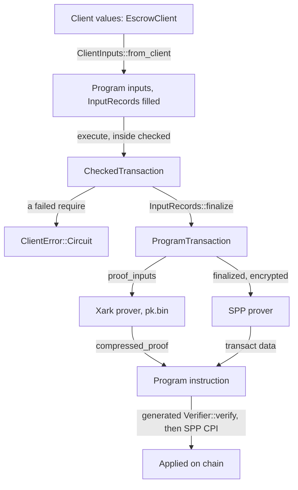

# spr-program

The SDK for Solana programs built on the shielded pool (SPP). It has three parts:

- **Instructions.** The crate re-exports [`spr-instruction`](../instruction): the SPP
  instruction builders, the `transact` CPI (feature `cpi`), and the SPP derivations a Solana
  program recomputes. Without features the crate is `no_std` and builds for SBF.
- **Compressed accounts.** `compression` keeps a pinocchio program's state as SPP UTXOs that
  one of its PDAs owns, and creates, updates and reads them through a `transact` CPI.
- **ZK programs.** A program with its own Groth16 circuit, whose proof shares `private_tx_hash`
  with the SPP transaction it CPIs. The circuit is ordinary Rust compiled by
  [Xark](https://github.com/ananas-block/xark/tree/ad7baad990cb949227ad7d6046e4cfbe3806d357)
  (the revision the root `Cargo.toml` pins). The same `execute` method runs twice:
  - natively on the client, where it builds the SPP transaction's inputs and outputs;
  - compiled by Xark to R1CS over BN254, where the proof checks it against the public hash.

[`docs.md`](docs.md) is the API reference. This file is the overview and the end-to-end guide.
The protocol rules live in [`spr-circuit`](../circuit), whose
[`tests/rules`](../circuit/tests/rules) run each rule natively and assert the requirement that
refuses a broken input. [`sdk-tests/timelock-escrow`](../../sdk-tests/timelock-escrow) is the
complete example every snippet below comes from.

## Crates

| Crate | Holds |
| --- | --- |
| `spr-program` (this crate) | The client (`InputRecords`, `ProgramTransaction`, `DataUtxo`, `ProgramOwner`), proof conversion, the on-chain verifier, the build metadata, the WASM bindings and compressed accounts. It re-exports the other crates at the paths below. |
| [`spr-circuit`](../circuit) | The protocol types and operations a program's `execute` uses: `Utxo`, `TokenUtxos`, `DataUtxo`, `UniqueDataUtxo`, `NewAddress`, `ConfidentialTransaction`, `require`, `ArrayVec`, `CircuitError`, Poseidon. Re-exported as `spr_program::circuit`. |
| [`spr-macros`](../macros) | The derives `ZkProgram`, `ClientInputs`, `PublicInputs` and `UtxoState`. |
| `xark` | The circuit language: `#[input]`, `Field`, the prover. Re-exported as `spr_program::xark`, with `spr_program::input` and `spr_program::Field`. |
| `spr-cli` (`zolana`) | `zolana build-zk-program` and `zolana zk compile \| setup \| export-verifier`. |

## Features

No feature is on by default.

| Feature | Contents |
| --- | --- |
| none | `no_std`: the `spr-instruction` re-export, `CompressedProof`, `hasher` and `MAX_POSEIDON_INPUTS`. |
| `cpi` | The SPP `transact` instruction as a signed CPI from a pinocchio program. |
| `compression` | Compressed accounts for pinocchio programs (implies `cpi`). |
| `shielded-pda` | Experimental: `ShieldedPda`, a shielded identity owned by a program-derived address. Needs `std`; `client` includes it. |
| `circuit` | `spr_program::circuit`, the root re-exports of `spr-circuit` and Xark, and the derives. Needs `std`. |
| `client` | `circuit` and `verifier`, plus `InputRecords`, `ProgramTransaction`, `DataUtxo`, `ProgramOwner` and `spr_program::proof`. |
| `build` | `spr_program::build`: the program metadata the derives export for the Zolana CLI. |
| `verifier` | `no_std`: `spr_program::verifier`, which the generated verifier modules call with a `CompressedProof`. |
| `serde`, `tsify` | Serde and TypeScript types for the client types. |
| `wasm` | `spr_program::wasm`: the JavaScript transaction, state-decoding and proof-conversion bindings. |
| `wasm-prover` | Links Xark's proving runtime into the application's WASM module. |
| `wasm-verify` | `proofToSnarkjs` and `verifyingKeyToSnarkjs`, for independent verification with snarkjs. |

A Solana program depends on the crate with `compression` or `cpi`, and with `verifier` when it
verifies ZK program proofs. Its circuits and its client enable `client`.

The ZK program code is compiled three ways, told apart by `cfg`:

- the native host build (no extra cfg), which has the client;
- the Xark circuit build, with `--cfg xark` for `wasm32-unknown-unknown`;
- Xark's client module build, with `--cfg xark_client`.

`spr-program`'s client, WASM and build modules exist only in the native build. Code in a
program crate that uses them is gated with `#[cfg(all(not(xark), not(xark_client)))]`, as the
escrow's `circuits/mod.rs` does for `escrow_authority`.

## Writing a ZK program

### 1. Crate setup

The circuits sit in the Solana program's crate. The escrow's `Cargo.toml`, shortened:

```toml
[lib]
crate-type = ["cdylib", "lib"]

[features]
default = ["insecure-test-setup"]
insecure-test-setup = []
circuits = ["dep:borsh", "dep:xark", "spr-program/client"]
wasm = ["dep:borsh", "dep:xark", "spr-program/wasm"]
build-circuits = ["spr-program/build"]

[dependencies]
xark = { workspace = true, optional = true }
spr-program = { workspace = true, features = ["cpi", "compression", "verifier"] }
```

- `circuits` is the feature the CLI builds the circuits with (`--r1cs-features`, default
  `circuits`), and `wasm` the one it builds the WASM module with (`--wasm-features`, default
  `wasm`). The generated client and WASM code takes serde, tsify and wasm-bindgen from
  `spr-program`, so the crate does not depend on them.
- `build-circuits` is enabled only while the CLI discovers the programs. The crate gates
  `pub mod verifier;` and the code that uses it with `#[cfg(not(feature = "build-circuits"))]`,
  so discovery compiles before the generated verifier files exist.
- `insecure-test-setup` lets the crate compile verifying keys that did not come from a
  production ceremony (see [Keys for a deployment](#keys-for-a-deployment)).

The escrow's `lib.rs`:

```rust
#[cfg(any(feature = "circuits", feature = "wasm"))]
pub mod circuits;
#[cfg(not(feature = "build-circuits"))]
pub mod instructions;
#[cfg(not(feature = "build-circuits"))]
pub mod verifier;
```

By default the CLI looks for each program at `crate::circuits::<Name>`.
`#[zk_program(path = "...")]` names another path from the crate root.

### 2. State

A state is a struct a data UTXO commits to. `UtxoState` derives its hash (Poseidon over an
8-byte type tag and each field's hash), a Borsh-backed `EncryptionCodec`, and with `wasm` a
`<state>DataUtxo` decoding binding. `#[input]` makes it a Xark input.

```rust
#[input]
#[derive(Default, PartialEq, Eq, BorshSerialize, BorshDeserialize, UtxoState, spr_program::ClientInputs)]
pub struct EscrowTerms {
    pub creator: UtxoOwner,
    pub unlock: u64,
}
```

A state has at most 11 fields. A field is `u8` to `u128`, `bool`, `Field`, `UtxoOwner`,
`ShieldedAddress`, `[u8; N]` or another `UtxoState` type. `ClientInputs` is needed when the
state is also a private input, as `EscrowTerms` is for the withdrawal.

### 3. Inputs

Each instruction is a struct with exactly the fields `private` and `public`, derived with
`ZkProgram`:

```rust
#[input]
#[derive(ZkProgram)]
pub struct Escrow {
    pub private: EscrowPrivateInputs,
    pub public: EscrowPublicInputs,
}

#[input]
#[derive(spr_program::ClientInputs)]
pub struct EscrowPrivateInputs {
    pub tx_context: TxContext,
    pub token_utxos_asset_a: ArrayVec<Utxo, ESCROW_TOKEN_INPUTS>,
    pub unlock: u64,
    pub amount: u64,
}

#[input]
#[derive(PublicInputs)]
pub struct EscrowPublicInputs {
    pub escrow_owner: ShieldedAddress,
    pub creator_identity: Field,
}
```

- The private inputs derive `ClientInputs`, the public inputs `PublicInputs`, which includes
  `ClientInputs`. Each generates a `<Name>Client` type the client fills with wallet values: a
  `WalletUtxo` for a `Utxo`, a `Vec<WalletUtxo>` for an `ArrayVec<Utxo, N>`,
  `TransactionOptions` for `TxContext`, a native shielded address for `ShieldedAddress` and a
  `Mint` for an `Asset`, which records the mint (see [docs.md](docs.md#client-inputs)). Other
  fields, `Field` included, take their own type; in JavaScript a `Field` is a decimal string.
- `ArrayVec<T, N>` always holds `N` slots: the given items, then `PaddedInput::padding()`
  (`Utxo::dummy()` for a UTXO). A circuit has a fixed shape, so this is how a client spends
  fewer UTXOs than the circuit allows.
- The public inputs fold into one public input, the public hash:
  `Poseidon(field hashes..., transaction_hash)`. A program has at most 11 public fields, each
  `u8` to `u128`, `bool`, `Field`, `UtxoOwner` or `ShieldedAddress`. A `UtxoOwner` enters as
  its owner hash and a `ShieldedAddress` as its address hash, which the on-chain verifier
  takes as `[u8; 32]`.

### 4. The circuit logic

The program implements an inherent `execute` method:

```rust
impl Escrow {
    pub fn execute(&self) -> Result<CheckedTransaction, CircuitError> {
        let private = &self.private;
        require(private.amount != 0);
        let mut tokens = TokenUtxos::new_mut(&private.token_utxos_asset_a)?;
        require_eq(
            tokens.owner().key().identity()?,
            self.public.creator_identity,
        );
        let mut escrow = DataUtxo::<EscrowTerms>::new_init(&self.public.escrow_owner)
            .with_asset(&tokens.asset())?;
        tokens.transfer(&mut escrow, &private.amount)?;
        escrow.creator = tokens.owner();
        escrow.unlock = private.unlock;

        ConfidentialTransaction::new(&private.tx_context, &self.public)
            .with(tokens)
            .with(escrow)
            .check()
    }
}
```

- `TokenUtxos`, `DataUtxo` and `UniqueDataUtxo` move value between UTXOs. A
  `ConfidentialTransaction` registers them, and `check` derives the output blindings, hashes the
  outputs and computes `private_tx_hash`, the transaction hash and the public hash.
- `require(cond)` and `require_eq(a, b)` are the program's own rules. In the circuit build
  they are constraints. Natively, a failed requirement is recorded and returned as
  `CircuitErrorKind::RequirementFailed { file, line, column }` by `spr_program::checked`, which
  the client wraps around `execute`; outside it the requirement panics (see [Native and circuit execution](#native-and-circuit-execution)).
- The CLI generates one Xark circuit per program:

  ```rust
  #[circuit]
  pub fn escrow(program: Private<program::circuits::Escrow>, public_hash: Public<Field>) {
      let checked = program.execute().expect("valid program transaction");
      require_eq(*checked.public_hash(), public_hash);
  }
  ```

  The whole program is a private input. The public hash is the only public input.

`execute` is restricted to the Rust subset Xark compiles: loop bounds and array sizes known
when the circuit is built, branches on private values evaluated on both arms. Xark's
[`docs/subset.md`](https://github.com/ananas-block/xark/blob/ad7baad990cb949227ad7d6046e4cfbe3806d357/docs/subset.md)
is the reference.

### 5. Build

```bash
zolana build-zk-program -p <crate> [--test]
```

1. Discovers the programs: runs the crate's generated `__zk_export` tests with
   `<r1cs-features>,build-circuits`, validates each program's metadata and writes
   `<target>/zk/<crate>/programs.json`.
2. Writes a Xark entry crate per program to `<target>/zk/<crate>/.entries/<program>` and
   compiles it into `<target>/zk/<crate>/<program>/` (`circuit.xbc`, `schema.json`,
   `sources.json`, `digest`).
3. Generates `pk.bin`, `vk.bin` and `metadata.json` in the same directory, or reuses them while
   the circuit digest and setup kind are unchanged. `--test` uses a fixed public seed.
4. When the crate has a `src/verifier` directory, writes `<program>.rs` and `<program>.vk.rs`
   there. `src/verifier/mod.rs` is the crate's own and declares `pub mod <program>;`.
5. Builds the WASM package into `<target>/zk/<crate>/wasm` (or `--wasm-out`).
6. Runs `cargo build-sbf` (`--sbf-features`, `--sbf-out-dir`, `--skip-sbf`).

`zolana zk compile` runs steps 1 to 5, `zolana zk setup` step 3 on compiled circuits, and
`zolana zk export-verifier` step 4 from keys a trusted manifest pins. `--check` compiles the
circuits, requires matching cached keys and fails when a committed verifier module is stale,
missing or orphaned, without writing files or building WASM or SBF. [docs.md](docs.md#cli)
lists every flag.

A crate without a `ZkProgram` is compiled as one plain Xark `#[circuit]`: its artifacts go
directly into `<target>/zk/<crate>`, only `<circuit>.vk.rs` is generated, and its verifier is
hand-written. [`sdk-tests/zk-standalone`](../../sdk-tests/zk-standalone) is that case.

### 6. On-chain verifier

The generated `src/verifier/escrow.rs` holds the public inputs in their on-chain form and a
`Verifier`:

```rust
pub struct PublicInputs {
    pub escrow_owner: [u8; 32],
    pub creator_identity: [u8; 32],
}

pub struct Verifier<'a> {
    pub proof: &'a CompressedProof,
    pub public_inputs: PublicInputs,
    pub private_tx_hash: &'a [u8; 32],
    pub transfers: &'a [PublicTransfer],
}
```

`verify` computes the transaction hash from `private_tx_hash` and the public transfers,
hashes the public inputs into the public hash and verifies the Groth16 proof under the
committed key. The escrow instruction recomputes every public input from its accounts and
instruction data, so the client cannot choose them:

```rust
escrow::Verifier {
    proof: &proof,
    public_inputs: escrow::PublicInputs {
        escrow_owner: spr_program::verifier::address_hash(
            &escrow_authority.owner_hash()?,
            &viewing_pubkey,
        )
        .map_err(TimelockEscrowError::from)?,
        creator_identity,
    },
    private_tx_hash,
    transfers: &[],
}
.verify()
.map_err(TimelockEscrowError::from)?;
```

`private_tx_hash` comes from the SPP instruction data the program forwards
(`TransactIxDataRef::from_bytes(transact)?.private_tx_hash`), and `transfers` must be the
public deposits and withdrawals that SPP transaction settles, in order. The program then
invokes SPP, signed by the PDA that owns the program's UTXOs.

### 7. Client in Rust

`ZkProgram` generates `<Name>Client` with
`prepare(self, sender: &ShieldedAddress, payer: Address) -> Result<ProgramTransaction, ClientError>`.
It converts the client values, runs `execute` natively, finalizes the SPP transaction and
returns it with the program's proof inputs and public hash. From the escrow's localnet test:

```rust
let transaction = EscrowClient {
    private: EscrowPrivateInputsClient {
        tx_context: TransactionOptions {
            blinding_seed: Some(random_blinding()),
            output_tree_id: Some(localnet.tree_id),
        },
        token_utxos_asset_a: balance.utxos.clone(),
        unlock: UNLOCK_TIMESTAMP,
        amount: LOCK_AMOUNT,
    },
    public: EscrowPublicInputsClient {
        escrow_owner: authority.address(address.viewing_pubkey)?,
        creator_identity: creator_owner.key().identity()?,
    },
}
.prepare(&address, payer)?;

let result = xark::prover::circuit_at(workspace_path("target/zk/timelock-escrow-program/escrow"))
    .prove(transaction.proof_inputs)?;
let proof = spr_program::proof::compressed_proof(&result.proof).map_err(anyhow::Error::msg)?;
let spp_proof_inputs = transaction.finalized.encrypt_with_keys(&creator)?;
let transact = localnet.client.prove_transact(spp_proof_inputs, None, &creator)?;
```

The program's proof and the SPP proof come from the same `ProgramTransaction`: the Xark
prover takes `proof_inputs`, and the SPP prover takes the encrypted `finalized` transaction.
`ProgramOwner::decrypt_data_utxos::<EscrowTerms>` later finds the escrow UTXO the program's
PDA owns, and `DataUtxo<T>` holds it with its decoded state.

### 8. Client in TypeScript

The WASM package exports `escrowTransaction(inputs, sender, payer)`. The TypeScript SDK's
`bindProgramTransaction` binds it to an asset registry and checks every result: the output
commitments, the mints, the sender, the payer and that `proofInputs.public_hash` equals
`publicHash`. From `sdk-tests/timelock-escrow/typescript`:

```ts
const buildEscrow = bindProgramTransaction(wasm.escrowTransaction, { assets });
const escrowTransaction = await buildEscrow(
  {
    private: {
      txContext: { blindingSeed: randomBlinding(), outputTreeId: client.treeId },
      tokenUtxosAssetA: [...deposited],
      unlock: UNLOCK_TIMESTAMP,
      amount: LOCK_AMOUNT,
    },
    public: {
      escrowOwner: authority.address(address.viewingPublicKey).toBytes(),
      creatorIdentity,
    },
  },
  address.toBytes(),
  signer.address,
);
```

Proving goes through Xark's runtime in the same module. The escrow's `ProgramProver` keeps a
`ProvingSession` and checks each proof against the verifying key before converting it:

```ts
const session = new wasm.ProvingSession(circuitXbc, provingKey, sourcesJson);
const verifier = new wasm.VerifyingKey(verifyingKey);
const bundle = session.prove(escrowTransaction.proofInputs);
if (!verifier.verify(bundle.proof, bundle.publicInputs)) throw new Error("invalid proof");
const proof = wasm.programProof(bundle.proof, bundle.publicInputs, escrowTransaction.publicHash);
bundle.free();

const transact = await client.proveTransact(
  escrowTransaction.transaction.encryptWithKeys(creator),
  [creator],
);
```

`proof.compressedProof` goes into the instruction. A failed `require` arrives as an error named
`CircuitError.RequirementFailed` with code `PROGRAM_REQUIREMENT_FAILED`, wrapped by
`bindProgramTransaction` in a `TRANSACTION_PROGRAM_BUILD` error.

## Flow



*Figure 1: One set of inputs feeds both proofs.*

`InputRecords::finalize` refuses a transaction whose SPP form differs from what the circuit
committed: its `padding_independent_private_tx_hash`, its transaction hash with the public
transfers, and each committed output hash must match the `CheckedTransaction`.

## Native and circuit execution

Xark's own `require` panics natively, which traps a browser WASM module.
`spr_program::require` and `require_eq` are constraints in the circuit build, and natively
they record the first failure instead:

- The generated `prepare` and the WASM bindings run `execute` inside
  `spr_program::checked`, which returns that failure as
  `CircuitErrorKind::RequirementFailed { file, line, column }` ahead of whatever `execute`
  returned. Execution continues after the failure only to reach `checked`, which discards the
  result.
- Outside `checked`, a failed requirement panics, naming its source location but not the
  compared values, which can be private inputs. A test that calls `execute()` directly with
  failing inputs, then passes the result to `InputRecords::create_program_transaction`,
  panics.

A `CircuitError` that `execute` returns with `?` reaches the client as `ClientError::Circuit`.
In the circuit build the generated entry calls `execute().expect(..)`, so such an error is a
panic, and Xark treats a branch that can only panic as one the inputs must not take. Write
conditions on input values with `require` and `require_eq`; [Xark's
`LIMITATIONS.md`](https://github.com/ananas-block/xark/blob/ad7baad990cb949227ad7d6046e4cfbe3806d357/LIMITATIONS.md)
explains why its own requirements are not recoverable.

## Client and WASM integration

### Records and finalization

`InputRecords` keeps the native values the circuit values were converted from: the wallet
UTXOs, the shielded addresses and the mints. `finalize` resolves the `CheckedTransaction`
against them:

- Every spent UTXO must have been converted through the records, which checks that its
  commitment matches its preimage.
- Every output owner must be a `ShieldedAddress` the inputs contain, or the sender. An owner
  that is neither has no viewing key to encrypt to, and `finalize` refuses it.
- Every non-SOL output asset must be the asset of a converted input UTXO.
- A transaction that starts with an address reservation has no spent UTXO to take its output
  tree from, so its `TxContext` needs an explicit output tree.

### WASM package

`zolana zk compile` builds the program crate with wasm-pack. The package directory
(`<target>/zk/<crate>/wasm/` by default) holds:

| Path | Contents |
| --- | --- |
| `<lib name>.js`, `.wasm`, `.d.ts` | The application module: the generated `<program>Transaction` and `<state>DataUtxo` functions, the `spr_program::wasm` exports and, with the prover, Xark's runtime (`ProvingSession`, `VerifyingKey`, `preloadStreaming`, `proveStreamingPreloaded`, `verify`). |
| `<program>/` | Xark's typed TypeScript client per program. |
| `proving-keys.json` | Per program, the proving key's SHA-256 and whether it is an insecure test setup. Absent with `--no-prover`. |
| `xark/` | Xark's pool scripts (`pool.mjs`, `pool-worker.mjs`, `client.mjs` and their declarations). Absent with `--no-prover`. |
| `runtime-options.json` | `{ "threads": bool }`: false with `--single-threaded` or `--no-prover`. |
| `.zolana-zk-package` | Marks a directory the CLI may replace. |

The package is built in a staging directory and replaces the previous one only once it is
complete. `--wasm-out` refuses a non-empty directory without the marker and a directory that
contains the crate or the circuit artifacts. `--wasm-target nodejs` builds for Node.js and adds a
CommonJS `package.json`.

Before loading a proving key, check its exact bytes with
`checkProvingKey(provingKey, expectedSha256)` against the digest in `proving-keys.json` shipped
with the application module, not a digest served next to the key. Proving with a pool runs in a
Web Worker and needs cross-origin isolation: pass the application module's glue URL to
`createPool({ threads, wasm })` from `xark/pool.mjs`, so each pool worker loads its own
instance of the application module instead of Xark's stock one.

`#[zk_program(raw_client)]` replaces the generated client with
`<program>Transaction(inputs, records, sender, payer)`, which takes the program in Xark's input
JSON form and the wallet records separately. `proofInputUtxo`, `proofInputAddress` and
`proofInputContext` convert wallet values into that form. The SDK's
[browser test program](tests/wasm/program) uses it.

[docs.md](docs.md#wasm-exports) lists every export and error name.

## Compressed accounts (`spr_program::program`, feature `compression`)

A compressed account is a UTXO a program PDA owns whose data hash commits to the program's
plaintext state. The PDA's nullifier key is zero, so the program recomputes the UTXO hash
and the nullifier from the state instead of trusting instruction data.

| Name | What it is for |
| --- | --- |
| `PdaOwner` | A program PDA as the owner of its accounts: its identity and owner hash under the zero nullifier key. |
| `AddressSeed`, `NewAddress` | The address an account is created at, derived from the owner and a seed in the address tree. Only create derives it; update and read use its metadata. |
| `hasher::DataHasher` | The native state hash, including a type tag. State also implements Borsh serialization; address and blinding stay outside application state. |
| `UtxoMeta` | What a client sends about an account's current UTXO besides its state: the address, the blinding and the root indexes it is proven against. Wrong values give a UTXO hash or nullifier no proof matches. |
| `UniqueDataUtxo<S>` | A PDA-owned state UTXO with an immutable address and mutable application state. `new_init(owner, seed, tree_context)` derives and reserves the address; `new_mut(owner, meta, state, tree_id)` spends the current UTXO and keeps its address. `data_hash()` is `Poseidon(UNIQ, address, state.hash())`, matching the circuit type. |
| `SppTransactCpi` | Puts the accounts an instruction writes into one SPP transaction and invokes it, signed by the owning PDAs. It derives everything but the proof in the Solana program: the blindings, the output UTXO hashes, the external data hash and the private transaction hash. |
| `ReadRoots`, `load_tree_id` | Read an account without spending it: the program verifies its own proof of state-tree inclusion and nullifier-tree non-inclusion under the roots `ReadRoots::load` reads from the tree account, and `assert_unspent` checks that the nullifier PDA does not exist. |
| `UtxoKey` | A state UTXO's hash and nullifier, from `ReadRoots::key(owner, meta, state)`. |
| `CompressedAccountError` | The errors, with their program error codes. |

`SppTransactCpi::with_unique_data_utxo` publishes `address || Borsh(state)` inside the
plaintext output envelope. Readers derive the UTXO blinding from the creating
transaction's first nullifier, `ACCOUNT_BLINDING_SEED`, and output position.

The state's `DataHasher::hash` selects Poseidon or SHA-256; both are available without extra
features. For SHA-256, `hasher::Sha256BE` clears the digest's first byte so it fits the BN254
field. Include a type tag and all state fields in either hash. States using different
algorithms can share one transaction. `UtxoState` generates Poseidon hashes, and a state a
circuit also reads must use them.

Rules a program keeps:

- Only a UTXO with a non-zero data hash is program state. Anyone can send a PDA a UTXO with
  a zero data hash; a non-zero one needs the owner's signature in the transact circuit, and
  only the program signs for its PDA.
- A program that signs with a state-owning PDA builds every output that PDA owns itself. It
  never signs transact data a client built.
- The state hash commits to its type tag; the SDK wraps it with `UNIQ` and the address.

## Keys for a deployment

The CLI's own setup is a single-party setup. With `--test` it uses the fixed public seed 0,
without it fresh randomness; in both cases the setup metadata says `insecure-dev-mode`, and the
generated `<program>.vk.rs` is an insecure test setup that contains a `compile_error!` unless
the crate enables its `insecure-test-setup` feature. A deployment needs keys from Xark's phase-2
setup or multi-party ceremony
([`docs/trusted-setup.md`](https://github.com/ananas-block/xark/blob/ad7baad990cb949227ad7d6046e4cfbe3806d357/docs/trusted-setup.md)),
whose metadata the CLI accepts as production.

- The CLI never replaces production keys. `--test` against production keys fails, and an
  incomplete production directory or one for another circuit digest fails without changing its
  files. Use a separate `--r1cs-out` directory for a new setup.
- Keep the whole artifact directory per program: `circuit.xbc`, `schema.json`, `sources.json`,
  `digest`, `pk.bin`, `vk.bin` and `metadata.json`.
- Export the verifiers from a trusted sha256sum manifest that pins each program's `vk.bin`,
  `pk.bin` and `metadata.json`, with paths relative to the manifest:

  ```bash
  zolana zk export-verifier -p <crate> --checksums trusted-keys.sha256
  ```

  Every program is checked before any file is written, and each proving key must belong to its
  verifying key. The setup kind comes from the pinned metadata.
- Each generated `.vk.rs` embeds a setup marker with the proving key's SHA-256, plus
  `ZOLANA_VK_SHA256` and `ZOLANA_CIRCUIT_DIGEST`. `zolana vks check --so <program.so>` or
  `--program-id <id>` reads the markers from a build or a deployment, fails on an insecure test
  setup, and with `--expect trusted-keys.sha256` also fails when a pinned `pk.bin` is not
  embedded.
- A checksum pins bytes. It does not attest to the ceremony that produced them.

## Tests

```bash
just test-spr-circuit            # the protocol rules and the Xark fixture circuit
just test-spr-program-unit       # the client tests
just test-spr-program-release    # the macro tests and the escrow circuits, in release
just test-zk-standalone          # the plain-circuit fixture and `zk compile --check`
just check-wasm                  # the wasm32 builds
just test-zk-program-wasm        # the WASM module in Chromium
just test-escrow-validator       # the escrow lifecycle on a local validator
```

- `spr-circuit`'s `tests/rules` runs every protocol rule natively and asserts the
  requirement that refuses each broken input; its other tests pin Poseidon, the byte and chain
  hashes and the transaction hashes. `tests/xark-fixture` compiles and proves a circuit over
  `spr-circuit` with the pinned Xark CLI.
- `tests/finalize` builds SPP transactions from checked program transactions: address
  reservations, dummy padding trees and output owner resolution.
- `tests/client_inputs` covers the generated client conversions, `tests/client_data_decode`
  data UTXOs and their custom codecs, `tests/proving_key_checksum` `check_proving_key`.
- `tests/verifier_public_hash` holds the on-chain public hash to the circuit's.
- `tests/compression*` and `tests/program_hashers` cover the compressed account CPI and the read.
- `tests/wasm` holds a test program and its Playwright suite, which prove in the browser and
  compare against the native fixtures and snarkjs (`just bench-zk-program-wasm` measures it).
- The escrow's `tests/zk_functional.rs` proves both programs with the compiled circuits and
  checks that the compiled escrow refuses a wrong signer, an excess amount and a changed public
  hash.
